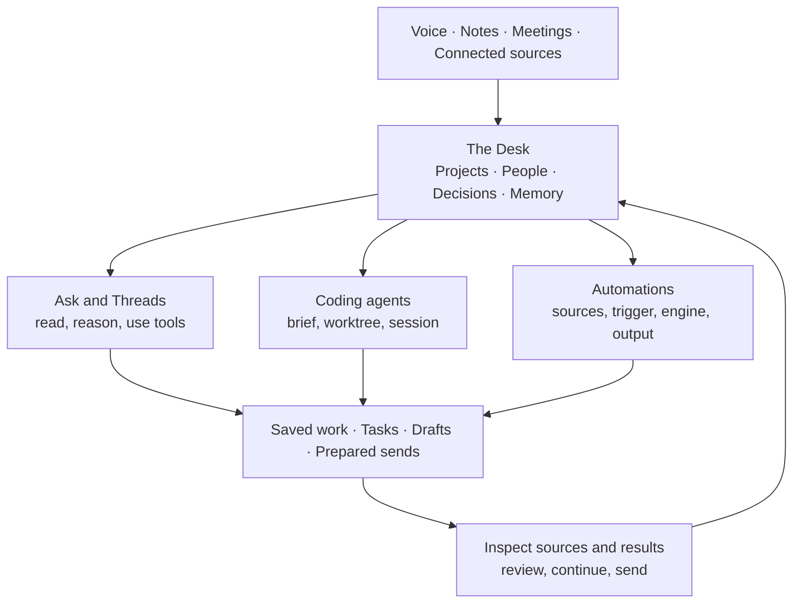

# HoldSpeak

**An agentic-first, web-based AI operating system for your work.**

Bring your notes, meetings, projects, people, and coding agents onto one Desk.
Ask it to find context, prepare work, and take action through tools.
Hand a task to a coding agent, run a multi-step Program, or set up an Automation to do it again.
Keep the sources, results, and execution records together.
Use Calls to work with the Desk by phone when its line and access are configured.

HoldSpeak runs on your machine. You use it in a browser.
Its Desk takes its cues from Amiga Workbench.
It has objects, drawers, movable windows, menus, and a dock.
A local hub stores your work and runs the services behind that surface.
You choose the engines: local models, endpoints on your network, cloud APIs, or supported agent CLIs.

Built first for a software architect who leads people and projects.
Open source under [Apache 2.0](LICENSE). Version 0.4, pre-alpha.

[Start here](#quick-start) · [Work flows](#what-you-can-do) · [Agents](#hand-work-to-a-coding-agent) · [Automations](#make-useful-work-repeat) · [Documentation](docs/README.md)

## One Desk, shared context, tools that act

The Desk gives you a place to keep work and a place to run it.
Open tools beside each other, arrange their windows, and file records in drawers.
On a phone, work moves through full-width windows with a Back control.
Open a Note, Meeting, Project, or person, then ask about that object.
The same records can supply context for a conversation, a project update, an automation, or an agent brief.

**Agentic-first** means the AI can use tools to work with those records.
With a suitable engine, a request can search memory, read sources, create a Note, find tasks, or prepare a send.
The result shows source references, writes, and prepared actions, so you can inspect what happened.
A prepared send waits for your **Send** press.

The browser and MCP clients reach the same product services.
A coding agent can use HoldSpeak as its working context through MCP.
HoldSpeak can also launch that agent on a task, keep track of its work, and bring its questions back to you.



## What you can do

| Start with | Work through it | Get |
| --- | --- | --- |
| A rough idea | Write or speak a Note, ask questions, refine the text | A useful Note, tasks, or a brief |
| A meeting | Record or import, run intelligence, review outcomes | A transcript, summary, decisions, and actions |
| A project question | Ask about its meetings, decisions, issues, and pull requests | An answer or update grounded in project records |
| A task to build | Hand a Desk item to Claude Code, Codex, or pi | An agent working in its own Git worktree |
| A goal with several implementation steps | Plan a Program, choose agents and checks, review what needs you | Step results, reviews, pull requests, and a handover Note |
| A phone conversation | Call the configured line and authenticate | Desk work and a retained call Note |
| A recurring job | Choose sources, a trigger, an engine or agent, and an output | Retained results and a run history |
| A person you lead | Review shared work and prepare for a 1:1 | A brief with open commitments on both sides |
| Words for another app | Hold the hotkey, speak, release | Text in your editor, terminal, or message field |

### Turn a thought into work

Keep an idea as a Note. Edit it as Markdown, or select **Develop this thought** to work through it with AI.
Attach other Notes as context and ask one question at a time.
HoldSpeak preserves the original text and keeps the working Note editable.

Use **Ask about this** to reason over the Note.
Use **Find the tasks** to extract work, associate it with a Project, or prepare it for an agent.
Keep a useful answer as a Note or Artifact so you can return to it.

For example: start with “We need to move this service off the shared database.”
Develop the constraints, compare options, record a decision, and prepare the implementation task from the same material.

[Notes and thought development](docs/USER_GUIDE.md#develop-a-thought) · [Architecture work recipes](docs/ARCHITECTURE_WORK.md)

### Take a meeting through to follow-up

Record microphone and system audio, or import an existing recording or transcript.
Read the saved transcript, then run meeting intelligence on an assigned engine.

HoldSpeak includes **14 built-in plugins** for decisions, requirements, action owners, risks, dependencies, milestones, architecture drafts, and other meeting outputs.
Review proposed decisions and commitments before you confirm them.
Meeting aftercare brings open work and changes back into view.

Link the meeting to its Project.
Ask about the outcome, prepare an update, or hand an action to a coding agent.
The transcript and saved outputs remain available as context for later work.
Calendar integration and scheduled recording are available when configured.

[Meeting mode](docs/MEETING_MODE_GUIDE.md) · [Meeting intelligence](docs/MEETING_INTELLIGENCE.md) · [Aftercare](docs/MEETING_AFTERCARE.md)

### Ask your work, then do something with the answer

Open **Ask**, or select **Ask about this** on a record.
Choose starting context through its scope control: a Note, Meeting, drawer, Project, or person.
Ask a question such as “What is blocking this project?” or “Draft an update from this week's meetings.”

An engine with tool support can retrieve more evidence and perform permitted Desk work during the turn.
Open the sources and inspect the writes or prepared actions shown with the result.
Ask saves the exchange as a Thread from the first answer.
Ask a follow-up in the same window, or reopen the conversation from **Recent**.
Use **Save as note** for a separate editable result, or **Add to note** when Ask came from a Note.

The answer offers **Make it a task**, **Save as note**, **Copy**, and **Send…** where applicable.
Start another conversation from the first row of **Recent**, or press `⌘N` while Ask has focus.
Stored Threads retain their turns, references, and tool results.
The separate Thread service also supports modes and branching through its APIs.

[Ask on the Desk](docs/WEB_DESK.md#ask-about-your-work) · [Threads](docs/AGENTS_AND_THREADS.md) · [Interview](docs/INTERVIEW.md)

### Hand work to a coding agent

Choose a task, Note, decision, Meeting, Artifact, or Project item and select **Hand to agent**.
GitHub and Jira issues read by a Project Watch can also become handoffs.
Choose an installed Claude Code, Codex, or pi profile.

HoldSpeak prepares a brief from the item and relevant project context.
You can inspect the brief, repository, branch, and worktree before launch.
It then starts the agent in a separate Git worktree, with the brief as its starting instruction.
This path needs a configured project repository, the selected agent CLI, and tmux.

Use the agent surfaces to see progress and find sessions that need you.
Read the terminal output, answer a question by text or voice, and inspect the session's delivery work.
Existing Claude Code and Codex sessions can also report to the Desk through hooks.
An installed reviewer can provide a separate review where the launch controls offer it.
Set how many agents can work at once.
At the limit, **Start when one is free** queues a handoff.

The handoff starts the work. Read the result and review the changes before you treat the task as finished.

[Coder integration](docs/CODER_INTEGRATION.md) · [Agent hook setup](docs/AGENT_HOOK_INSTALL.md)

### Run a goal as a Program

Use a Program when a goal needs several bounded implementation steps.
Choose the repository, describe the steps and their dependencies, and select the agents and review choices.
Each step runs in its own worktree and moves through work, check, review, pull request, and merge.

Programs use check results and repository evidence to advance a step.
The selected Control level determines routine decisions and merge behavior.
Core questions, security findings, and other owner decisions return through **Your turn** and **Needs you**.
The Program keeps a handover Note with its state and decisions.

You can configure an ordered list of agents for usage-limit handoffs.
A continuation receives a redacted brief and stays on the step's branch and worktree.
An overnight template can use an idle engine when the required agents and repository checks are available.

[Programs](docs/programs.md) · [Coding-agent integration](docs/CODER_INTEGRATION.md)

### Make useful work repeat

An Automation describes a job in a sentence:

| Part | You choose |
| --- | --- |
| **When** | A schedule, supported event, or manual start |
| **Do** | An instruction, or a handoff to an agent |
| **About** | The Notes, Meetings, Projects, drawers, or other supported sources to use |
| **With** | The engine or installed agent that does the work |
| **Review by** | An installed reviewer for an agent handoff, when needed |
| **Put it in** | Where the result belongs |

For example, configure a Friday draft from the week's meetings and put it in your Inbox.
Or configure an agent handoff for eligible source items, with a reviewer.
Run the job once, inspect the output, then enable its supported trigger.

Results retain what the run looked at, wrote, and prepared.
With memory enabled, Automations can retain their own working memory between runs.
A configured schedule needs the hub running when it is due.
A destination output prepares the send for your review.

Project Watches observe connected sources.
The Project Steward can prepare updates and supported follow-up work under the policy you set.
Heartbeat and Cadence provide other recurring checks for work that needs attention.

[Automation paths and limits](docs/AUTOMATION.md) · [Project Watches and Steward](docs/PROJECT_ROOMS.md#use-the-steward) · [Cadence](docs/CADENCE.md)

### Lead projects and people from the same place

Open **Today** for current work and **Needs you** for items that require your action.
Enter a Project Room to inspect its open work, decisions, commitments, and recent changes.
Connect GitHub, Jira, or Confluence sources when the Project needs them.

Ask about the Project or use **Write update** to prepare a status report from its records.
Review the draft and its sources, then send it to a saved destination.

People holds the context for your reports and peers.
Use preparation briefs to collect open commitments before a 1:1.
Confidential People material has a separate encrypted store and specific access rules.

[Project Rooms](docs/PROJECT_ROOMS.md) · [People](docs/USER_GUIDE.md#people) · [People security](docs/PEOPLE_SECURITY.md)

### Speak into the tools you already use

Hold Right Option on macOS or Right Alt on Linux, speak, and release.
Voice typing puts the text into the focused app.
The dictation pipeline can add project context and rewrite the text through your selected engine.

Correct a result and teach the correction.
The dictation journal keeps what you said, what was typed, and the route used.
Replay lets you try an earlier utterance against the updated pipeline.
Voice commands and a local wake word are available when configured.

[Voice typing](docs/USER_GUIDE.md#voice-typing) · [Dictation pipeline](docs/DICTATION_PIPELINE_GUIDE.md) · [Voice commands](docs/VOICE_COMMANDS.md)

### Work with your Desk by phone

Calls lets you speak to HoldSpeak through a configured phone line.
Authenticate with the call passphrase, then ask about work, add a task, write a Note, or prepare an update.
A proposed send asks for your spoken confirmation.
The completed conversation becomes a Note.

The Line is HoldSpeak's SIP adapter and can run on the Mac or a configured node.
The optional ai-phone adapter has its own installation and platform requirements.
Both need the applicable speech, model, and line setup.
Carrier calls can incur charges.

Phone adds rules for contacting you about work that needs attention.
Configured number calls are available. The iPhone-app transport remains incomplete, as described in the Phone guide.
Messages can wait on the Desk until a supported phone transport is available.

[Calls and The Line](docs/calls.md) · [Phone and reach-you rules](docs/phone.md)

## Memory that stays connected to its sources

Normal work supplies memory: saved Notes, Meetings, decisions, Artifacts, Threads, and other retained records become searchable.
Search by keyword, time, name, and saved relationships.
Enable meaning search to add local embeddings.

Recall separates current, superseded, and disputed decisions.
With the required model assignments, background jobs can extract facts, consolidate beliefs, and write standing project pages.
Those pages cover decisions, open commitments, risks, and recent changes, with citations for each sentence.
Source edits or removals invalidate the affected page text.

Use `⌘K` to find work and Desk commands.
Attach specific records when you want to control the context for a model request.

[Memory and grounding](docs/RELATIONSHIP_AWARE_MEMORY.md)

## Your machine, your choice of engines

HoldSpeak stores its work on your machine and transcribes speech locally with Whisper.
There is no HoldSpeak account or required HoldSpeak cloud service, and the product has no telemetry.

Choose engines in **Settings > Engines**.
Different jobs can use different engines: speech recognition, writing, meeting intelligence, tool use, and background work.

| Engine path | Where the work runs |
| --- | --- |
| Local GGUF or MLX model | On your machine, with the appropriate runtime |
| OpenAI-compatible endpoint | On the host you configure, including your LAN or a cloud provider |
| Supported agent CLI | Through its installed CLI and sign-in, using its configured provider |

Supported CLI presets include Claude Code, Codex, pi, and Gemini CLI.
A CLI engine answers Desk requests through the installed CLI.
Tool-capable presets receive scoped access to HoldSpeak tools for the run.
Coding handoffs start separate repository sessions with a task and worktree.

A CLI process on your machine can send its prompt to a cloud provider.
Models, connectors, agent runtimes, and outbound actions each have their own data boundary.
Check the assigned engine and destination before a run.
Run records identify the route used.
External providers can require accounts and charge for use.

**Secure**, **Normal**, and **YOLO** set how eligible operations obtain authority.
YOLO is the default and permits eligible work within configured scope without another confirmation.
Tool permissions, source scope, and service checks still apply.
Inspect Receipts for execution outcomes.

[Models and assignments](docs/MODELS.md) · [Control modes](docs/AUTHORITY.md) · [Security and privacy](docs/SECURITY.md)

## Connect it and extend it

Send saved work to a folder, GitHub, Jira, Confluence, email, or Slack through configured destinations.
The send controls show the content and target and retain an outcome record.

Use MCP to let an external agent read context and perform permitted Desk operations.
The local sidecar serves clients such as Claude Code, Codex, and Cursor.
Reach exposes Streamable HTTP access with a scoped credential and expiry when enabled.
The full catalogue has **306 tools across 52 families**.
Each caller receives only its allowed tools.
The [MCP reference](docs/MCP_SIDECAR.md) lists the tools and transport limits.

| Add or configure | Purpose | Reference |
| --- | --- | --- |
| Meeting plugin | Produce a typed output from a transcript | [Plugin authoring](docs/PLUGIN_AUTHORING.md) |
| Connector | Read activity from another tool | [Connector development](docs/CONNECTOR_DEVELOPMENT.md) |
| Actuator | Propose and execute a supported external effect | [Actuator development](docs/ACTUATOR_DEVELOPMENT.md) |
| Agent persona | Define instructions for a specialist conversation | [Agents and Threads](docs/AGENTS_AND_THREADS.md) |
| Workflow | Run a supported sequence of processing steps | [Automation](docs/AUTOMATION.md) |
| Voice command | Map a spoken phrase to a registered action | [Voice commands](docs/VOICE_COMMANDS.md) |

[Integrations and destinations](docs/INTEGRATIONS.md) · [System architecture](docs/SYSTEM_ARCHITECTURE.md)

## Quick start

For a source install, use Python 3.10+, Git, [uv](https://docs.astral.sh/uv/), npm, and Node.js 22.12+.
The local model runtime also needs CMake and a C++ compiler.

```sh
git clone https://github.com/karolswdev/HoldSpeak.git
cd HoldSpeak
uv venv
source .venv/bin/activate
uv pip install -e .
holdspeak
```

On Linux, replace the install command with `uv pip install -e '.[linux]'`.
Open the URL printed by the hub.

1. Follow Setup to prepare speech and the engines you want to use.
2. Keep a dictated sentence as a Note, or continue to the Desk and type one.
3. Choose an engine in **Settings > Engines** for the AI work you want to try.
4. Ask about the Note, import a meeting, or create a Project.

Add provider connections and agent CLIs when you need their workflows.
Run `holdspeak doctor` to diagnose missing dependencies and setup problems.
See [Getting Started](docs/GETTING_STARTED.md) for system packages, permissions, optional extras, and first-run details.

## Platform support and current limits

| Capability | macOS, Apple Silicon | Linux X11 | Linux Wayland |
| --- | --- | --- | --- |
| Local speech recognition | MLX Whisper | faster-whisper | faster-whisper |
| Global hotkey and text insertion | Requires OS permissions | Supported | Best effort, compositor dependent |
| Meeting capture | Microphone, plus BlackHole for system audio | Microphone and PulseAudio/PipeWire | Microphone and PulseAudio/PipeWire |
| Web Desk | Browser | Browser | Browser |

The Desk also supports phone-sized browser layouts.
The hub and native integrations run on the host machine.
Windows is not supported today.

HoldSpeak is pre-alpha. Interfaces, defaults, and APIs can change.
Model quality and tool support depend on the engine you select.
Recording, agent launches, source integrations, and scheduled work need their respective dependencies and a running hub.
Published packages can differ from this repository's `main` branch.

## Documentation and development

| You want to | Start with |
| --- | --- |
| Install and try one flow | [Getting Started](docs/GETTING_STARTED.md) |
| Use the Desk each day | [User Guide](docs/USER_GUIDE.md), [Desk guide](docs/WEB_DESK.md) |
| Configure engines and data boundaries | [Models](docs/MODELS.md), [Security](docs/SECURITY.md) |
| Connect an agent | [MCP sidecar](docs/MCP_SIDECAR.md), [Coder integration](docs/CODER_INTEGRATION.md) |
| Understand the implementation | [Architecture](docs/ARCHITECTURE.md), [repository map](docs/generated/REPOSITORY_MAP.md) |
| Contribute a change | [Contributing](CONTRIBUTING.md), [change history](CHANGELOG.md) |

The [documentation index](docs/README.md) groups the full set of guides and references.
