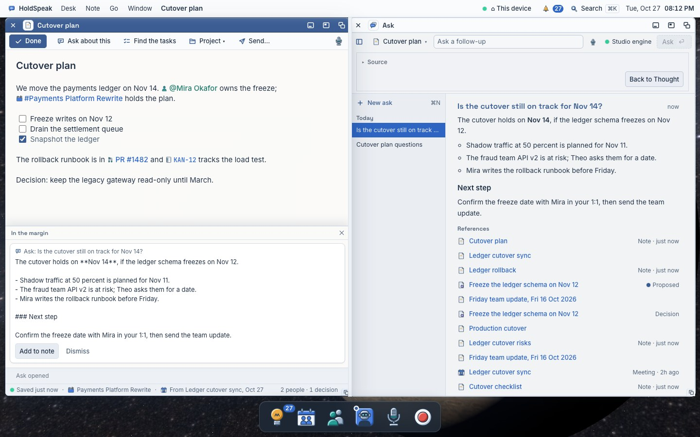
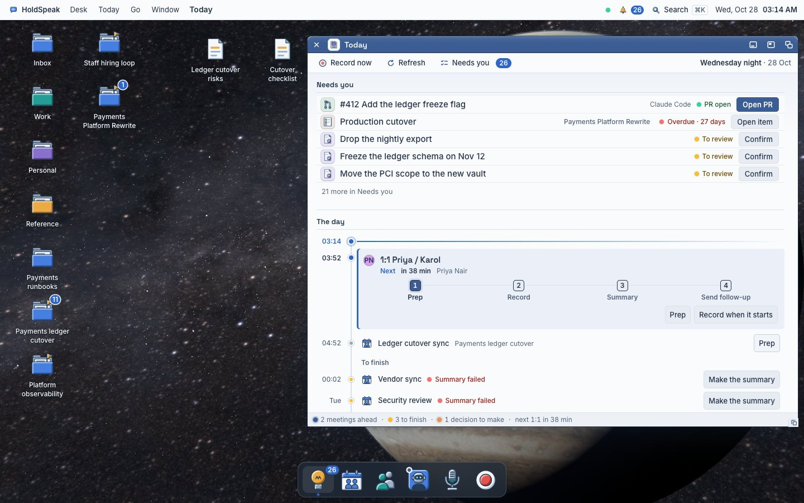
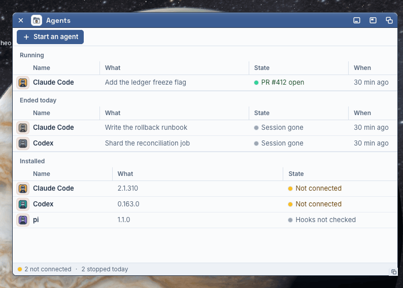
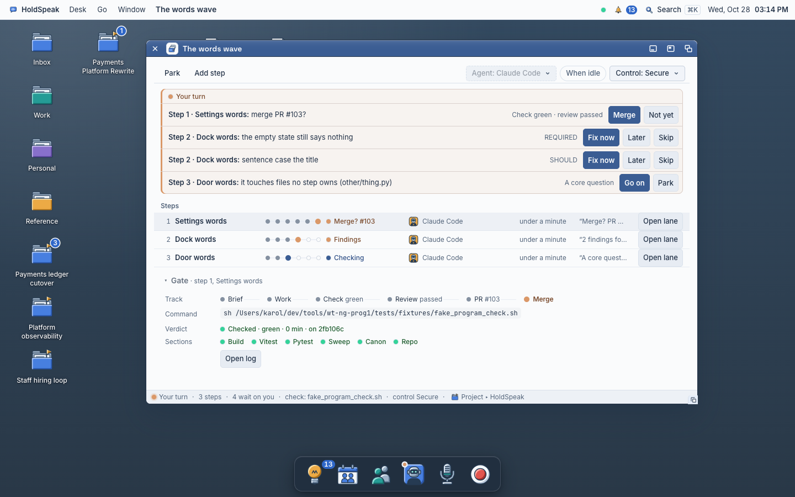
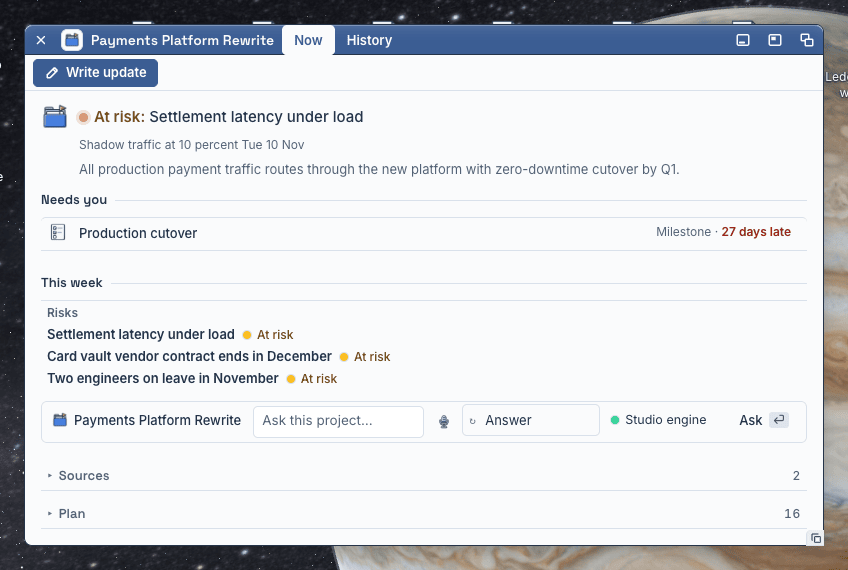
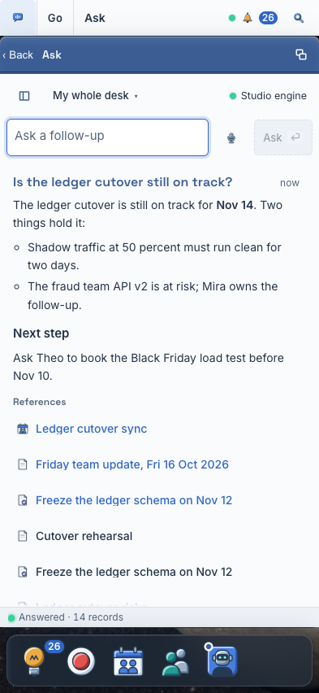
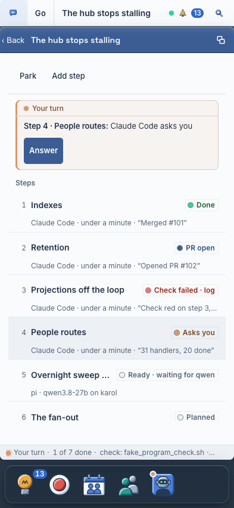

# HoldSpeak

**An agentic-first, web-based AI operating system for your work.**

Bring notes, meetings, projects, people, and coding agents onto one Desk.
Ask about your work, inspect the sources, and give an agent the next task.
The hub stores your work locally. You choose local, network, or cloud engines.

**Capture context → Ask with sources → Hand off a task → Review the result.**

[Quick start](#quick-start) · [Explore the Desk](#what-can-you-do-with-it) · [Documentation](docs/README.md) · [Contribute](CONTRIBUTING.md)

Open source · [Apache 2.0](LICENSE) · Version 0.4, pre-alpha



*“Is the ledger cutover still on track?” Ask follows the question back to your work. Screenshots show sample workspaces from October 2026 repository captures.*

## Quick start

A source install needs Python 3.10+, Git, [uv](https://docs.astral.sh/uv/), npm, and Node.js 22.12+.
The local model runtime also needs CMake and a C++ compiler.
On Linux, use `uv pip install -e '.[linux]'` for the install step.

```sh
git clone https://github.com/karolswdev/HoldSpeak.git
cd HoldSpeak
uv venv
source .venv/bin/activate
uv pip install -e .
holdspeak
```

1. Open the URL printed by the hub and follow Setup.
2. Choose an engine in **Settings > Engines**.
3. Speak or type a Note, then select **Ask about this**.

Try a service migration idea: use **Develop this thought** to refine its constraints, then **Find the tasks** to prepare work.
Hand a task to an agent, review the change, and use the Project's records for your next update.

[Installation, permissions, and optional extras](docs/GETTING_STARTED.md) · [Notes and thought development](docs/USER_GUIDE.md#develop-a-thought)

## What can you do with it?

The Desk takes its cues from Amiga Workbench: objects, drawers, movable windows, menus, and a dock.
Arrange the tools around your work.
**Agentic-first** means AI can use tools to act on that work, with the context you have already saved.

### Take a meeting through to follow-up

<p align="center">
  
</p>

*Prepare, record, review, and follow up. Today brings the next action into view.*

Record microphone and system audio, or import a recording or transcript.
Use **14 built-in plugins** to propose decisions, requirements, owners, risks, and other meeting outputs. Each needs an engine assignment.
Review the outcomes, link the meeting to a Project, and turn an action into a task or agent brief.

[Meeting mode](docs/MEETING_MODE_GUIDE.md) · [Meeting intelligence](docs/MEETING_INTELLIGENCE.md) · [Aftercare](docs/MEETING_AFTERCARE.md)

### Ask your work, then use the answer

Ask about a Note, Meeting, Project, person, or your whole Desk.
A tool-capable engine can find more permitted records, write a Note, create a task, or prepare an update.
Inspect **References** and tool results before you use the answer.
The conversation is saved as a Thread from its first answer, ready for a follow-up.

[Ask and conversations](docs/AGENTS_AND_THREADS.md) · [Architecture work](docs/ARCHITECTURE_WORK.md)

### Hand work to a coding agent

<p align="center">
  
</p>

*Keep the task, agent, and latest state together.*

Select **Hand to agent** on a task or Desk item.
Inspect the brief, repository, branch, and worktree before launching Claude Code, Codex, or pi in a separate Git worktree.
Follow progress, read terminal output, answer questions by text or voice, and review the result.
This needs a project repository, the installed agent CLI, and tmux.

[Coder integration](docs/CODER_INTEGRATION.md) · [Agent hook setup](docs/AGENT_HOOK_INSTALL.md)

### Run a goal as a Program

<p align="center">
  
</p>

*One goal, several steps, visible decisions. Check and pull request states shown here use a test fixture.*

Choose steps, dependencies, agents, and checks. Each step gets its own worktree.
Configured gates can take a step through work, check, review, pull request, and merge.
The Control level sets how routine decisions proceed; **Your turn** brings questions and findings back to you.
A handover Note retains the state and decisions.

[Programs, templates, overnight work, and fallback agents](docs/programs.md)

### Lead projects and people from the same place

<p align="center">
  
</p>

*See what needs you, ask a project question, or select **Write update**.*

Project Rooms connect open work, decisions, commitments, and recent changes.
Add GitHub, Jira, or Confluence sources. Review an update and its sources before sending it to a saved destination.
People helps you prepare for a 1:1 with open commitments on both sides.
Confidential People material has a separate encrypted store and specific access rules.

[Project Rooms](docs/PROJECT_ROOMS.md) · [People](docs/USER_GUIDE.md#people) · [People security](docs/PEOPLE_SECURITY.md)

### Make useful work repeat

Configure an Automation's sources, instruction, engine or agent, trigger, and output.
Prepare a Friday draft from the week's meetings, or hand eligible source items to an agent.
Inspect a test run before enabling a schedule or supported event.
Runs retain their results and history; a destination output prepares a send for review.
Scheduled work needs the hub running when it is due.

[Automations](docs/AUTOMATION.md) · [Project Watches and Steward](docs/PROJECT_ROOMS.md#use-the-steward) · [Cadence](docs/CADENCE.md)

### Take the Desk with you

<p align="center">
  
  
</p>

*The browser Desk adapts to a phone. Program step states shown here use test fixtures.*

Hold Right Option on macOS or Right Alt on Linux, speak, and release to type into the focused app.
With Calls set up, phone your Desk, authenticate, and ask about work, add a task, or write a Note.
Confirm proposed sends by voice. The completed conversation becomes a Note.

[Voice typing](docs/USER_GUIDE.md#voice-typing) · [Calls and The Line](docs/calls.md) · [Phone and reach-you rules](docs/phone.md)

## Your work, your engines

The local hub stores your work. Whisper transcribes speech locally.
Choose engines per job: local GGUF or MLX models, OpenAI-compatible endpoints, or supported CLI presets.
Those presets include Claude Code, Codex, pi, and Gemini CLI.
A CLI used as an engine answers Desk requests; a coding handoff starts a separate repository session.

There is no required HoldSpeak account or cloud service, and no product telemetry.
Cloud engines and connectors can send data outside your machine. Providers can require accounts and charge for use.
**Secure**, **Normal**, and **YOLO** control authority for eligible operations within configured scope.
Saved sources, tool results, run records, and Receipts let you inspect the work.

[Models](docs/MODELS.md) · [Memory](docs/RELATIONSHIP_AWARE_MEMORY.md) · [Control modes](docs/AUTHORITY.md) · [Security](docs/SECURITY.md)

## Connect external tools

MCP lets external agents use permitted Desk operations: **306 tools across 52 families**, filtered for each caller.
Use the local sidecar, or enable Reach for scoped Streamable HTTP access.
Configure destinations for folders, GitHub, Jira, Confluence, email, or Slack.
Extend the system with meeting plugins, connectors, actuators, Modes, and voice commands.

[MCP reference](docs/MCP_SIDECAR.md) · [Integrations](docs/INTEGRATIONS.md) · [Plugin authoring](docs/PLUGIN_AUTHORING.md)

## Platforms and current limits

Built first for a software architect who leads people and projects.
The hub runs on macOS with Apple Silicon or Linux. Windows is not supported today.
Wayland text insertion is best effort and depends on the compositor.
System audio capture needs BlackHole on macOS or PulseAudio/PipeWire on Linux.

Interfaces and APIs can change. Model quality and tool support depend on the engine.
Recording, integrations, agent launches, and scheduled work need their dependencies and a running hub.
The phone browser works with the web Desk; the separate iPhone-app transport is incomplete.
Run `holdspeak doctor` for setup problems.

## Go deeper

| You want to | Start with |
| --- | --- |
| Use the Desk | [User Guide](docs/USER_GUIDE.md), [Desk guide](docs/WEB_DESK.md) |
| Build with agents | [Coder integration](docs/CODER_INTEGRATION.md), [Programs](docs/programs.md) |
| Understand the system | [Architecture](docs/ARCHITECTURE.md), [repository map](docs/generated/REPOSITORY_MAP.md) |
| Contribute | [Contributing](CONTRIBUTING.md), [change history](CHANGELOG.md) |

Browse the [full documentation index](docs/README.md).
