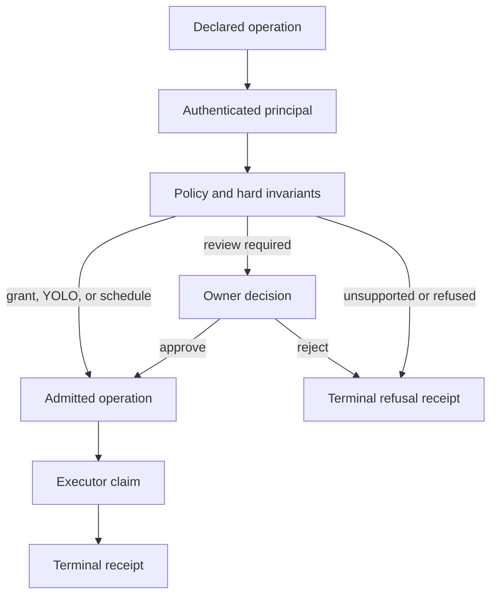

# Authority model

This page maps the user-facing [Authority](AUTHORITY.md) contract to the
runtime. It adds no second policy.

## Three separate questions

1. **Review.** Is the proposed content acceptable?
2. **Authorization.** May this exact effect occur under the principal, mode,
   grant, delegation, and hard invariants?
3. **Execution.** Did an executor claim, perform, and receipt the effect?

The operation record stores these states separately. A provider response without
a terminal Receipt is not proof of completion.

## Authority flow

## Principal rights

The edge derives the principal from authentication. A request body cannot choose
its principal.

| Principal | Rights | Limit |
| --- | --- | --- |
| Owner | Owner routes, decisions, posture, grants, and reads | Policy and hard invariants still apply |
| Agent | Submit and read scoped work, usage, self-revoke | Cannot decide, delegate, change posture, or claim as a node |
| Node | Node link and executor protocol | No owner control plane |
| Scheduler | Exact saved delegation only | Cannot widen a schedule |
| Service | Narrow service path | No general owner rights |
| None | Named public exceptions | No protected operation |

## Policy resolution

`holdspeak/operation_policy.py` evaluates hard invariants, revocation, exact
grant, control mode, and feature default. The wire modes are `safe`, `neutral`,
and `yolo`. The initial families are dictation commit, coder steering,
external write, sync cadence, and tool gate. Unknown families are refused.

Steering grant TTLs are five, fifteen, and sixty minutes for Secure, Normal, and
YOLO. `AuthorityService` owns mode and grant persistence.

## Kernel authority layers

The broker applies authenticated principal, declared operation, hard
prerequisites, and interruption policy. The envelope binds operation name and
version, target, placement, policy version, authority basis, identity, and
idempotency.

An executor checks the warrant, envelope, revocation, deadline, ancestor
liveness, and claim identity before it performs work. A caller cannot inject
authority fields into the admission body.

## Parent runs, schedules, and delegation

A parent run stores a definition reference, input snapshot, deadline, execution
epoch, active child, budget, and lease in `kernel_parent_runs`. Each physical
model attempt is a child. A retry or fallback creates a new child and receipt.

Scheduled work uses the internal scheduler principal and an exact owner
delegation. A missing, expired, revoked, stale, or changed term is refused
before dispatch.

## Approval, rejection, and cancellation

`POST /api/kernel/operations/{operation_id}/decide` accepts decision data only.
Approval signs a warrant. Rejection writes a terminal owner-rejection receipt
without an execution claim.

Cancellation raises the execution epoch and clears the active child before the
provider stop request. A late result cannot win a newer epoch. A publication
claim blocks ordinary writes until it reaches a terminal state.

## Receipts and audit

Terminal states include `succeeded`, `failed`, `refused`, `cancelled`, and
`indeterminate`. Every admitted terminal path leaves an immutable receipt.
Inference receipts include attestation. The journal is hash chained and
attestation rows cannot be updated or deleted.

To judge completion, read operation state, Receipt, journal event, and domain
record together.

## Limits

These are application controls. They do not isolate a same-user process, prove
that every future adapter uses the broker, or recover text that the operating
system never delivered. Agent credentials live in memory and a restart clears
them. See [Security model](SECURITY_MODEL.md).
