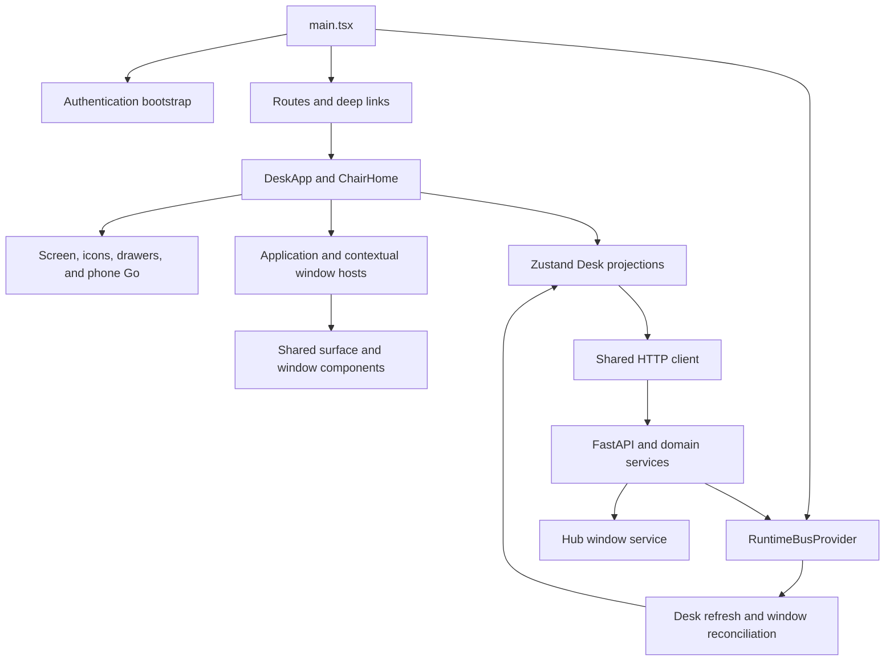

# Desk architecture

The Desk is the browser operating surface of HoldSpeak.
It presents saved work, agent sessions, model requests, and automation through one application and window framework.
This reference explains rendering, state ownership, and recovery for contributors.

Read [The Desk](WEB_DESK.md) for user tasks.
Read [Desk object model](DESK_OBJECT_MODEL.md) for object declarations, verbs, and window behavior.
The [frontend map](internal/ARCHITECTURE_WEB_FRONTEND.md), [UX canon](internal/UX-CANON.md), and [surface contract](../web/src/desk/surface/contract.md) own implementation rules.

## Render and data flow

`web/src/main.tsx` mounts the route and runtime providers.
`web/src/lib/auth.ts` handles the browser's hub authentication bootstrap.
`DeskApp.tsx` composes the active Desk and its contextual windows.
`chair/ChairHome` and `screen/Screen` provide the desktop entry and compact navigation.

The current shell is React and DOM-based.
Selected atmosphere scenes use the existing lazy Three.js host behind the controls.
The parked spatial Floor and its rendering path do not define the active Desk.

## Routes

`web/src/routes.tsx` defines `/`, `/welcome`, and `/presence` as page routes.
Other supported addresses are deep links that open the matching Desk window and preserve its scope.
For example, `/history` opens Meetings and `/models` opens Engines.
The legacy `/studio` address opens Settings.

`web/src/desk/applications.ts` defines the application registry.
Add a deep link only when the application needs an address.
A saved domain object and its open window retain separate identities.

## What the Desk renders

The Screen presents root drawers, Projects, loose work, and live agents.
Drawer contents open through the existing drawer hosts.
`zone:<id>` remains the qualified reference for a stored directory.
Phone Go exposes the available apps, drawers, and Projects through compact navigation.

`DeskApp` also hosts Ask, agent handoffs, agent lanes, delivery readers, repository windows, object editors, and other contextual surfaces.
Programs and Calls are registered applications with their own shared-framework windows.
An individual Program opens a goal and step board; Phone also contributes attention rows and Calls controls.
Application windows load through `SurfaceWindows` and the shared registry.
The delete/Undo host stays above the Desk render branches so refresh failures do not remove a pending recovery action.

Atmosphere, motion, and wallpaper are presentation preferences.
A scene failure does not authorize a replacement domain action.
Reduced motion and hidden-document handling belong to the existing atmosphere and motion runtime.

## State ownership

| State | Owner | Browser role |
| --- | --- | --- |
| Notes, Meetings, Projects, outputs, and model configuration | Hub domain services and repositories | Read and edit through supported APIs |
| Registered windows, geometry, depth, seat, and revision | `holdspeak/services/desk_window_service.py` | Present and anticipate changes |
| Desk-level window counters and Stage shelf | `desk_window_desk` | Resolve against the view's work area |
| Contextual windows listed in `NOT_ON_HUB` | Their browser host | Keep view-local opening context |
| Initial workspace snapshot | `store/workspaceStorage.ts` | Cache first presentation, then follow hub rows |
| Field drafts and view preferences | Their editor or browser contract | Preserve local work without executing it |
| Selection, hover, and drag candidates | Browser state | Transient presentation |
| Domain operation outcome | Owning service and Receipt | Show evidence and supported recovery |

`compositor/hubWindows.ts` loads registered windows from `/api/desk/windows`.
The local workspace document, `hs.desk.workspace.v1`, is a cache for those windows.
Newer hub state replaces that cached arrangement.
Its other sections keep local drafts, places, and view preferences under their own contracts.

A window that needs opening context absent from the hub row can remain view-local.
Read the service's `NOT_ON_HUB` registry before promising cross-browser behavior for a contextual surface.

## Applications and windows

`DESK_APPLICATIONS` supplies app identities, openers, menus, shortcuts, aliases, and surface declarations.
`PRIMITIVES` supplies object kinds and declared capabilities.
`verbRegistry.ts` supplies the common verbs and their availability checks.
These registries have different roles and must agree at their integration points.

The shared window frame owns focus, title controls, movement, resize, iconify, zoom, and close behavior.
The active host composes domain content inside it.
New faces use the shared surface library and its Button.

Registered window changes use one desk revision sequence.
A stale expected revision is refused and the client rereads current hub state.
Depth is a monotonically increased ordering value, with the front window derived from shown windows.
Geometry supports share-plus-pixel values resolved against each view's work area.

## HTTP and RuntimeBus

`web/src/lib/api.ts` owns `apiRequest`, `apiFetch`, and `apiBlob`.
Transport failures become `ApiError`; display code uses the shared readable error mapping.
`desk/api.ts` maps wire records into typed primitives.
Feature components do not create another HTTP stack.

`web/src/runtime/RuntimeBus.tsx` owns the product `/ws` connection.
It exposes connection state and typed frames and handles reconnects.
`DeskChangedRefresh` refreshes domain projections after relevant changes.
The compositor follows `desk_changed` frames whose kind is `windows`.
A no-op window write does not emit another change frame.

An anticipated window change stays visible while its request is pending.
Its response then reconciles the presentation with the hub.
The follower avoids replacing a pending write with an older read.
A stale-write conflict recovers by reading the current row.

## Rules for new work

1. Find the domain record, window identity, and source-return context for the task.
2. Use the existing application, primitive, verb, and window registries.
3. Use the shared API client and runtime bus.
4. Compose controls from the surface library.
5. Keep a draft with the exact editor and object that owns it.
6. Distinguish a failed read from a failed write before offering Retry.
7. Validate the rendered outcome and the affected stored record.

Do not save a domain result only in workspace storage.
Do not infer execution success from a window closing or a loading indicator ending.

## Known gaps

Backend capabilities and current browser affordances have separate exposure.
The Thread data model and modes remain in services while the separate Thread window is parked.
New Thread opens the current Ask surface.
The old Floor file-drop layer is also parked; use active import controls for supported ingestion.

A registered primitive can have capabilities that the current host exposes differently.
For example, the Meetings host opens meeting records and the Automation host replaces the old queue editor for ordinary automations.
Check the active opener and host as well as the static descriptor.

## Current workflow recovery

Editors retain the draft associated with the object and request that owns it.
A completed save must not clear a newer edit.
A retry must repeat the failed operation's identity and scope where the service supports that contract.
A successful write followed by a failed read needs read recovery, not another write.

Notes use the active document pattern, CodeMirror selection, source references, and editor-specific save behavior.
Ask source return preserves the source identity and selection context.
Saved outputs retain their source links through the owning service.
Closing or reopening an editor does not transfer its pending work to another Note.

Project source controls, People preparation, provider checks, and channel sends each retain their own failure and retry states.
A generic refresh cannot replace their exact result or establish external delivery.

### Conditional work controls (2026-10-16)

Conditional controls depend on the stored object's identity, state, and applicable service operation.
A held tool call, a prepared send, and a session reply have different decision and execution paths.
Use their owning app contracts rather than a shared boolean named success.
The [workflow record](internal/COHESIVE-WORKFLOWS-2026-10-15/README.md) retains historical verification and its stated limits.

### Desk entry composition (2026-10-16)

Desktop Screen and phone Go reach the same retained work through their respective layouts.
A compact layout is still a browser view of the hub.
It does not establish native-device support or a separate runtime.
Historical entry verification lives in the [entry record](internal/COHESIVE-DESK-ENTRY-2026-10-16/README.md).

## See also

- [Desk object model](DESK_OBJECT_MODEL.md): declarations and interactions.
- [System architecture](SYSTEM_ARCHITECTURE.md): services and lifetimes.
- [Domain model](DOMAIN_MODEL.md): records and execution identities.
- [Contributing](../CONTRIBUTING.md): focused verification and submission.
