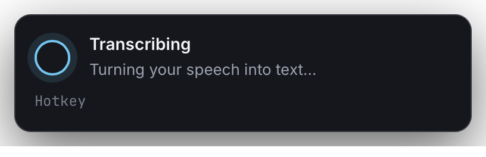
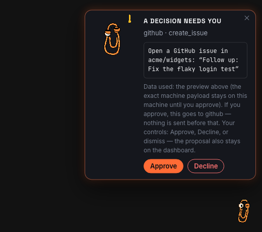

# Dictation Pipeline Guide

Dictation turns an owner speech gesture into useful text for the app you type
in, a preview, focused typing, or an admitted agent destination. Capture,
local Whisper transcription, model stages, and typing are separate. A stage can
fail without losing the original transcript.

Read [Getting Started](./GETTING_STARTED.md) first if basic voice typing does
not work yet. To see a full run first, read [The Dictation Copilot](./DICTATION_COPILOT.md).

The loop is:

```text
speech -> Whisper transcript -> punctuation cleanup -> dictation pipeline -> typed text
```

The pipeline is on by default. Non-fatal stage failures fail open: if a stage
fails or its model is not available, HoldSpeak keeps the original transcript.
A fatal speech-session signal stops publication instead of typing late text.

An optional last gate sits after the pipeline. Turn on **Preview before
type** in **Settings > Speak > Voice typing**. HoldSpeak then shows the finished
text on a card. **Type it** commits the text. **Discard** drops it.

## Project knowledge: facts and context

Project knowledge is input to a rewrite stage. It is not a sandbox and it is
not an instruction to write files.

| Input | Source | Stage |
| --- | --- | --- |
| Facts | `<repo>/.holdspeak/project.yaml` | `kb-enricher` |
| Context | `.hs/` Markdown files | `project-rewriter` |
| Blocks | Saved block templates | `block-resolver` |

HoldSpeak reads these files when the project root is configured. A project
document suggestion is a separate saved proposal. Applying it is a Desk write.

## 1. Open the dictation face

Open **Dictation** in the Desk, or use the configured desktop hotkey. In the
browser, `POST /api/dictation/mic/open` admits one microphone interval and
`POST /api/dictation/mic/close` ends it. The interval has an opaque server
handle and an expiry. The audio floor prevents two capture owners from using the
same microphone.

## 2. Choose the model

Speech transcription uses the local Whisper backend selected by the runtime.
Pipeline stages can use a configured model assignment. The dictation runtime is
not set on the dictation face. The **Dictation runtime** group in **Configure
dictation** says **SET IN ENGINES**. Click **Open Engines**.

1. In **HoldSpeak > Engines**, add your endpoint or local model.
2. Assign it to **Dictation clean-up** in **HoldSpeak > Engines**.
3. Click **Use these**.

See [Models](./MODELS.md) for the full contract and headless fallback.

The available backends for model stages are:

| Backend | Use when |
|---|---|
| `auto` | Use MLX on Apple Silicon only when `mlx_lm` and an MLX model are available; otherwise try llama.cpp and report unavailable if neither backend is ready. |
| `mlx` | You are on Apple Silicon with an MLX model. |
| `llama_cpp` | You have a local GGUF model. |
| `openai_compatible` | You have a local, LAN, or hosted `/v1/chat/completions` endpoint. |

The intent router and rewriter need a model. The `kb-enricher` stage does not.

The engine route is not the same as a coding-agent launch. A CLI can be an
inference engine for one request; **Hand to agent** starts a separate process
with its own worktree and brief.

## 3. Choose the stages

Use `POST /api/dictation/dry-run` to see the proposed stages and egress before
delivery.

| Stage | Model | Result |
| --- | --- | --- |
| Transcribe | Speech backend | Original speech text. |
| Intent router | Optional | Target and configured intent. |
| Correction | No | Applies saved correction rules. |
| `project-rewriter` | Yes | Rewrites with project context. |
| `kb-enricher` | No | Adds configured facts or block values. |
| Delivery | No model by itself | Preview, focused typing, or agent relay. |

To add the rewriter, set `stages` in **Settings > Speak**. Unfold **More** and
edit **Stages** in the **Pipeline** group. Or edit the config file:

```json
{
  "dictation": {
    "pipeline": {
      "stages": ["intent-router", "kb-enricher", "project-rewriter"],
      "max_total_latency_ms": 600
    }
  }
}
```

Stages that need no assigned model can still run. A skipped model stage leaves
the current text unchanged. A non-fatal failed stage records the reason and
returns the original utterance text.

## 4. Set the output target

Choose **Preview** when you want to inspect text. Choose focused delivery only
when the desktop target is identified. Choose **Agent** when a waiting coding
session owns the destination.

The remote route is `POST /api/dictation/remote`. A committed remote delivery
requires a caller-supplied `delivery_id`; the hub claims it before typing and
returns the same terminal receipt on a retry. A different payload with the same
id is refused.

The **Delivery** group in **Configure dictation** shows the detected target.
Set the value back to `auto` when detection works again.

When the window gives weak hints, the model can infer the target. Turn on
**LLM target detect** in **Settings > Speak > More**. **Detect below** sets
the confidence limit. The default is `0.8`. A manual override always wins.

## 5. Set up project knowledge

Use the Dictation face or these routes:

- `GET/PUT /api/dictation/project-kb`
- `GET/PUT /api/dictation/project-hs`
- `GET /api/dictation/project-context`
- `GET /api/dictation/agent-context`

### Facts

Facts are structured project values. The enricher stamps exact values. It does
not ask a model to invent them.

### Context

Context files guide a rewrite. They can contain instructions for the selected
model, but they do not grant authority to type or send.

### Suggested documentation updates

The pipeline can create a project document suggestion. Review the diff and use
the explicit apply action. A model result or a dry run never writes `.hs/` files
by itself.

## 6. Install the agent hooks

Agent hooks capture a short session event for the selected project. They do not
grant the hook authority to type or send. Generate the installed hook with
`holdspeak agent-hook templates --agent claude` or
`holdspeak agent-hook templates --agent codex`.

Use [Claude/Codex automation hooks](AGENT_HOOK_INSTALL.md) for installation and
the `--capture-messages` boundary.

## 7. Rehearse a dictation

Use **Dry run** before a first remote route. It returns the original text,
stages, selected route, and egress boundary without typing or sending.

The browser can also use `POST /api/dictation/transcribe` for one WAV. The hub
caps the body, runs the local transcriber, and does not retain that raw audio.

## 8. Dictation blocks

Block templates and records are managed by:

- `GET /api/dictation/block-templates`
- `GET/POST /api/dictation/blocks`
- `PUT/DELETE /api/dictation/blocks/{block_id}`

Blocks are data. They do not override route rights or operation policy.

## Rewrite passes
Set **Rewrite passes** in **Settings > Speak > More**, or in the config:

An assigned rewrite model receives the frozen transcript and the selected
project context. It can return unchanged text, rewritten text, or a named
failure. A non-fatal stage failure is recorded and returns the original
utterance text.

## The journal, corrections, and replay

### The journal

The dictation journal records the heard text, processed text, route, and
delivery outcome. It is an audit and learning record, not a copy of raw audio.

### Correct a result

Use the correction action on a journal row. Corrections create new entries and
do not rewrite the old receipt.

### See what it learned

`GET /api/dictation/corrections` and
`GET /api/dictation/learning-digest` show correction rules and a bounded
digest. The digest is not model training.

### Replay

`POST /api/dictation/journal/{entry_id}/replay` replays stored transcript text
through the dry-run stages. It does not replay audio and does not type.

## Desktop presence

When you dictate into another app, the web dashboard is not visible. Desktop
presence shows what HoldSpeak does now: listening, transcribing, processing,
or typing. It is off by default and never takes keyboard focus.

Turn on **Presence** in **Settings > Desk**. Or set the config:

```json
{ "presence": { "enabled": true } }
```

`HOLDSPEAK_DESKTOP_PRESENCE=1` forces it on for a headless launch. Install
the native extra:

```bash
uv pip install -e '.[presence]'
```

| State | Label |
|---|---|
| `listening` | Listening |
| `recording` | Recording |
| `transcribing` | Transcribing |
| `processing` | Processing |
| `typing` | Typing |
| `complete` | Complete |
| `error` | Needs attention |

Presence shows only while something happens. It never renders `idle`.

On macOS, presence is a floating panel and a menu-bar glyph. The panel is
non-activating, so it cannot take keyboard focus.



On Linux, presence is an in-place notification and a tray glyph. On X11 and
wlroots Wayland, it also shows a floating overlay. On GNOME and KDE Wayland,
the compositor blocks overlays, so only the notification and tray work.
On GNOME, the tray glyph needs the AppIndicator extension. The Linux system
packages are `gir1.2-notify-0.7` and `gir1.2-ayatanaappindicator3-0.1`. The
overlay also needs `gir1.2-gtk-3.0` and `gir1.2-webkit2-4.1`.

### Qlippy, the mascot

Qlippy is a small pixel-art companion on the presence surface. Turn on
**Mascot** in **Settings > Desk**, or set
`presence.mascot` to `true`. It is off by default.

The dock is a small animated sprite that mirrors the runtime state. A card
slides out only in these cases:

- **A decision needs you.** An action waits for approval. The card stays until
  you resolve or dismiss it.
- **The result of an action you approved.** The card says that it ran as
  previewed, or that it failed and nothing was sent.
- **Learned from you.** A correction reached past dictations. The card shows
  the real match count.
- **A finished meeting left open items.** The card names the top items.

Qlippy, the mascot, never acts on his own. **Approve** on a card sends the same
request as **Approve** on the dashboard. It uses the same audit trail and the
same guarded path. Dismissing a card is always safe. Each card shows the egress badge.

**Local** means everything stays on this machine. A cloud mark with a
destination means that approval sends the previewed content to that destination
only. The preview is the exact content. The badge is the destination.



## Troubleshooting

| Problem | Action |
| --- | --- |
| No microphone | Check the floor and microphone permission. Re-open the interval. |
| Dry run keeps original text | Check stage readiness and the assigned model route. |
| Remote delivery repeats | Retry the same `delivery_id`; do not make a new id for an unknown result. |
| Agent target unavailable | Check the waiting session and its scoped relay. |
| Endpoint fails | Check the host, key, model id, and egress chip. |
| Hooks show no events | Reinstall the generated hook and check its project root. |

## Verification lanes

Default tests use an isolated home. They do not open a real microphone or type
through a real keyboard. Hardware walks are separate and must state their
machine, model, and destination.

## See also

- [Dictation architecture](DICTATION_ARCHITECTURE.md)
- [The Dictation Copilot](DICTATION_COPILOT.md)
- [Voice commands](VOICE_COMMANDS.md)
- [Models](MODELS.md)
- [Security](SECURITY.md)
