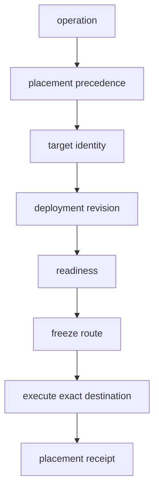

# Execution destinations

An execution destination identifies where one admitted operation runs and
which boundary it crosses. This reference is for contributors. Users can
start with [Models and assignments](INFERENCE_TARGETS.md).

## Flow

`resolve_placement` selects the invocation, Workbench, agent or capability,
or global `this_machine` target. It returns the winning tier. Admission then
freezes the deployment identity and route revisions.

## Destination kinds

| Destination | Boundary | Runtime rule |
| --- | --- | --- |
| `this_machine` | `same_device` | The frozen revision names a model file. Missing files refuse. |
| OpenAI-compatible private endpoint | `private_network` | The URL and profile key slot must be valid. |
| OpenAI-compatible external service | `external_service` | Data leaves the local network and the Receipt shows the route. |
| paired device | `paired_device` | Manifest reads are possible. Execution is currently unsupported. |
| mesh node | `private_mesh` | A node id and live polling are required. No fallback is hidden. |
| cloud deployment | External cloud leg | Cloud is a separate route and Receipt boundary. |

## Readiness and refusal

`target_from_profile` derives readiness from saved configuration. It can report
`ready`, `unavailable`, `stale_manifest`, `offline`, `unsupported`, or
`needs_key`. A readiness check does not contact every target or guarantee a
future run.

`resolve_inference_target` returns an unavailable target for an unknown id. It
does not silently select a local or cloud replacement. `target_refusal` and
`target_runtime_error` keep the chosen destination in the error.

## Routes, fallback, and receipts

`InferenceRoutePlanService` freezes the ordered deployment revisions when a
run starts. `InferenceFallbackController` can reserve only the next child in
that frozen plan. Assignment edits cannot alter an active run.

`InferenceTarget.placement_receipt` records target identity, deployment
revision, model, host, boundary, attempted legs, and result. A same-device
child cannot become cloud inside one engine call.

## Limits

- A configured private-network label does not prove server identity.
- A CLI engine's own provider configuration can choose its egress host.
- A Receipt proves what HoldSpeak recorded, not that an external person saw a
  message.

## See also

- [Models](MODELS.md): engine selection and CLI presets.
- [Models and assignments](INFERENCE_TARGETS.md): target concepts.
- [Integrations](INTEGRATIONS.md): providers and destinations.
