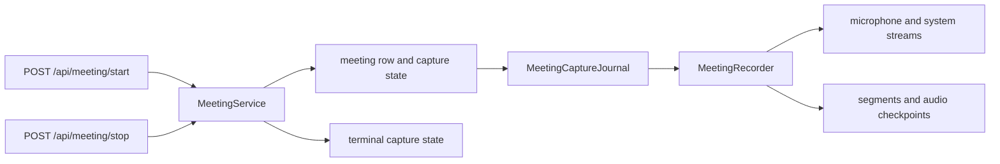

# Meeting architecture

This contributor reference follows the meeting path from capture to saved
records and later intelligence. The Web runtime composes one set of services;
the browser and MCP transports do not create a second meeting database.

## Modules

| Concern | Source |
| --- | --- |
| Web route composition | `holdspeak/web/routes/meetings/__init__.py` |
| Live start, stop, and bookmarks | `holdspeak/web/routes/meetings/live.py` |
| Saved meeting and recovery routes | `holdspeak/web/routes/meetings/crud.py` |
| Import and transcription | `holdspeak/web/routes/meeting_import.py` |
| Capture service | `holdspeak/services/meeting_service.py` |
| Dual-stream recorder | `holdspeak/meeting_recorder.py` |
| Capture process | `holdspeak/capture_process.py` |
| Capture journal | `holdspeak/meeting_capture_journal.py` |
| Intelligence queue | `holdspeak/web/routes/meetings/intel.py` and `holdspeak/services/meeting_intel_service.py` |
| Deterministic aftercare | `holdspeak/meeting_aftercare.py` |

## Live capture

The service creates a meeting before the first chunk. The recorder accepts
microphone and system audio. Native capture can run in a child process so a
driver failure does not take down the hub. The parent commits accepted chunks
to the journal and records a terminal status.

Transcription is a separate operation. `Transcriber` uses the selected local
Whisper backend and records one admitted inference child for each non-empty
decode. An assigned model for meeting intelligence is a later route and can be
remote.

## Capture journal and recovery

The capture journal is a write-ahead record under
`~/.local/share/holdspeak/meeting-captures/<meeting_id>`. It stores accepted
audio checkpoints and the source label. `recoverable` means the process ended
before a terminal capture record was trusted. It does not mean that every
sample reached SQLite.

`POST /api/meetings/{meeting_id}/capture/recover` keeps the last accepted
checkpoint as a partial meeting. Recovery does not create missing audio or claim
that a stopped native stream delivered bytes that were not journaled.

## States

| State | Meaning |
| --- | --- |
| `provisional` | Meeting row exists before capture is ready. |
| `recording` | Capture is active. |
| `finalized` | Capture ended with a trusted terminal status. |
| `capture_failed` | Capture ended with a named failure. |
| `recoverable` | The journal has an accepted checkpoint without a trusted terminal status. |

The database state and the journal are both evidence. A process view alone does
not prove that audio was saved.

## Summary job

After capture, `MeetingIntelService` queues the summary and plugin jobs. Each
physical model attempt freezes the selected route and receives a child receipt.
The route may use a local model, an OpenAI-compatible endpoint, a supported CLI
inference engine, or a mesh node. A CLI inference engine is not a launched
coding-agent session.

## Import

`POST /api/meetings/import` accepts WAV and formats that `ffmpeg` can decode,
plus VTT, SRT, and text transcripts. Import creates normal meeting and segment
rows. It uses one speaker label for an audio file unless transcript metadata
provides names. Source audio is not retained by the meeting database.

## Handoff to intelligence

The intelligence route receives the saved meeting id and an expected selection
hash. A stale selection is refused instead of silently switching hosts. The
queue and attempts record the selected host, result, and recovery state. The
aftercare service reads the saved result and does not call a model.

## Known limits

- Native audio driver behavior depends on operating-system permissions and devices.
- The journal is not a complete copy of an audio device buffer.
- The local database is not encrypted by the meeting layer.
- A model output is not evidence until its transcript source is inspected.
- Browser, CLI, and MCP calls still require route authentication and rights.

## See also

- [Meeting Mode guide](MEETING_MODE_GUIDE.md)
- [Meeting intelligence](MEETING_INTELLIGENCE.md)
- [Storage and migrations](STORAGE_AND_MIGRATIONS.md)
- [Security model](SECURITY_MODEL.md)
