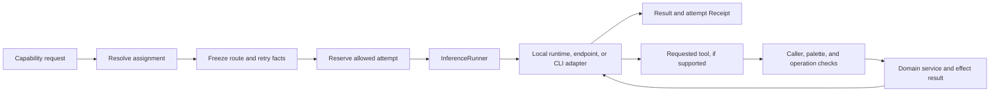

# Model runtime

This page traces a model request from its job to its execution record.
It covers local runtimes, configured endpoints, and supported CLI engines.
For engine setup, read [Models](MODELS.md).
For tool permissions, read [Agents and Threads](AGENTS_AND_THREADS.md) and [Authority](AUTHORITY_MODEL.md).

The runtime keeps capability, assignment, route, attempt, and tool effect separate.
A model answer does not establish that a requested effect ran.

## Capability registry

`holdspeak/inference_capabilities.py` defines the jobs models can perform.
A capability declares its input modalities, output kind, compatibility requirements, revision, retry policy, and permitted fallback dispositions.
Examples include `ask.answer`, `chat.turn`, `workbench.item`, `speech.transcribe`, and the meeting and memory capabilities.
The registry also composes meeting-plugin capabilities.

A capability describes a job. It does not install a model or choose a provider.
The registry restricts `speech.transcribe` to the local boundary.
Text-generation capabilities have their own allowed boundaries and model requirements.

Retry limits are registry data, including these policies:

| Policy | Attempts per entry | Total physical attempts | Deadline |
| --- | --- | --- | --- |
| `retry.structured.standard` | 2 | 4 | 75 seconds |
| `retry.audio.transcription` | 1 | 2 | 120 seconds |
| `retry.tool.turn` | 2 | 4 | 75 seconds |

Policies can also bind token, cost, and tool-call budgets.
Read the registry for the policy applied to a particular capability.

## Assignment and route plan

`services/inference_assignment_service.py` stores the owner's ordered model choices for a capability.
The public groups cover Notes, chat, writing, speech recognition, meetings, agents and tools, and background work.
The assignment service does not execute a provider request.

`services/inference_route_plan_service.py` resolves compatible deployments and freezes the route's ordered legs.
The plan records identities, revisions, hashes, budgets, retry rules, and execution boundaries.
It excludes domain audio, transcript, prompt, secret, and private endpoint text.
Content belongs to the service and run input that uses the plan.

`freeze_legacy_one_leg_plan` adapts a legacy profile to one frozen leg.
It does not restore an arbitrary provider chain supplied by a caller.
The speech-session plan in `holdspeak/speech_session/plan.py` separately binds the voice session's allowed stages.

Paths beginning with `services/` on this page are relative to `holdspeak/`.

## Targets and readiness

`holdspeak/inference_targets.py` resolves target identities and their readiness.
Target kinds include local runtimes, endpoints, desktop or mesh routes, and CLI engines.
A model label, execution host, and authenticated user are separate facts.

Readiness resolution checks available configuration and local state.
It is distinct from a live endpoint check, download, or model probe.
A ready projection does not establish output quality or successful tool use.

`holdspeak/intel/cli_engine.py` defines the Claude Code, Codex, pi, and Gemini CLI engine presets.
A CLI engine runs a request through the installed CLI and its own sign-in.
Its process can call a remote provider.
Its tool support and isolation flags depend on the preset.
Gemini retains some read-only tools, so tool restrictions must be described per preset.

A CLI engine is an inference adapter.
A coding handoff instead starts a repository session with a task brief and worktree.
Read [Coder integration](CODER_INTEGRATION.md) for that path.

## Tool execution

Ask chooses its execution path through `services/ask_desk.py`.
A compatible HTTP engine can use the Thread tool loop.
Supported CLI runs can receive the hub's run-scoped MCP credential.
An engine without tools can still answer from supplied grounding.

Automations use `services/engine_tool_loop.py` for compatible HTTP tool calls inside the item's admitted run.
That loop reuses Thread tool schemas and limits without creating a separate Thread conversation.
CLI automation runs use their scoped MCP access instead.

Each offered tool still needs the caller's rights, its palette, and the called service's policy.
Ask and automation tool sets prepare sends but do not perform the owner's final send.
The active Ask result labels read evidence **References**. The retained result
trace also records **Wrote** and **Prepared** when those facts apply; those
fields do not grant authority or prove that an external send happened.
Tool support does not grant configuration, authority, or unrestricted nested delegation rights.

## Fallback, cancel, and Receipts

`services/inference_fallback_controller.py` owns execution of the frozen route.
It reserves the next legal attempt from stored evidence.
A permitted failure can retry a leg or move to a later frozen leg.
The controller cannot invent another deployment or borrow another credential.

A deadline is final.
A stream that has emitted a delta cannot fall back to another provider.
`holdspeak/kernel/inference_runner.py` records physical invocation state and receipts.
Cancellation uses the admitted signal path in `holdspeak/kernel/inference_cancel_signal.py`.
Unknown outcomes remain uncertain in the receipt.

Domain outputs and tool writes have their own persistence contracts.
Closing their browser window does not establish cancellation of the server run.
Inspect the recorded outcome and affected record before retrying uncertain work.

## See also

- [Models](MODELS.md): choose engines and assignments.
- [Kernel](KERNEL.md): admission, execution, and recovery.
- [Memory](RELATIONSHIP_AWARE_MEMORY.md): source selection and grounding.
- [Automation](AUTOMATION.md): recurring runs and retained results.
- [Intelligence Router architecture](internal/ARCHITECTURE_INTELLIGENCE_ROUTER.md): frozen routes, fallback, and receipts.
