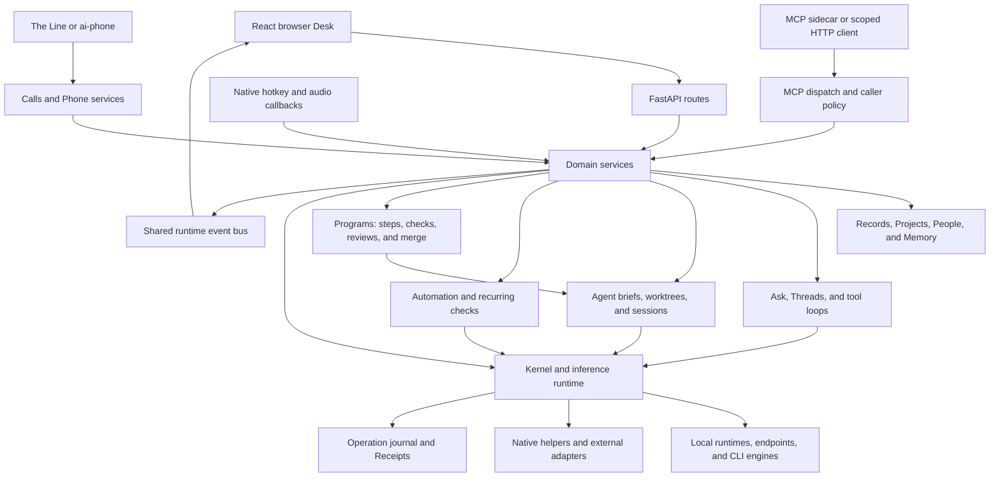

# System architecture

HoldSpeak is an agentic-first, web-based AI operating system with a local Python hub.
The browser Desk is its main operating surface.
Domain services connect retained records, retrieval, model runs, coding sessions, and external effects.

Use this map to identify the service behind a flow.
Read [Architecture](ARCHITECTURE.md) for detailed execution paths.
For product tasks, start with [What is HoldSpeak?](WHAT_IS_HOLDSPEAK.md).

The arrows show subsystem relationships, not every function call.
Reads and presentation do not each need an operation admission.
Consequential operations use their registered runtime paths.
Domain content belongs to its domain store, while operation evidence records execution facts.

## Who owns what

| Concern | Main implementation | Reference |
| --- | --- | --- |
| Runtime composition and host | `holdspeak/web_runtime.py`, `holdspeak/runtime/`, `holdspeak/web_server.py` | [Architecture](ARCHITECTURE.md) |
| HTTP transport | `holdspeak/web/routes/` | [API surface](API_SURFACE.md) |
| MCP transport and authority | `holdspeak/mcp/server.py`, `holdspeak/mcp/tool_authority.py`, tool families | [MCP sidecar](MCP_SIDECAR.md) |
| Ask and conversations | `services/ask_service.py`, `ask_desk.py`, `thread_service.py`, `thread_tools.py` under `holdspeak/` | [Agents and Threads](AGENTS_AND_THREADS.md) |
| Agent handoff | `holdspeak/services/agent_hand_service.py`, `agent_brief.py`, delivery launch services | [Coder integration](CODER_INTEGRATION.md) |
| Automations | `holdspeak/services/workbench_service.py`, `automation_runs.py`, `workbench_runner.py`, `engine_tool_loop.py` | [Automation](AUTOMATION.md) |
| Programs | `holdspeak/services/program_service.py`, `program_runner.py`, `program_verifier.py`, `program_handoff.py` | [Programs](programs.md) |
| Calls, Phone, and The Line | `holdspeak/calls/`, `holdspeak/phone/`, `holdspeak/line/` | [Calls](calls.md), [Phone](phone.md) |
| Speech and meetings | `holdspeak/runtime/`, `holdspeak/speech_session/`, `holdspeak/meeting_session/`, plugins | [Dictation](DICTATION_ARCHITECTURE.md), [Meetings](MEETING_ARCHITECTURE.md) |
| Model assignment and execution | `holdspeak/services/inference_assignment_service.py`, route services, `holdspeak/kernel/` | [Model runtime](MODEL_RUNTIME.md) |
| Operation authority and evidence | `holdspeak/kernel/`, principals, operation policy | [Kernel](KERNEL.md), [Authority](AUTHORITY_MODEL.md) |
| Domain storage | `holdspeak/db/` and service-owned stores | [Domain model](DOMAIN_MODEL.md), [Data model](DATA_MODEL.md) |
| Desk and compositor | `web/src/desk/`, `holdspeak/services/desk_window_service.py` | [Desk architecture](DESK_ARCHITECTURE.md) |

Paths abbreviated to `services/` in the table are relative to `holdspeak/`.

## State lifetimes

| State | Authority | Lifetime |
| --- | --- | --- |
| Note, Meeting, Thread, or Project | Domain repository | Retained until its supported retention action |
| Registered Desk window geometry, depth, and seat | Hub window service | Shared across browser views of that desk |
| Browser workspace snapshot | Browser cache and local view preferences | Used for initial presentation and view-local state |
| Unsent field draft | Its editor and local draft contract | Until saved, discarded, or replaced by that editor |
| Hover, selection, or animation | Browser presentation | Transient |
| Model attempt or external effect | Registered operation and its Receipt | Durable execution evidence |

`web/src/desk/compositor/hubWindows.ts` follows the hub's window rows.
Some contextual windows remain view-local, as listed in `NOT_ON_HUB` in the window service.
A local cache must not replace newer hub state.

Closing a window does not remove its underlying record.
It also does not prove that an active server run stopped.
Use the flow's supported stop operation and read its result.

## Authority

The hub authenticates the caller and derives its rights.
The owner, a scoped agent, and a node executor do not receive the same operations.
Control modes govern eligible work within those rights.
The current default is **YOLO**.
Programs also apply their own Control level to routine step decisions, usage handoffs, and merge.
Their core questions remain owner decisions.
Calls uses the call's authenticated turn and confirmation path for held or outgoing work.

An inference engine choice determines where model work runs.
It does not grant permission to send, change configuration, or launch another agent.
Ask and automation tool sets can prepare sends while keeping final sending with the owner.

Read [Authority](AUTHORITY_MODEL.md), [Security](SECURITY_MODEL.md), and the owning service for the exact path.

## Change the system

1. Identify the task, source records, executor, and output.
2. Find the service, route, operation codec, and store that own it.
3. Extend the existing contract and expose it through the shared transports.
4. Compose its Desk surface from the shared component library.
5. Update the task guide and run focused validation.

The [integration map](SYSTEM_INTEGRATION_MAP.md) maps deployment boundaries.
The [repository map](generated/REPOSITORY_MAP.md) maps source directories.
