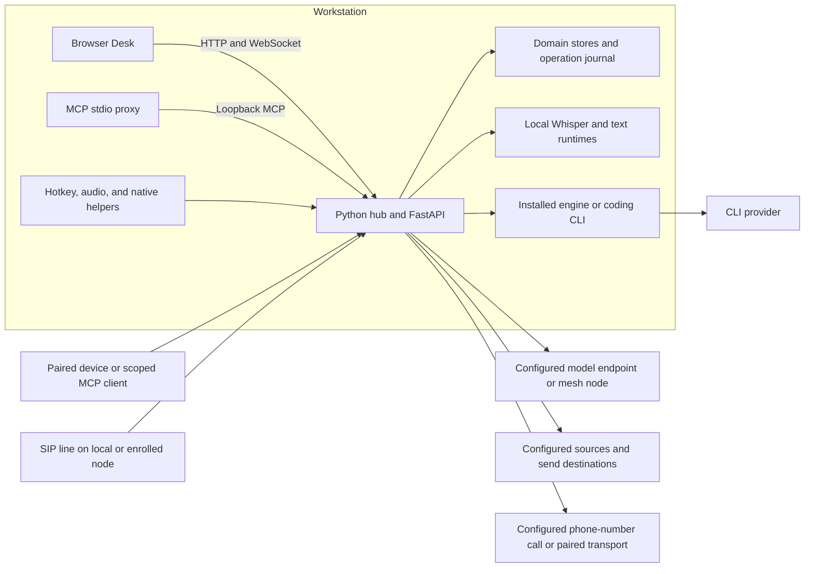
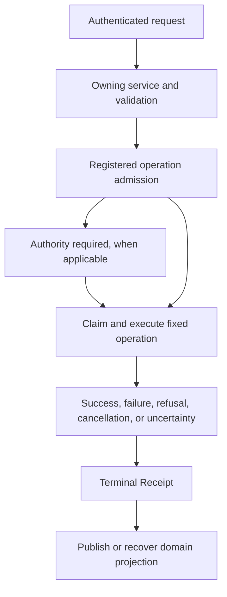

# System integration map

This map identifies processes, network boundaries, and the records produced by each work flow.
Start with [System architecture](SYSTEM_ARCHITECTURE.md) for the service map.
A network address identifies a location. Credentials and operation policy determine authority.

## Deployment

The hub is the composition root and the owner of its main database.
The stdio sidecar discovers the live hub and proxies JSON-RPC to `/api/mcp`.
It does not open a second database connection or compose a second service layer.
A companion can keep a local cache or store while the hub remains canonical for hub-backed work.

Native audio and hotkey services can run without the browser tab.
The browser presents current work and sends explicit commands through the hub API.
A model CLI executes locally as a process, but its provider can be remote.
A launched coding CLI also has repository access in its assigned worktree.
The Line can run locally or on an enrolled node and exchanges audio events and control commands with the hub.
Number calls need their configured SIP or carrier path.
The iPhone-app transport is not complete, even though pairing and Phone services exist.

Read [Companion architecture](COMPANIONS_ARCHITECTURE.md) for device-specific transports.

## Admitted operations

A read does not need the same admission as an effect.
An admitted effect has an authenticated principal, fixed input and target, and its own execution result.
A held decision can authorize that operation without changing its stored payload.
A tool or child operation still needs the checks required by its own contract.

The kernel coordinates cooperating HoldSpeak code.
It is not an OS sandbox for arbitrary installed Python or CLI programs.
Read [Kernel](KERNEL.md) for claims, deadlines, receipts, and recovery.

## Jobs and their owners

| Flow | Service path | Retained result | Guide |
| --- | --- | --- | --- |
| Capture and type | Speech session, dictation processing, desktop delivery | Dictation journal and delivery evidence | [Dictation](DICTATION_ARCHITECTURE.md) |
| Understand a meeting | Capture/import, intelligence queue, plugin host | Meeting, transcript, summary, typed Artifacts | [Meetings](MEETING_ARCHITECTURE.md) |
| Ask and act on context | Ask service, Thread loop or CLI engine, MCP tools | Answer, trace, optional saved work | [Agents and Threads](AGENTS_AND_THREADS.md) |
| Delegate implementation | Brief composition, repository resolution, worktree and agent launch | Launch record, work attempt, linked item | [Coder integration](CODER_INTEGRATION.md) |
| Repeat a job | Automation configuration, trigger, occurrence item, runner | Run, output, tool trace, optional working memory | [Automation](AUTOMATION.md) |
| Coordinate a goal | Program service, runner, verifier, handoff, agent and PR services | Program, steps, checkpoints, handover Note, decisions | [Programs](programs.md) |
| Work by phone | Calls runner, configured Line or ai-phone adapter, authenticated tool turns | Call state, completed call Note, prepared or confirmed work | [Calls](calls.md) |
| Reach the owner | Phone rules, transport, quiet hours, Program event | Phone messages, calls, events, and returned decision | [Phone](phone.md) |
| Observe a Project | Watches, source snapshots, Steward | Observations, proposals, updates, run records | [Project Rooms](PROJECT_ROOMS.md) |
| Deliver prepared work | Channel preview, prepare, owner send | Frozen prepared content and send outcome | [Integrations](INTEGRATIONS.md) |
| Run a model elsewhere | Assignment, frozen route, inference attempt | Attempt, result reference, execution placement | [Model runtime](MODEL_RUNTIME.md) |

A proposal, launch, queue entry, and terminal result are different records.
The owning guide explains which one establishes completion for its task.

## Frontend

`web/src/lib/api.ts` owns HTTP access.
`web/src/runtime/RuntimeBus.tsx` owns the product WebSocket.
The Desk applications, menus, object verbs, and shared window framework compose the user surface.

The hub stores registered window state in `desk_windows` and `desk_window_desk`.
`compositor/hubWindows.ts` hydrates and follows that state in each browser.
Browser storage keeps the initial workspace cache, local drafts, and other view preferences.
Context-dependent windows can remain local to a view.

A window update changes the presentation of work.
It does not complete a domain operation or save the content of an editor.

## Failure and recovery

- A disconnected client can leave a server run active.
- A queued job has not produced its output.
- A successful agent launch does not establish that the implementation is complete.
- A prepared send has not delivered its content.
- A runtime restart reconciles durable operations and staged projections through their owning services.
- An unknown outcome remains unknown until the system has evidence to resolve it.

Read [Operations](OPERATIONS.md), [Storage](STORAGE_AND_MIGRATIONS.md), and [Troubleshooting](TROUBLESHOOTING.md) before retrying an uncertain effect.
