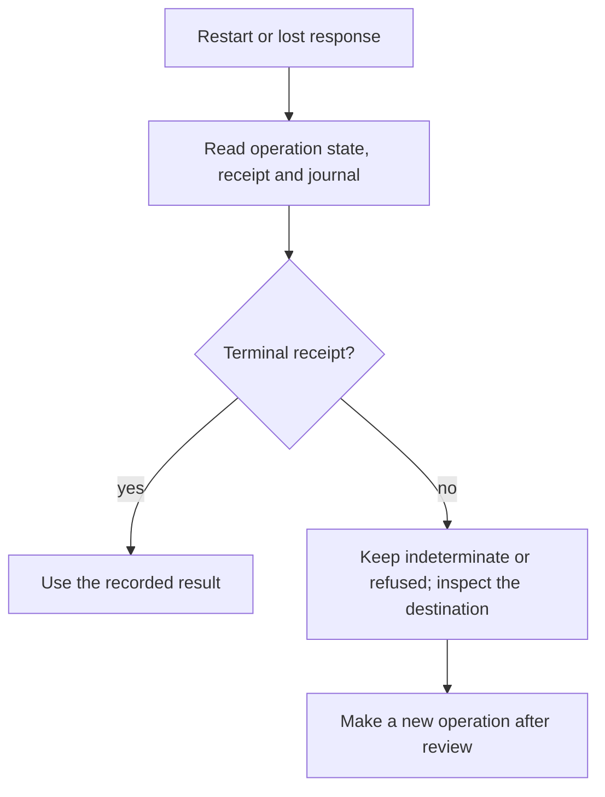

# Troubleshooting

Start with `holdspeak doctor`. Read the operation state, journal, and Receipt
before you retry a request. A client timeout does not prove whether a provider
finished.

## After a restart

The hub recovers parent work, checks liveness, and repairs projections when it
starts. It does not invent a success result for work it cannot prove.

## Operation states

Terminal states are `succeeded`, `failed`, `refused`, `cancelled`, and
`indeterminate`. A retry is a new child operation.

| State | Meaning | Action |
| --- | --- | --- |
| `admitting` | Admission stopped before a final decision. | Read the journal. Do not dispatch from this state. |
| `awaiting_decision` | A pending decision was interrupted. | Expect `indeterminate` or a restart refusal. Inspect the destination. |
| `awaiting_execution` | No executor claimed the work before its deadline. | Confirm that no external work started, then make a new operation. |
| `claimed` | An executor claimed work but supplied no receipt. | Treat any external result as unknown. |
| `refused` | Admission, authority, destination, or liveness blocked work. | Fix the named cause. |
| `cancelled` | The parent cancellation won. | Do not publish late provider output. |
| `indeterminate` | HoldSpeak cannot prove the outcome. | Inspect the destination before any retry. |
| `succeeded` | A success Receipt exists. | Read the native result and affected record. |
| `failed` | The executor wrote a failure Receipt. | Read the error and decide whether a new operation is safe. |

## Refusal codes

| Code | Cause | Action |
| --- | --- | --- |
| `principal_right_required` | The credential lacks the route right. | Use the correct principal or owner surface. |
| `unknown_operation` | The operation is not registered. | Use a documented operation. Control mode does not add one. |
| `idempotency_payload_mismatch` | A key was reused with changed arguments. | Repeat the original request or use a new key. |
| `parent_operation_unknown`, `parent_operation_not_running`, `parent_operation_not_live` | The parent is missing or no longer live. | Read the parent and its Receipt. |
| `execution_claim_expired`, `execution_liveness_expired` | The executor did not prove work in time. | Inspect external effects before retry. |
| `hub_restart_during_decision` | A restart canceled an open decision. | Make a new request only after destination review. |
| `delegation_missing`, `delegation_revoked`, `delegation_expired` | A scheduled task has no live authority. | Inspect the delegation and Automation terms. |
| `delegation_target_changed` | Schedule terms differ from approved terms. | Approve the new terms again. |
| `duplicate_tick` | The same scheduled minute already ran. | Read the run ledger. |
| `owner_rejected` | The owner rejected the operation. | Make a new proposal when intent changes. |

## An agent gets a forbidden response

1. Check that the agent credential is current.
2. Check the MCP palette and the selected agent profile.
3. Check whether the operation is `work`, `egress`, `authority`, or `config`.
4. Remember that an agent cannot become the owner or a mesh node.

A Thread receives only tools classified as work. A launched CLI run receives
only its scoped HoldSpeak MCP credential when that preset supports Desk tools.
The Gemini CLI can retain its own read-only tools. Do not diagnose every tool
absence as a global tool-off setting.

## A coding handoff will not start

Read the preview and launch record. Common named refusals are:

| Refusal | Action |
| --- | --- |
| `no_repository` | Register or connect a local Project repository. |
| `repository_not_registered` | Register the repository watched by the Project Room. |
| `profile_unknown` | Choose an installed Claude Code, Codex, or pi profile. |
| `executable_absent` | Put the selected CLI on PATH. |
| `tmux_absent` | Install and expose tmux. |
| `launch_cap_reached` | Queue the hand with **Start when one is free**. |
| `brief_over_cap` | Reduce source scope or instruction length. |
| `hooks_missing` or `codex_hooks_untrusted` | Install or trust the relevant rider hooks, then resume the held brief. |
| `worktree_duplicate` | Inspect the earlier launch. Hand again resumes stopped work only when its worktree is eligible. |

## An Automation did not run

Check the saved **When**, its enabled state, and the local time zone. A
schedule can be saved but off when **With** has no ready engine or agent. A
full handoff queue can return `queued` instead of starting a process. Read the
run record, item result, and Receipt.

For a destination result, distinguish **Prepared** from **Sent**. A saved
destination waits for your **Send** press.

## An MCP client cannot connect

The local sidecar needs a running `holdspeak web`. It proxies to the hub and
does not open the database itself. Start the hub, then retry. For Reach, check
the remote flag, `Authorization: Bearer` credential, palette, listener, and
network path. Do not put the token in a URL.

## An approval did not run

Read the proposal, authorization, execution, operation, and Receipt as
separate records. An approved proposal can wait for a claim, fail at its
adapter, be canceled, or become indeterminate.

## YOLO refused the work

YOLO is the default Control mode, not a bypass. It still refuses unsupported
operations, unknown destinations, missing fixed-destination registrations,
secret-custody violations, and missing Receipt requirements.

## Database problems

1. Run `holdspeak doctor`.
2. Stop the hub before copying or restoring its database.
3. Copy the database together with its `-wal` and `-shm` files.
4. Restore only from a validated backup. Do not edit schema rows or journal
   events.
5. Start the hub, run the doctor again, and inspect records and Receipts.

The hub's shape repair adds missing structures. It does not drop tables,
columns, or rows. See [Operations](OPERATIONS.md).

## Search or a card shows old data

Trust the operation, journal, and Receipt when a projection disagrees with a
result. Let the owning repair path rebuild the projection. Never write a fake
success Receipt.

## What the records cannot tell you

The records cannot prove that an external provider acted after a lost
response, or that a person saw a control. Mark those facts unknown and keep
the operation id.
