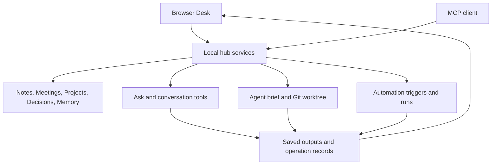

# What is HoldSpeak?

HoldSpeak is an agentic-first, web-based AI operating system for your work.
It brings records, tools, models, and coding agents onto one Desk.
You run a local hub and use its Desk in a browser.

The first user is a software architect who leads projects and people.
The work spans ideas, meetings, decisions, implementation, and follow-up.
HoldSpeak connects those stages through saved records and tools that can act on them.

## Choose a job

| You have | You do | Result to inspect |
| --- | --- | --- |
| A rough idea | Write a Note, ask questions, develop the text | A saved Note, tasks, or a brief |
| A discussion | Record or import it, then review meeting intelligence | Transcript, summary, proposed decisions, and actions |
| A project question | Ask from its records and connected sources | An answer with source references |
| A task to build | Hand the item to an installed coding agent | A brief, separate Git worktree, and tracked session |
| A goal with several implementation steps | Create a Program with dependencies, checks, and agents | Step results, reviews, pull requests, and a handover Note |
| Work away from the computer | Use configured Calls or Phone rules | Authenticated call turns, decisions, and retained call Notes |
| A repeating job | Configure an Automation and run a trial | Saved results and run history |
| An upcoming 1:1 | Prepare from People and shared work | An agenda and open commitments |
| Words for another app | Hold the hotkey, speak, release | Text in the selected app |

These jobs share context.
A meeting can supply a decision, the decision can supply an agent brief, and the result can inform a project update.
Each step still needs its own supported operation and prerequisites.

Read [Use cases](USE_CASES.md) for complete journeys.

## The words you need first

| Word | Meaning |
| --- | --- |
| Hub | The local process that owns the records, services, and runtime work |
| Desk | The browser workspace, with objects, drawers, windows, menus, and a dock |
| Note | Editable text you keep as working material |
| Meeting | A captured or imported conversation with a transcript |
| Artifact | A saved output with its type and source information |
| Project | Related work, decisions, sources, and open items |
| Ask | A request about your work that can use permitted tools on a suitable engine |
| Thread | Saved conversation state, including turns, references, and tool results |
| Engine | The model execution choice assigned to a job |
| Automation | A recurring or manually started job with sources, an executor, and an output |
| Program | A multi-step goal coordinated across agent worktrees, checks, reviews, and merge decisions |
| Calls | A configured voice connection to the Desk through The Line or ai-phone |
| Phone | Rules and transports for contacting you about work that needs attention |
| Coding agent | An installed CLI session that works on a repository task |
| Receipt | The recorded outcome of an operation |

An agent persona supplies instructions for a specialist conversation.
A CLI engine answers model requests through an installed CLI.
A coding-agent handoff starts a repository session with a brief and worktree.
A Program coordinates several such steps and checks their results.
Calls runs authenticated conversation turns over a configured phone line.
The iPhone-app transport remains incomplete; configured number calls have a separate supported path.
These paths have different tools and prerequisites.

The [Glossary](GLOSSARY.md) defines more terms.
The [domain model](DOMAIN_MODEL.md) identifies the records behind them.

## How the parts fit

The Desk and MCP clients use the same service layer.
Their credentials and permissions can differ.
An exposed tool does not grant its caller authority to run every operation.

With a tool-capable engine, Ask can look up context and perform permitted Desk work.
Results identify what the run looked at, wrote, and prepared.
A prepared send waits for your **Send** press.

## Add tools when the job needs them

1. Create a Note or import a meeting.
2. Assign an engine for the AI job you want to try.
3. Ask one useful question and inspect the result.
4. Add a Project and sources when the work needs that context.
5. Configure an agent handoff or Automation when you have a clear task.

A Note and a blank Project can exist without a working AI engine.
Voice capture needs a speech model and microphone access.
Coding handoffs need a repository, tmux, and the selected CLI.
Scheduled work needs its trigger enabled and the hub running.

The [capability reference](CAPABILITIES.md) distinguishes implementation, exposure, and recorded evidence.
An implementation entry does not establish release availability or owner acceptance.

## Know what an action can do

HoldSpeak stores work locally and uses local Whisper for speech recognition.
Other model work runs on the engine you select.
That can be a local runtime, an endpoint, or a supported CLI using its configured provider.

A CLI running on your machine can still send prompts to a cloud service.
Connectors, remote clients, and outbound actions also have data boundaries.
Read [Security and privacy](SECURITY.md) and check your selected engine and destination.

The default Control mode is **YOLO**.
Eligible work can execute within configured scope without another confirmation.
**Normal** and **Secure** hold different classes of operation for a decision or grant.
Service checks and tool restrictions still apply in every mode.

Read the result and Receipt before treating an action as finished.
A queued job, proposal, or agent launch is an intermediate state.

## See also

- [Getting Started](GETTING_STARTED.md): install and try one flow.
- [The Desk](WEB_DESK.md): open and arrange your work.
- [Automation](AUTOMATION.md): configure recurring work.
- [Coder integration](CODER_INTEGRATION.md): hand off and steer implementation work.
- [Programs](programs.md): coordinate a multi-step goal.
- [Calls](calls.md) and [Phone](phone.md): work by phone and configure attention rules.
- [System architecture](SYSTEM_ARCHITECTURE.md): trace the runtime.
