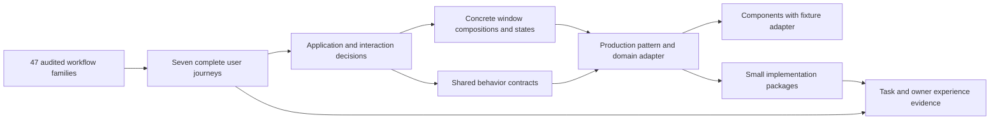

# The proposed HoldSpeak desktop

**Design v1 — owner-authorized execution, 2026-10-23.** Still UNCHECKED by
Muad'Dib; execution authorization does not invent his ratification or owner
aesthetic acceptance.

HoldSpeak becomes a coherent desktop for an architect's work: capture an
idea, inspect material, prepare a review, ask a grounded question, make a
decision, delegate, inspect the result and return to the original task.
Applications have their own useful compositions and behavior, while one
framework supplies their window, input, command, navigation and feedback
rules. React/TypeScript/DOM and the existing backend/native services remain.

This is the proposed experience and its architecture. It translates the
research and audited jobs into design choices; the [delivery plan](DELIVERY-PLAN.md)
is derived from them. [Execution](EXECUTION.md) records merged slices and
remaining work; a partial implementation does not complete the proposal or
establish owner aesthetic acceptance. The Constitution and UX-CANON remain authoritative.

## Read the proposal as one design

| Record | What is defined |
| --- | --- |
| This proposal | Desktop organization, application families, ownership, interaction rules, state and visual grammar. |
| [Workflow map](design-proposal/WORKFLOW-MAP.md) | Every one of the 47 audited family IDs mapped to its proposed view, shared contracts, journey, recovery/return and delivery package. |
| [Seven journeys](design-proposal/JOURNEYS.md) | Complete jobs through actual application boundaries, including failure, interruption, narrow layout and return. |
| [Canvas guide](design-proposal/CANVASES.md) and [static artboards](design-proposal/CANVASES.html) | Eighteen proposed desktop/narrow compositions and their state variants in the current material. These illustrate design; they are not production components or executed behavior. |
| [Delivery plan](DELIVERY-PLAN.md) | Dependency order, real consumers, counterexamples, proposed packages and evidence needed to deliver this design. |

The 13 public jobs, 47 audited families, application windows and component
patterns are different units. A family can span several windows; a shared
behavior can support many families. The [inventory](USE-CASE-INVENTORY.json)
and [47 adversarial records](adversarial/README.md) remain the source evidence.
Their historical verdicts are not changed by this design map.

## D1. One desktop, recognizable applications

The Desk remains the operating surface. Go opens applications; object doors
open the appropriate resource view. The contextual application menu changes
with the active application. Global Desk navigation, the Dock and window
controls remain common. A resource link opens within this model rather than
replacing the Desk with a feature page.

| Application family | Proposed useful composition | Current homes and retained distinctions |
| --- | --- | --- |
| Daily/project/person work | Scannable collection or overview, selected subject, useful next actions and an optional detail/reading area. | Today, Needs, Project Room and People retain their domain projections. Today/Needs already share NeedRow and their snapshot. |
| Resources | Location/history controls, collection, file/member inspection and optional contextual inspector. | Directory, KB and registered repositories share appropriate collection behavior; membership, repository paths and Git operations keep different providers. |
| Documents | Writing/reading area, native editor commands, optional outline/source inspector and quiet edit receipt. | Ordinary Notes use active ThoughtWorkspaceWindow/CodeMirror. Decisions and derived project updates keep their own revisions and lineage. |
| Conversations | About/source context, a readable turn stream, stable composer and contextual source/result actions. | One Ask window, saved threads and Save as note remain. Specialist conversation scope is explicit; no Keep/Bin answer model is restored. |
| Live sessions and retained work | Live material and controls while active; useful record/result plus exact outcome afterward. | Meetings, Agent results and Automation occurrences retain their own operation and result identities. Closing a view does not define cancellation. |
| Configuration/inspection | Compact categories or selected object, grouped fields, local validation and exact write/readiness feedback. | Settings, Engines, Accounts, Setup and doctor retain different authority and jobs. Setup adoption is not a replacement configuration wizard. |
| Workflow/terminal tools | Their task-specific editor or console inside the shared window/input/command model. | Automation construction, Gate, Coder and terminals keep specialized control and rendering. A terminal is not converted into a generic collection/form. |
| System/reference | Existing window/menu behavior, useful Components examples and per-window feedback. | Components lives in the Desk. Presence stays disabled; portable clients and native-host repair remain separate boundaries. |

These composition families use the existing application registry; they do
not require replacing every existing component. The workflow map names the active
consumer; parked NoteEditor and project DrawerWindow do not count as adoption.

## D2. Separate application, window, resource and work identity

The proposed resource browser supports two locations of the same registered
repository in two windows. **Open** raises the default resource window;
**New window** explicitly creates another view instance. The current resource
key remains the default instance for restoration. Additional instances get
stable opaque window ids and retain their resource reference separately.
Existing single-instance decisions for Ask, Settings and a Note document
remain; multiple repository views do not authorize multiple document writers.

| Owner | State it owns | Example |
| --- | --- | --- |
| Existing compositor/window service | Window identity, geometry, front/minimized state and opener/return link. | Repo view A is front; view B is minimized. |
| Application view, keyed by window instance | Location/history, query, sort, view mode, selected ids, focused row, range anchor and pane scroll. | A is in `src`; B is in `docs`. Selection and Back in A do not change B. |
| Existing document/domain writer | Resource identity, authoritative revision, current draft, save/retry and supported undo. | A Note has one document writer; its caret is view state. |
| Existing retained operation/domain service | Actual job/parent/occurrence, captured input, terminal outcome, result and receipt. | A project update continues after its originating window closes. |
| Existing command registry/context | Invocation origin, command scope, exact targets and availability at invocation. | Stage uses A's selected paths in the named repository. |

Restoration validates the resource and location. A missing folder produces a
named unavailable state with Back/Retry; it does not silently become an empty
folder or move the other window. Existing geometry is preserved. React's
[state structure guidance](https://react.dev/learn/choosing-the-state-structure)
supports avoiding contradictory or duplicated state; choosing these ownership
boundaries is this proposal's architecture decision, not a React feature claim.

## D3. Commands have explicit scope and a captured origin

There are three command classes: **view-local**, **Desk-global**, and
**explicitly targeted**. The same view command uses the same targets from its
menu, toolbar, context menu and shortcut. Global navigation remains global.
Configured voice macros retain their saved targets and execution policy;
contextual voice proposals retain their existing confirmation boundary.

A command invocation captures its originating window/view, qualified target
ids, relevant document/selection or revision, opener and operation identity.
Opening a menu must not replace that origin with the menu element's focus.
Provider/domain authority determines availability and refusal. The existing
verb registry is extended, not replaced by a second command bus.

A disabled or unavailable action keeps its real reason beside the owning
resource when the user invokes it; it does not silently fall through to
another window. Closing a menu returns focus to its invoking control. Returning
from a child/source view restores the originating control or a valid neighbor
if it no longer exists. Do not assign a fresh global shortcut for each app.

Within an input or CodeMirror editor, platform text selection, clipboard,
IME and undo commands remain editor commands. Tab moves between regions and
controls; arrows navigate the appropriate list/tree/menu; Enter opens or
activates its focused item. Focus, selected objects and active window have
different visible treatments. This follows the distinction and keyboard
conventions in the [WAI-ARIA keyboard guidance](https://www.w3.org/WAI/ARIA/apg/practices/keyboard-interface/),
while respecting existing owner-selected shortcuts.

Right-clicking a selected item preserves its selected set; right-clicking an
unselected item makes that item the context target. Primary-modifier toggles
and Shift range work in supported collections. They do not turn a text range
or the Desk's icon selection into an application collection selection.

## D4. Navigation and selection form a view, not global page state

Each navigation entry retains location, query, sort, selected ids, focused
item and scroll anchor. Back/Forward restores that entry in the same window.
An older read cannot replace a newer location, thread or selection. Source
inspection remembers its origin so returning does not rebuild the prior task.

Sorting preserves valid selected ids and the focused item. Filtering restricts
the active selection to its visible intersection; hidden items are not silent
command targets. Back can restore the prior query/selection. A refresh prunes
deleted ids and restores focus to a valid neighbor. Failure to read a source
retains useful content and marks it stale; it is not proof of an empty result.
Operations apply their own freshness rules rather than one blanket stale gate.

List/icon/tree presentations reuse the same appropriate collection model.
View-mode changes preserve identity and focus; different providers need not
offer every view mode. A KB membership edge and a filesystem path are not the
same transfer operation.

### Repository operation boundary

The current [repository client](../../../../web/src/desk/repository.ts) exposes
tree/file read, file write, explicit path staging, index commit, status,
branches and checkout. Its file writer sends content without an expected
revision. Source presence alone does not establish the full user operation.

| Proposed user operation | v1 design |
| --- | --- |
| Browse/open | Open a directory in this view; open a supported file as read/inspection material through the existing provider. Keep path, history and selected identity. |
| Edit a file | Available only with a defined revision/conflict-aware provider write contract. Otherwise the document is read-only with a true reason; do not advertise an unsafe Edit action. |
| Stage/commit | Stage names explicit selected paths. Commit names the repository/branch and actual index, not an unrelated view selection. The operation needs its real outcome/retry contract before the Git job is declared delivered. |
| Checkout | Names the repository and requested branch; dirty/index refusal and resulting branch are provider facts. A location or tab change is not checkout. |
| Copy/move/rename/OS drop | Not inferred from repository APIs. Semantic HoldSpeak ref handoff and local import keep existing authority; general filesystem operations require their own producer contract. |

## D5. Editing preserves current work and native input behavior

Settings keeps its on-change save policy; Notes keep their existing writer.
The common contract presents **Edited → Saving → Saved**, or **Not saved**
with the retained draft and a precise Retry. Edited is visible immediately,
including the debounce interval. Saved requires acknowledgment. In-flight
requests own captured input; a later local draft remains independently owned.
Retry reconciles against the authoritative revision and retains newer edits.

The web mic gesture captures a candidate window/editor/selection before it
can take focus. Talk release (or completion of that capture gesture) validates
and binds this target generation before asynchronous transcription/delivery.
A changed target retains a recoverable result rather than silently retargeting.
The native focused-app path binds its actual OS target at Talk release.
Focus moving A→B afterward does not retarget delivery. Insertion is one appropriate
editor transaction and participates in undo. If target authority is lost, the
result remains recoverable for that task instead of typing into a different
field. Composition/IME completion is not interpreted as Send. Native inputs
and CodeMirror remain; a generic string form engine does not own their text.

| Input consumer | Declared voice/edit policy | Authority and recovery |
| --- | --- | --- |
| Active Thought / CodeMirror | Replace the bound selection, or insert at the bound caret, in one undo transaction. | Existing Thought writer and CodeMirror history; a stale target/draft generation retains words for explicit insertion. IME commits before insertion; focus returns to that editor when the owner chooses to return. |
| Ask / retained Thread composer | Append using the existing Pad/composer policy. A moving caret does not silently switch this to selection replacement. | Existing composer draft and request snapshot; preserve a later draft, never auto-submit a transcript, and do not treat IME Enter as Ask. |
| Settings StringGadget field | Replace that field's value, preserving its field/revision save policy. | Existing Settings queued writer; Edited/Saving/Not saved/Retry remain field facts. Native undo remains usable; a newer field edit is not overwritten by a late transcript. Secrets and non-dictatable fields do not gain a mic. |
| PadGadget / retained inline NoteEditor | Keep the existing append policy only where that retained route is actually supported. | Its own draft/controller; this is not the normal Note route and cannot certify active Thought adoption. |
| Native focused application | Deliver once to the OS target bound at Talk release, using the admitted adapter and delivery identity. | Receipt names delivered/refused/unknown; retain transcription and reconcile the same delivery before retry. No browser input adapter claims hardware/OS proof. |

For each consumer, composition, stale target, mic-floor refusal, insertion undo,
retained transcript and focus return are explicit acceptance cases. A retained
transcript is not a successful insertion receipt. No universal caret adapter
or generic editor runtime replaces these policies.

Done flushes the writer. A close request preserves the domain draft or completes
its save; if neither is confirmed, the work stays available with an inline
failure/recovery action. There is no new save-confirmation modal. Minimize
preserves the view. Reload restores only state actually supported by the
existing draft/persistence service; missing durable recovery is an explicit
implementation condition, not a promise made by React mounting behavior.

## D6. Outcomes survive their originating view

| Situation | Proposed visible behavior and retained authority |
| --- | --- |
| Read pending/failed | Keep meaningful previous material and location; identify unconfirmed/stale content and offer Retry. Known-empty and unavailable are different. |
| New edit during a request | Keep current text and focus. An older response can acknowledge its own request but cannot overwrite the newer draft. |
| Work continues after Close | Preserve its actual domain operation/result. Reopen the originating object or existing results surface; do not create a universal run-monitor app. |
| Completion while another task is active | Retain the result and its existing New/seen/notice state. Do not raise a window or take input focus. |
| Stop requested | Keep the job/target visible until a confirmed outcome. Unknown transport result is not confirmed cancellation or success. |
| Capture stopped, save partial/failed | Capture is idle; the same Meeting and retained outcome remain visible across Live→Record. Retry names the failed supported save/export/recovery step, never an already-stopped recording. |
| External effect not confirmed | Preserve captured intent, replay/receipt key and destination. Read back before replaying; do not invent Sent or silently start a new attempt. |

Project-update Stop is a concrete design test. Its job, exact Workbench parent
and occurrence are linked before effect admission. Stop and the producer write
arbitrate at the same authoritative commit boundary. If Stop wins, no later
write is admitted. If a write already won, the row/result remains visible with
its identity. The owner's newer editor draft is preserved; choosing the saved
engine result is explicit. Closing the view does not mean Stop. A stopped wait
does not mean that earlier committed work was undone. The parked candidate is
evidence of the seam, not verified implementation of this design.

Meeting persistence similarly distinguishes retained capture/record, optional
export and intelligence/aftercare. Reported flags do not prove every segment
is durable. A successful unrelated recovery call cannot clear an export error.
The service's actual result and supported recovery determine the action.

### Lifecycle by application

This is the proposed v1 contract, not a claim that every row already works.
Reload/restart requires durable domain records; keeping a React component
mounted only covers the current page lifetime.

| Application/work | Minimize or close its view | Reload/restart and honest recovery |
| --- | --- | --- |
| Resource browser | Keep per-instance location, history, selection and geometry; closing ends that view, not a repository operation. | Restore windows present in the saved workspace and validate each resource/location. Closed windows do not reopen automatically. Missing locations retain Back/Retry; an in-flight read can be started again for the restored location. |
| Thought/Settings | Minimize keeps input. Close saves or retains the domain draft; a failed save/draft retention leaves the work available inline. | Restore acknowledged content and only genuinely durable local edits. Where durable drafts are absent, implement that bounded support before promising recovery; never call an unacknowledged edit Saved. |
| Ask | Retain saved thread and draft; use the actual request identity for any returning result. | Read the saved thread and supported retained result. An interrupted view-bound request is not automatically resubmitted or called complete; keep recoverable input and offer an explicit retry. Durable background Ask is not inferred from thread persistence. |
| Meeting | Closing the record view does not define Stop. Live capture retains its real recording authority and visible existing Desk indication; intelligence uses its actual run. | Read the retained meeting/transcript and job/receipt. Recover supported capture material explicitly. If a run has no durable continuation, show interrupted/unknown and its supported next action; do not invent a completed summary. |
| Project update/Automation/Agent | Existing job, occurrence, launch and turn services own work; completion retains result without taking focus. | Read the same retained domain record. The project Stop fence and first-write identity are implementation conditions. An unknown delivery is read back by its receipt before replay; it does not become a second occurrence. |
| Terminal | Reopen the existing session; follow/pause remains view-local. Close is not a process Stop command. | Reattach only when the existing session/process authority supports it. Otherwise distinguish old retained output from a new process; stale generation cannot Stop the new one. |

## D7. Sources and cross-application return are part of the job

Source→Ask carries the selected resource/material and its real provenance.
The About context states the scope. A saved conversation retains its thread;
Save as note retains the useful material and source lineage. Inspecting a
citation opens the actual source and returning restores the caller's position.
An imported transcript without genuine timing gets a read action, not a fake
timestamp seek. A removed source is unavailable evidence, not fabricated content.

| Source route | Proposed v1 capability and captured context |
| --- | --- |
| Thought, Project and People | Use the existing supported Ask-about/source handoff. Capture qualified ref, chosen scope, available revision or exact selected quote, provider provenance and return opener. The first complete Ask case starts from Thought; Project and People challenge source-return reuse. |
| Repository object, directory or file | Read/inspect is the initial resource job. Ask attachment is unavailable unless the real provider declares that capability and supplies content/provenance; a selected repository ID alone is insufficient. A file target needs repository ID, path and an actual content/version or captured-material contract, not an invented document ref. |
| Memory or imported material | Only genuinely supported opener/material may become context. A display-only hit stays display-only; an untimed transcript remains readable without fake seek. |
| Unsupported, missing or changed source | Keep the originating location/selection and explicit bounded Ask input. Show a typed unsupported/missing/stale outcome; offer Back and a meaningful Retry only where supported. Never broaden to whole-Desk scope or silently drop a target. |

Egress and route disclosure use actual provider/engine facts. Static fixture
labels do not certify placement. No repository Ask job is claimed merely
because the selection or file-read client exists.

Send uses the existing frozen prepared bytes, destination and replay/receipt
identity. Egress is visible at the send action. External commit remains at the
owner's press. The existing deleted-source prepared-Send exception, and the
distinct Brief freshness policy, remain; this proposal adds no blanket source
freshness gate or approval wizard.

The [journeys](design-proposal/JOURNEYS.md) specify the transitions: thought
to saved material; meeting to reviewed action/decision and Today; project or
person preparation to scoped Ask; delegation to actual result and return;
resource browsing to source/context; readiness repair back to the blocked job;
and window/reference/feedback work without losing the user's task.

## D8. A common visual grammar with task-specific proportions

Use the existing Workbench × Pop!_OS material: cool paper, slate type, quiet
blue chrome, fine borders, restrained rounding/depth and rich illustrated
object identity. The frame names the resource once and keeps window controls
and Feedback reachable. Contextual commands sit next to their work. Metadata
is subordinate; a field group is not a stack of decorative cards.

The [artboards](design-proposal/CANVASES.html) define the proposed proportions.
Desktop resources allocate navigation, collection/inspection and an optional
inspector. Writing gives the document a useful measure and an editor area;
Ask holds its composer still. Preferences use a compact window/category rail.
Live material becomes a useful retained record rather than a new dashboard.
Initial/minimum geometry is chosen per composition; the user's resized pose
is retained, and arriving data does not resize the window.

The window's **available content width** drives reflow, including a narrow
floating window on a large desktop. At 393, collection/detail and inspectors
become explicit views with Back and preserved state. The same commands and
job remain available. Use existing type/target tokens and desktop/narrow
ownership floors. Do not shrink a desktop table or stack every pane into a
long page. GNOME's [adaptive guidance](https://developer.gnome.org/hig/guidelines/adaptive.html)
and [utility-pane guidance](https://developer.gnome.org/hig/patterns/containers/utility-panes.html)
inform this composition choice; their toolkit/theme/modal rules are not adopted.

Active window, inactive selection, keyboard focus, hover, pressed, busy and
disabled have distinct treatments. Row actions do not move the content when
they appear. Loading preserves structure. Failed/resumed and populated states
receive the same craft attention as the idle face. A static artboard cannot
prove any of this behavior or establish the owner's aesthetic acceptance.

## D9. Components becomes the living design record

Components opens within the Desk and groups complete patterns before isolated
controls. Each pattern has useful fixture states, a production-consumer link,
and optional behavior/contract notes. It renders the **same production
composition and controller boundary** with a fixture adapter; provider data
and effects are isolated. State selectors exercise editing, busy, refusal,
partial and resumed cases. No producer outcome is fabricated as real evidence.

A second production consumer tests whether a shared seam is useful. Components
is not that second application. If reuse requires unrelated flags, keep the
controller local and share the smaller behavior/composition. The controls
catalogue remains available. It is not promoted to production parity because
its demonstration looks convincing.

## D10. Deliver the design through the current stack

Extend the existing compositor, window registry, verb context, inputs,
CodeMirror, SurfaceSplit/Rows, ComposerWell, reading anchors, receipts and
domain services in their current homes. Window/view ownership connects those
pieces; it is not a new window manager, serialized UI language, application
runtime or second operation ledger. Domain adapters supply supported reads,
commands, revisions and outcomes; common views do not acquire domain authority.

The [derived plan](DELIVERY-PLAN.md) identifies the first/second production
consumers and their whole-job proof. Optional rendering/browser improvements
follow measured constraints. The stack choice does not reopen with each UI
defect. Presence remains off, and no new wrapper or WASM UI experiment is part
of this proposal.

Before claiming success, answer three different questions: did the named case
render and behave correctly; could the owner finish the complete job while
preserving work/context; did the owner find the experience clear and delightful?
Immediate operation feedback stays beside the effect; the separate existing
per-window issue report captures audio, screenshot and state and uses the
installed speech engine. It supports that review loop without becoming a
second notification window. Technical floors, source inspection and
static designs cannot substitute for the latter judgments.

### One convergence sequence

| Order | First real consumer | Next challenge and boundary |
| --- | --- | --- |
| 1 | RepoWindow read/inspect and independent view identity | Settings challenges the common frame, focus and retained edit ownership; it does not acquire repository navigation. |
| 2 | Settings You fields and revision/refusal behavior | Active Thought challenges native editor, selection, IME, voice and undo. Retain both writers; share only the demonstrated seam. |
| 3 | Thought → Ask about selected material | Project Room, then People challenge source scope and return. They are source-handoff consumers, not a second Ask controller. Keep that controller local until a real second conversation needs it. |
| 4 | Repository collection behavior | Directory/KB, then People/Meeting archive challenge stable selection/detail/reflow while retaining membership and transcript semantics. |
| 5 | ProcessCore operation outcome projection | SendWell challenges egress, frozen intent and unknown/replay; UiFeedbackHost separately retains report bundles/transcription. They share appropriate receipt/view treatment, not one state machine. |

Components mirrors each demonstrated production seam with fixture adapters at
its first delivery. It never substitutes for the next production consumer.
Later packages follow this sequence in small slices, using existing domain
services; they do not wait for all other packages to migrate.

## What remains a design decision or proof condition

The recommended v1 choices above are explicit proposals. The actual repository
write/checkout/commit refusal and retry contracts, extra-window restoration
migration, durable close/reload behavior and operation-side Stop fences need
their implementation designs checked against real providers before those
verbs are delivered. The visual compositions need owner critique. Native/AT,
browser task, performance and provider evidence remain unobserved here.

These are bounded open conditions, not instructions to postpone the product
definition or invent another approval process. The design definition, its
47-family trace, journeys and canvases are now concrete review artifacts.
They remain drafts; the existing implementation cycle applies only when a
subsequent build is actually briefed.
