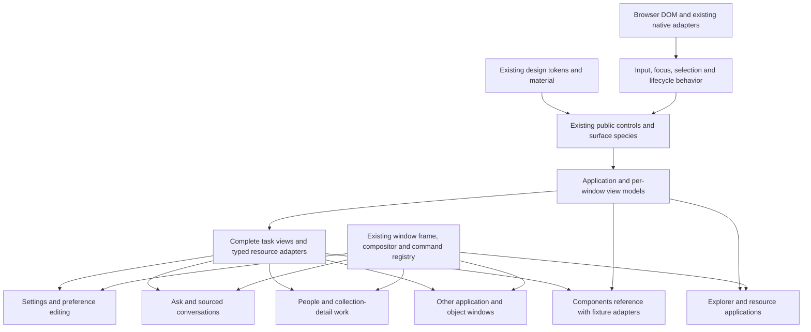

# Native-feeling HoldSpeak within the current stack

Research commissioned by the owner on 2026-10-23. Baseline: main
`787c55c8096f746b06a4c8d5d42ae48ef5c1fe20` (PR1428).

Owner direction: retain React; do not experiment with replacement UI stacks.
Invest heavily in the future of this stack and its UI/UX implementation to
build a nearly OS-native experience. This packet records research and a
proposed delivery architecture. Recommendations are not shipped capabilities,
new canon, or owner aesthetic acceptance.

## Current checkpoint: refine the strategy before further code

The owner clarified on 2026-10-23: finish the bounded repairs already underway,
then continue refining the plan and strategy before further implementation.
[STRATEGY.md](STRATEGY.md) is the resulting **DRAFT — UNCHECKED, awaiting
Muad'Dib**. It recommends concrete identity/lifetime, command-scope and state
ownership choices, a resource → Settings/Thought → sourced-Ask falsification
sequence, production/Components parity, and whole-job craft evidence.
The [delivery plan](DELIVERY-PLAN.md) now separates immediate design work from
later candidate implementation homes. The [advisory strategy review](checks/strategy-adversarial-2026-10-23.md)
preserves the objections and unresolved evidence. No recommendation in this
refinement has been acted on. Repair closeout is recorded in the synthesis.

## Result

Retain React/TypeScript/DOM, the current Desk compositor, Zustand, RuntimeBus,
FastAPI and native adapters. The investment is a desktop application
framework inside that stack: application/window identity and lifecycle,
selection, navigation, commands, transfer, editing, complete task views,
deliberate visual composition and measured rendering. PR1428
improved shared material and authority; it did not prove this target achieved.

The owner has authorized the stack direction and substantial research.
Implementation recommendations below remain proposed, not new canon or
shipped capabilities. No replacement toolkit, package addition, React upgrade,
platform wrapper, or product-code change is part of this research delivery.

## Owner clarification: applications, not contained pages

The owner clarified that the framework must serve native-feeling apps,
windows and explorers throughout the Desk. Preferences and conversations are
important views, but cannot define the whole architecture. The
[application model](APPLICATION-MODEL.md) now defines the missing common
contracts and an explorer-style acceptance workload. This extends PR1429's
first research packet; its Settings-first checkpoint alone was too narrow.

## Read this packet

| Record | Purpose |
| --- | --- |
| [Bounded repair closeout](checks/repair-closeout-2026-10-23.md) | Actual merged/deployed repairs, Astra post-merge reviews, proof limits and the parked Stop candidate. |
| [47 adversarial reviews](adversarial/README.md) | Individual whole-job, convergence and user-value reviews, corrected source assumptions and delivery priorities. |
| [Use-case behavior audit](USE-CASE-AUDIT.md) | Whole-product job/behavior matrix, current evidence, gaps and prioritized cross-application journeys. |
| [Inventory snapshot](USE-CASE-INVENTORY.json) | Reconciliation of the existing jobs, capability catalogue, recipes, manifest and object/specialized hosts; not a new runtime registry. |
| [Application model](APPLICATION-MODEL.md) | Desktop application/window/resource identity, lifecycle, selection, navigation, commands and cross-window operations. |
| [Experience principles](EXPERIENCE-PRINCIPLES.md) | Define the visible and behavioral qualities we mean by nearly OS-native. |
| [Current state](CURRENT-STATE.md) | Audit existing seams, reuse opportunities, gaps and baseline-specific source anchors. |
| [Interaction foundation](INTERACTION-FOUNDATION.md) | React roadmap, accessible behavior, asynchronous state and scoped library reuse. |
| [Browser and platform](BROWSER-PLATFORM.md) | Feature-specific compatibility, DOM/native boundaries and local performance proof. |
| [Delivery plan](DELIVERY-PLAN.md) | Concrete production adoption, measurable targets, dependencies and first work packages. |

Primary sources were checked on 2026-10-23. Vendor specifications and release
notes establish available mechanisms, not that HoldSpeak already uses them or
meets their performance claims. The browser matrix distinguishes partial or
future BCD entries from a deployable baseline. Source anchors describe the
named baseline and may drift. Root also ran an isolated three-engine capability probe, recorded in the
browser note and reproducible with `scripts/probe_ui_capabilities.py`. No
owner-state walk, performance benchmark, assistive-technology run or WebKit
application-task validation was performed.

## Whole-product use-case audit

The owner asked to audit all use cases. Existing sources describe 13 public
jobs, 87 catalogue capabilities, 117 cluster-qualified betterment slices,
and 25 manifest rows (21 active and four parked redirects). The behavioral
audit reconciles those sources and object/specialized hosts. It records which
shared application behaviors each family needs and distinguishes source
implementation, named tests, executed layout floors, and observed task quality.

This is coverage of the current declared product corpus, not a claim that
every state/gesture/provider combination has been exercised or that future
unwritten jobs are known. Audit shared behaviors once, map every declared
family to them, then prioritize real cross-application journeys by user cost
and reuse. Keep existing capability and recipe records authoritative.

## The architecture to invest in

These are responsibilities in the existing folders, not six new packages,
a serialized layout language, a second window registry, or a generic
application engine. Existing primitives remain useful. The missing common
layer is an application/view contract joining identity, navigation, selection,
commands and operations. Complete task patterns are shared views within it,
with explicit state, layout, focus, scrolling and recovery ownership.

For example, `ComposerWell` already owns arrangement while the caller owns
its draft and request. The next step is to share the conversation composition
and controller boundaries that Ask actually needs, preserving its backend
semantics. The reference should supply fixture data to that same pattern.
Copying a production-looking conversation into the reference would leave the
original divergence intact.

## Decision register

| Decision | Status | Consequence and reconsideration |
| --- | --- | --- |
| Keep the existing React stack; no replacement UI experiments | **Owner direction** | Investment improves this implementation. Reconsider only on a new owner instruction. |
| Application/view contracts and complete production patterns are the next framework investment | **Recommendation** | Prove explorer/resource behavior alongside preferences, then Ask and People; the reference consumes the same pattern code. Revisit an abstraction if it adds ceremony without a second useful consumer. |
| Retain proven behavior; reuse a mature headless primitive for a diagnosed gap | **Recommendation** | React Aria is an optional source of behavior behind the existing public control API. No default theme or blanket component migration. |
| Make layout/material ownership explicit | **Recommendation** | Frame owns head reservation and window physics; pattern owns composition; species owns paint and interaction states. Feature code supplies domain content and actions. |
| Preserve native DOM editing and the existing mic authority | **Existing canon plus recommendation** | Unify caret/selection insertion where semantics differ; retain audio recovery, composition and undo. No browser speech-service fallback. |
| Optimize measured scenes, not dependency novelty | **Recommendation** | Baseline first; then consider Compiler, deferred rendering, containment or virtualization where a trace supports them. |
| Treat new browser APIs as progressive enhancements | **Recommendation** | Keep a working Firefox path. Preserve the compositor's z/focus rules when evaluating top-layer menus. |
| Keep native presence disabled until repaired and explicitly re-enabled | **Current owner operation** | The broken panel was closed and `presence.enabled=false` persisted on 2026-10-23. Research does not re-enable it or claim its renderer repaired. |

A React upgrade is not a prerequisite. The repository locks React 19.2.7;
[React 19.3](https://react.dev/blog/2026/09/09/react-19-3) is now stable and
makes ViewTransition and Fragment Refs available for later targeted work.
The browser API and lifecycle contracts still require validation.
[Activity](https://react.dev/reference/react/Activity) destroys effects when
hidden, so blindly wrapping minimized windows can disrupt live-frame, focus,
subscription and microphone ownership. Compiler is a rendering optimization,
not a substitute for interaction or visual design.

## Ownership without more ceremony

The owner sets product direction and judges appearance on the live desk.
Muad'Dib's implementation workers build within settled briefs; Astra reviews
merged changes and fixes findings forward under CLAUDE's current fast cycle.
The framework maintainer owns the existing public surface API and reference;
a feature author owns domain rules, validation and operation outcomes.
Do not make the owner approve routine dependency or layout implementation
choices again, and do not create another committee or approval gate.

Build a useful pattern before adding a guard that forces adoption. Migrate a
real consumer in the same small change, then generalize from a second actual
consumer. If a terminal, editor, canvas or media control needs a bounded
exception, record its reason in the existing surface contract/adoption
inventory and retain the shared input/frame floors. Repeated exceptions mean
the framework needs work. No new exception registry or expiry machinery is
needed for this product stage.

The existing author map, UX-CANON and surface contract remain authoritative.
When an implementation lands, update its API, reference and actual consumer
record together. This packet is the researched direction and delivery backlog;
it does not silently amend existing canon.

## Evidence and dissent

Observed: the current framework has substantial useful machinery; reference
patterns do not yet establish complete production-pattern adoption; existing
Firefox/Chromium checks provide meaningful geometry and interaction evidence;
WebKit task proof and quantitative performance baselines are not established.
The native panel incident demonstrates that an OS-hosted WebView can still
fail visibly; its root cause was not established by disabling it.

Inference: the highest-value investment is stronger composition and behavior
ownership with consistent production adoption. React's available APIs support
that path. This is not proof that a proposed pattern will be pleasant or that
any optimization will help. The first production work packages must supply
that outcome evidence.

The completed PR1428 tape is red: 12 Python and nine browser failures; the
previous PR1427 tape had 13 Python and nine browser failures. Root compared
the actual failed-test names, not only the totals: three newly observed Room
393px checks expect an inline History tab that the new head folds; a fourth
new failure is a scheduled-microphone case whose cause this research does not
establish. Other cases no longer failed in that run. This run-to-run delta
is not proof of causal regression or repair. See the named artifacts in the
[current-state note](CURRENT-STATE.md). The full tape is not green, and source
conformance or screenshot bounds must not be reported as owner delight.

## First concrete checkpoint

Prove the application/view contracts in an existing repository or resource
browser alongside the shared Settings preference consumer. Demonstrate
independent window history and selection, contextual commands and supported
cross-window operations, with those same models in Components fixtures.
Produce paired task/visual/keyboard/voice evidence and a local timing baseline. The
[delivery plan](DELIVERY-PLAN.md) scopes this into small changes and names the
proof. Success is an owner completing resource and preference work across windows
with preserved state, coherent commands and an interface they like; it is not the number of new components.

No Vision Control portfolio was created or transitioned. Its framing and
adoption method was applied to the existing repository records; the packet
remains research until implementation supplies adoption and outcome evidence.

## Verification of this research delivery

Root ran the reproducible capability harness against all three installed
engines under an isolated HOME and the shared lock, and checked its results
against the recorded table. All nine changed Markdown files resolve their
local links and headings. Required quick: production build, 37 focused
documentation checks, 110 desk sweep cases, 27 canon and 1,126 repository
guards passed. Product web/backend source and dependency locks are unchanged.
These checks validate this delivery's records/tooling and existing layout
floors; they do not establish the proposed native-quality or timing targets.
