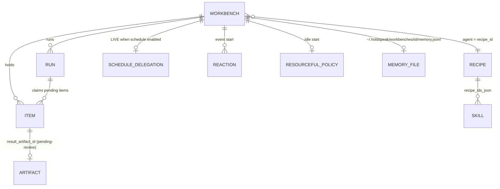

# Workbench: the model as it exists in code

Source map for the Workbench betterment. Read from `main` at `ebd2387b1`,
2026-10-17. No product code changed. No tests ran. Each claim cites
`file:line`. Items that this read did not prove are under **Unknown**.

**In one sentence:** a workbench is a named queue of text tasks. One saved
prompt (a "recipe", which the face calls an "Agent") answers each pending task
in one model call. A press, a cron schedule, a connector event or an idle
timer can start the run. Each answer becomes an artifact in `pending-review`
state, and no screen lets the owner review it.

---

## 1. What a workbench is, in data

### 1.1 Entities

| Entity | Table / store | Key fields | Source |
|---|---|---|---|
| **Workbench** | `workbenches` | `id`, `name`, `recipe_id`, `profile_id` (retired), `resolver_profile_id` (retired), `schedule` (cron text), `schedule_enabled`, `schedule_revision`, `item_order_json`, `deleted` (tombstone) | `holdspeak/db/schema.py:1726-1739` |
| **Item** | `workbench_items` | `title`, `body`, `priority` 1-5, `status`, `parked`, `grounding_json`, `context_json`, `result` (text), `result_egress_json`, `result_artifact_id`, `mint_attempted`, `tokens_consumed`, `claimed_at`, `completed_at` | `schema.py:1740-1760` |
| **Run** | `workbench_runs` | `started_at`, `completed_at`, item counts, `mint_failures`, `total_tokens`, `egress_boundary`, `model`, constitutional context revision and hash, `skills_injected_json`, `parent_operation_id`, `parent_receipt_id`, `child_links_json`, `status` | `schema.py:1761-1781` |
| **Agent** (recipe) | `recipes` | `name`, `avatar`, `role`, `system_prompt`, `user_template`, `tools_json`, `kb_id`, `manual_context`, `kind` (`''` or `'mode'`) | `schema.py:1414-1433` |
| **Skill** | `skills` | `title`, `body` (8 KB limit), `source` (owner-authored, agent-proposed), `status` (draft, active, archived), `recipe_ids_json` | `schema.py:1923`; limit `workbench_service.py:16` |
| **Memory** | a JSONL file, **not the DB**: `~/.holdspeak/workbenches/<id>/memory.jsonl` | `run_id`, `timestamp`, `kind`, `content`, `item_title`, `provenance`. Max 100 entries. A run reads the newest 20, up to 2048 bytes. | `holdspeak/workbench_memory.py:18-25,77-96` |
| **Output artifact** | `artifacts` + `artifact_sources` | `artifact_type='workbench_output'`, `status='pending-review'`, `origin='run'`, `source_run_id`, `source_item_id`; sources = the item and the recipe | `workbench_conductor.py:415-435`; `kernel/workbench_projection.py:34-37` |
| **Schedule delegation** | `kernel_schedule_delegations`, `kernel_schedule_ticks` | One LIVE row for each workbench. It freezes the recipe revision, the schedule revision, the cron and the route at the moment the owner enables the schedule. Local to the device; it never syncs. | `schema.py:1834-1852`; `services/schedule_delegation.py:114-130` |
| **Event start** ("Reaction") | `connector_reactions`, `reaction_event_projections` | `watch_id`, `event_pattern`, `workbench_id` (FK), `title_template`, `auto_run`, `enabled` | `schema.py:2676-2702` |
| **Idle start** ("Resourceful") | `resourceful_policies`, `resourceful_dispatches` | `idle_after_minutes`, `cooldown_hours`, `nightly_target`, night window, `routines` (`loose_ideas`, `failed_work`) | `schema.py:1791-1831` |
| **Engine** | inference assignments, subject `workbench:<id>`, capabilities `workbench.item` and `voice.reference_resolve` | Read for the face as `assignment_summary` | `workbench_service.py:699-714` |
| **Launch ownership** | `agent_launch_ownership` | Records which workbench and item refs a Conductor launch created. A launch can change only those refs. | `schema.py:1914`; `workbench_service.py:40-44,117-125` |

`docs/workbenches.json` is the published contract. It is out of date. It
names `profile_id` as the target (`docs/workbenches.json:9,50`). It does not
name parking, artifacts, memory, events or idle starts. It still says DELETE
removes an item (`:59`). In code, delete parks the item (`db/workbenches.py:362-387`).

### 1.2 States

**Item status** (`schema.py:1748-1749`): `pending`, `claimed`, `done`,
`failed`, `dismissed`. `parked` is a separate flag. You can park an item in
any status except `claimed` (`db/workbenches.py:334-337`).

**Run status** (`schema.py:1779-1780`): `running`, `completed`, `failed`,
`cancelled`, `indeterminate`. The runner copies the kernel receipt outcome to
the run (`services/workbench_runner.py:113-125`).

**Workbench:** no status of its own. It is "live" or tombstoned (`deleted=1`).
`schedule_enabled` is the only switch.

```mermaid
stateDiagram-v2
    [*] --> pending: Add item / template starter / event / idle routine
    pending --> claimed: Run claims it (BEGIN IMMEDIATE)
    claimed --> done: model answer staged + receipt; artifact minted
    claimed --> failed: grounding missing, or model call failed
    claimed --> pending: cancel or deadline before publish (claim released)
    pending --> dismissed: Dismiss
    done --> pending: "Re-run" (only re-queues)
    failed --> pending: "Re-run" (only re-queues)
    note right of pending
      parked is a flag on any state except claimed.
      Park / Restore never change status.
    end note
```





### 1.3 Lifecycle: create, items, config, run, result, schedule

1. **Create.** "New Workbench" opens a chooser before any record exists
   (`web/src/desk/store/dataSlice.ts:318-319`;
   `web/src/desk/components/NewWorkbenchChooser.tsx:1-8`). The owner picks a
   template or Blank. Blank posts `{name: "New Workbench"}`. A template
   **copies** a new recipe each time (`workbench_service.py:452-456`), adds
   starter items, and links seeded skills by title (`:469-480`). The template
   cron goes into `schedule`, but `schedule_enabled` stays false (`:460-462`).
2. **Items.** Sources of items: the inlet (typed or spoken), drag of a desk
   object (meeting, artifact or note becomes grounding,
   `WorkbenchWindow.tsx:1497-1533`), MCP `workbench.add_item`, an event
   Reaction (`services/reaction_service.py:573-582`), an idle routine
   (`services/resourceful_service.py:171-229`). The inlet cuts the title to 64
   characters and keeps the full text as the body
   (`WorkbenchWindow.tsx:1329-1343`). `@` adds zone references as grounding.
3. **Config.** Agent (`recipe_id`), engine (inference assignment), start mode,
   schedule. A change to schedule, enabled flag or recipe increments
   `schedule_revision` and revokes the LIVE delegation
   (`workbench_service.py:150-175`). Only the owner can enable a schedule
   (`:111-112,152-153`).
4. **Run.** `POST /api/workbenches/{id}/run`
   (`web/routes/primitives/workbenches.py:227-241`) goes to
   `WorkbenchRunner.run` (`workbench_service.py:386-398`). The runner:
   - refuses with a plain dict if no recipe is bound (`workbench_runner.py:185-186`);
   - takes **all** pending, unparked items in priority order (`:192`;
     `db/workbenches.py:282-306`);
   - opens a kernel parent run with a **60-second deadline for the whole
     batch** (`workbench_runner.py:179,202`);
   - for each item: claims it, hydrates grounding (refuses the item if an
     explicit source is missing, `workbench_conductor.py:184-214`), builds one
     prompt from `[CONTEXT]` (recipe manual context + KB), `[MEMORY]`,
     `[GROUNDING]`, `[TASK]` title and body (`workbench_runner.py:317-318`),
     and makes **one model call with 512 reserved output tokens and no tools**
     (`:320-332`);
   - then makes a second, small model call that asks "what ONE thing should
     future runs remember?" and appends the answer to memory
     (`:358-375`; `kernel/workbench_projection.py:38-42`).
   The items are independent. No step sees the answers of other items.
5. **Result.** The projection writes `status='done'`, `result`, egress and a
   new `workbench_output` artifact in `pending-review` in one transaction
   (`kernel/workbench_projection.py:34-37`). The run row gets counts, model,
   egress and receipt links (`:46-58`; `workbench_runner.py:113-125`). Five
   live frames go to the desk: `run_start`, `item_claimed`, `item_done`,
   `item_failed`, `run_complete` (`workbench_conductor.py:87-142`).
6. **Schedule.** One daemon thread ticks every 60 seconds
   (`workbench_conductor.py:522-528`). For each enabled workbench whose cron is
   due it calls `run_scheduled` as the SCHEDULER principal
   (`:548-574`). That run uses the route frozen in the delegation, not the
   current engine assignment (`workbench_runner.py:39-54,204-211`;
   `schedule_delegation.py:127-129`). The same tick also processes connector
   Reactions, Resourceful idle policies and the Project Steward
   (`workbench_conductor.py:576-654`).

---

## 2. What it can actually do: the shipped templates

Templates live in Python (`holdspeak/workbench_templates.py:9-127`), not in
`docs/workbenches.json`. Each template is a system prompt, a cron, skill names
and starter items. The runner gives each item one prompt and one answer. The
agent has no tools, no repository, no calendar and no web. It sees only the
item text, explicit grounding (meetings, artifacts, zones), recipe context,
memory and a recall query (`workbench_conductor.py:194-205`).

| Template | Inputs it expects | What it really produces | Where the output goes | Gap between promise and code |
|---|---|---|---|---|
| **TODO Agent** (`workbench_templates.py:10-39`), cron `0 2 * * *` | Free-text tasks. Starters: "Review open PRs", "Summarize yesterday's meeting notes", "Draft the weekly status update". | One markdown answer for each item. | Item `result` + a `pending-review` artifact. | No starter carries grounding. The agent cannot see PRs (no tools, no GitHub source). "Yesterday's meeting notes" works only if recall finds them. Schedule not enabled. |
| **Triage Agent** (`:40-63`), manual | Items to classify. No starters. | One label (ACT NOW / THIS WEEK / BACKLOG / DISMISS) + one line, as text. | Same. | The label is prose. Nothing moves, re-prioritises or dismisses the item. Triage of real inputs needs an event start to fill it. |
| **Meeting Prep Agent** (`:64-93`), cron `0 7 * * 1-5` | One item per upcoming meeting. Starters: "Monday standup", "1:1 with manager". | A prep pack for each item. | Same. | No calendar link. Starters are static titles; they do not change each week. Overlaps People 1:1 brief and the practice recipe Preparation brief (section 5). |
| **Morning Brief** (`:94-126`), cron `0 7 * * 1-5` | Starters: "Yesterday's meetings", "Open workbench receipts", "Delivery status". | One answer for each item. | Same. | The prompt asks for a "Today's focus" section "after processing all items" (`:108-109`). Items run separately, so no call sees all items. No source gives "workbench receipts" or "delivery roadmap" to the model. Overlaps the Today brief and Monday brief. |

**Where outputs go, for all templates:** item `result` (shown in the item
card), plus one artifact per item with `status='pending-review'`
(`workbench_conductor.py:422-423`). The artifact opens in the Artifact pullout,
which shows "Awaiting review" and has no accept or reject verb
(`web/src/desk/pullouts/ArtifactPullout.tsx:28-29`). The needs-you aggregate
does not read workbench items or artifacts (no match for "workbench" or
"artifact" in `holdspeak/services/needs_you_aggregate.py`). There is no
delivery, no send, no notification at run end in this path.

The idle routines (`resourceful_service.py:171-229`) are a second kind of
"template": "Develop loose idea" from the Loose Ideas zone, and "Prepare
recovery plan" for failed items on **other** workbenches.

---

## 3. Every user-facing verb and setting

Status key: **OK** works as named. **MISLEADING** works, but the name or
placement says something else. **DEAD** no backend effect, or no reachable
use. **DUP** a second path to the same thing.

### 3.1 Workbench-level

| Verb / setting | Where | Backend effect | Status |
|---|---|---|---|
| New Workbench | desk menu (`verbRegistry.ts:247-256`), Home "+ Create" (`WorkbenchesHomeCore.tsx:89-95`) | Opens the chooser; template = new recipe copy + workbench + items | OK. Each template press adds one more recipe copy to the Agents list (`workbench_service.py:452`). |
| Template card meta | `WorkbenchTemplatePicker.tsx:120-124` | Shows `⏱ 0 2 * * *` raw cron | **MISLEADING**: shows a cron as if it were on; instantiate keeps it off (`workbench_service.py:461-462`). |
| Rename (title edit) | `WorkbenchWindow.tsx:1588` | `PUT name` | OK |
| ▸ Run | title bar (`:1620-1636`); empty Runs wing "Run now" | Runs **all** pending items, 60 s deadline | OK, with a risk: one deadline for the whole batch (`workbench_runner.py:179`). The face also gives up after 60 s (`WorkbenchWindow.tsx:1374-1380`). |
| Cancel run | `POST .../runs/{op}/cancel` (`routes/primitives/workbenches.py:243-250`) | Cancels the parent | **DEAD in face**: no web caller. |
| Delete workbench | `DELETE /api/workbenches/{id}`; MCP `workbench.delete` | Tombstone | **No face verb.** The window has no delete or park for the workbench itself. |
| Configure / Choose agent | config strip (`WorkbenchWindow.tsx:192-244`) | Opens the panel; panel replaces the wing body | OK, but config hides items while open (`:1678,1698`). |
| Agent picker | `:363-425` | `PUT recipe_id`; bumps schedule revision, revokes delegation | OK. The word "Agent" here means a saved prompt. |
| Engines: Item assignment | `:430-440` | Subject assignment `workbench.item` | OK for manual runs. **MISLEADING** for scheduled runs: they keep the route frozen at enable time (section 1.3 step 6). |
| Engines: Reference assignment | `:441-449` | Subject assignment `voice.reference_resolve` | Works. Its only user is the inlet's voice "smart path" that maps spoken names to zones (`workbench_service.py:563-643`). A second engine setting for a minor helper. |
| Starts when: Manual / Schedule / Event / Idle | `:454-499` | A face-only mode. Selecting a mode **switches off** the other start kinds (`:297-328`) | **MISLEADING**: the backend allows schedule + events + idle at once. The face invents exclusivity and writes "pause" to the others. |
| Schedule preset | `:465-475`; presets `:155-161` | `PUT schedule` | OK |
| Schedule enabled | `:478-486` | Owner gesture creates a LIVE delegation (`workbench_service.py:128-138`) | OK |
| Event automations | `WorkbenchAutomations.tsx:17-29` | Creates a connector Reaction; GitHub review requested only | OK, one preset. Jira shows as unavailable. |
| Idle / Resourceful | `WorkbenchResourceful.tsx:10-21` | Policy; routines admit one item and run it at night | OK. "Prepare recovery plans" reads failed items of **other** workbenches (`resourceful_service.py:208-210`). |
| Skills (fold) | `WorkbenchWindow.tsx:503-545` | Read-only list of the recipe's skills | **MISLEADING**: "Edit in Agent" opens the Recipe pullout, which has no skill UI. `updateSkill` has no caller (`web/src/desk/api.ts:1173`). |
| Workspace (fold) | `:548-552` | Prints `~/.holdspeak/workbenches/<id>/` | **DEAD**: text only. The folder holds only `memory.jsonl`. The RFC workspace (repo, run files) was never built (`PLAN_WORKBENCH_ARCHITECTURE.md:63-89` vs `:535-540`). |
| Runs wing | `workbench/WorkbenchRunsWing.tsx` | Lists runs: counts, egress, model, tokens | OK, thin. A row does not list its items or outputs. `cancelled` and `indeterminate` show as FAILED (`:53-58`). |
| Memory wing: Clear | `WorkbenchWindow.tsx:1989-2000` | Deletes the JSONL file (`workbench_memory.py:99-108`) | OK. Not recoverable (it is a hard delete, against the park rule). |
| Memory: Promote to skill | `:2036-2042` | Creates a **draft** skill (`workbench_service.py:554-558`) | **DEAD in effect**: the runner injects only active skills (`workbench_runner.py:245`; `db/workbenches.py:636-641`), and no face can activate a draft. |
| Memory badges LESSON / PREF / OBS | `:2006` | Only `observation` is ever written (`kernel/workbench_projection.py:42`) | **DEAD** branches. |
| Voice: add, run, dismiss, set agent, set schedule, clear done | `voice/grammars/workbench.ts`; `WorkbenchWindow.tsx:1411-1486` | Same writers as the buttons | **DUP** (by design), OK. |
| Drop desk object | `:1492-1534` | Adds an item with grounding | OK |

### 3.2 Item-level

| Verb | Where | Backend effect | Status |
|---|---|---|---|
| Add (Enter) | inlet `:1715,1857` | `POST items` | OK |
| P1/P2/P3 cycle | `:1704-1712` | Priority 1-3; DB allows 1-5 (`db/workbenches.py:252`) | OK |
| Status chip "NEEDS REVIEW" on a pending item | `:180-181` | `pending` = not yet run | **MISLEADING**: it says the opposite of the state. |
| Body edit | `:654-704` | Debounced `PUT body` | OK |
| Re-run | `:651,883-890` | Sets `status=pending`, clears result. **Does not run.** | **MISLEADING**: it only re-queues. The owner must press Run, which runs every pending item. |
| Dismiss | `:652,892-895` | `status=dismissed` | OK, but overlaps Park (two "put away" verbs). |
| Park / Restore / Clear done | `:896-902,1908-1920`; `ParkedStrip` | `parked=1/0` | OK. "Clear done" also parks dismissed items. |
| "Review needed" chip | `:823` | Artifact is `pending-review` | **DEAD END**: no review verb anywhere. The `workbench_triage` kernel codec (accept, reject, rework) is registered (`kernel/runtime.py:107`) and has no caller. `WorkbenchTriage.test.tsx:10-26` tests a copy of logic that the card does not contain. |
| Open artifact | `:815-818` | Opens the artifact pullout | OK, leads to the dead end above. |
| Retry mint | `:861-871`; `workbench_service.py:325-384` | Mints a missing artifact | Rare repair verb on the main card. |
| Keep (legacy) | `:873-882` | `POST /api/recipes/{id}/keep` | Legacy for pre-Phase-118 items only. **DUP** of mint. |
| Copy | `:812` | Clipboard | OK |
| Why | `WhyControl` `:765` | Explains the work ref | OK |
| (any caller) `update_item status/result` | `workbench_service.py:234-259`; MCP `workbench.update_item` | Can set `status` and `result` to any value | Model hole: an agent can mark an item done with any text. |

### 3.3 Dead or vestigial backend pieces

- `profile_id`, `resolver_profile_id`: retired. Writes are refused after the
  assignment migration (`workbench_service.py:75-92`). The columns stay.
- `item_order_json`: no reader. `_wb_fields` resets it to `[]` on every update
  that omits it (`workbench_service.py:729`).
- `context_json`: written, never read by the runner (`workbench_runner.py:317`).
- `has_active_items` checks status `'running'`, which items can never have
  (`db/workbenches.py:392`).
- `recipes.tools_json`, `user_template`: the workbench runner ignores both
  (`workbench_runner.py:240,317-320`).
- `workbench_triage` codec: registered, no caller (above).
- `web/src/features/workbench/model.ts` (142 lines): a node-graph Workflow
  model. No file imports it. It is a remnant of the older "Workbench" that
  meant the workflow editor (`schema.py:1445`: "a saved Workbench workflow").

### 3.4 MCP surface

Ten tools: `workbench.list`, `get`, `create`, `update`, `delete`, `add_item`,
`update_item`, `delete_item` (parks), `list_runs`, `run`
(`holdspeak/mcp/tools.py:153-174,256-262`). No MCP tool for templates,
memory, skills, park/restore of many, cancel or item run. `workbench.update`
accepts `id`, `name`, `recipe_id`, `schedule`, `schedule_enabled`,
`schedule_revision`, `item_order` (`tools.py:232-243`). Reactions name a
`workbench_id` (`mcp/families/reactions.py:46-50`).

---

## 4. The face

### 4.1 Entry points

- Home application "Workbenches", `/workbenches`
  (`web/src/desk/applications.ts:287-300`) mounts `WorkbenchesHomeCore`.
- Desk menu "New Workbench" (`verbRegistry.ts:247-256`).
- A workbench window id `workbench:<id>`, lazy mounted by `DeskApp.tsx:62-64,97`.
- Parked items appear in the global Parked drawer
  (`web/src/desk/drawer/ParkedDrawer.tsx:41`).

### 4.2 Component tree and files

```
WorkbenchesHomeCore (pages/cores/WorkbenchesHomeCore.tsx, 210)
├─ hero verb "+ Create"  → NewWorkbenchChooser
├─ card grid (Button chrome .wb-home-card) → openWorkbenchWindow
└─ RECENT RUNS SurfaceLedger (first 10 workbenches × 5 runs, one fetch each)

NewWorkbenchChooser (desk/components/NewWorkbenchChooser.tsx, 35)
└─ WorkbenchTemplatePicker (desk/components/WorkbenchTemplatePicker.tsx, 147)

WorkbenchWindow (desk/components/WorkbenchWindow.tsx, 2097)
├─ DeskWindowFrame  title=EditInPlace  icon=AgentAvatar|sprite  actions=▸ Run
├─ SurfaceWings: Items | Runs | Memory
├─ ConfigStrip (collapsed)            ── :192-244
├─ ConfigPanel (replaces the wing)    ── :246-555
│  ├─ Agent: FoldGadget + search + SurfaceRows of recipes
│  ├─ Engines: 2 × ContextualAssignment
│  ├─ Starts when: CycleGadget mode
│  │  ├─ Schedule: CycleGadget + CheckGadget
│  │  ├─ Event: WorkbenchAutomations (219)
│  │  └─ Idle: WorkbenchResourceful (238)
│  ├─ Skills: FoldGadget, read-only
│  └─ Workspace: FoldGadget, a path string
├─ Items wing
│  ├─ Add item inlet: GadgetGroup + MicButton + PadGadget(combobox)
│  │  + InletAutocomplete (@ zones) + resolver state + ref tray
│  ├─ ParkedStrip
│  ├─ WorkbenchItemCard × n          ── :599-907
│  │  head: priority chip, title, LedMeter, StateChip, WhyControl
│  │  open: Instruction Pad, grounding chips, RESULT Material,
│  │        verbs Retry mint | Keep | Re-run | Dismiss | Park
│  ├─ Clear done
│  └─ voice proposal strip (Confirm / Cancel)
├─ Runs wing: WorkbenchRunsWing (workbench/WorkbenchRunsWing.tsx, 101)
│  + run state machine workbench/runLifecycle.ts (292)
├─ Memory wing: SurfaceLedger of entries, Clear (ConfirmVerb), Promote
└─ SurfaceFooter: Choose an engine | receipts | "n ITEMS · last run …"
```

Other files: `desk/components/workbench-config.css` (717 lines, also styles
Home and the picker), `desk/voice/grammars/workbench.ts` (80), API wrappers in
`desk/api.ts`, types in `desk/detail-types.ts`. About 25 test files cover the
face (`desk/components/__tests__/workbench*.test.tsx`, `WorkbenchTriage.test.tsx`,
`workbench/*.test.tsx`, `pages/cores/__tests__/workbenchesHome.test.tsx`).

**Not the feature, same name:** `web/src/components/signal/WorkbenchSelect.tsx`
(216) and `.css` (42) are the design-system dropdown ("Workbench" = the visual
language). `web/src/features/workbench/model.ts` (142) is an orphan workflow
graph model.

Total feature face: about 3,900 lines of TSX/TS plus 717 lines of CSS. One
file, `WorkbenchWindow.tsx`, holds 2,097 of them: the window, the config
panel, the item card, the inlet with its own autocomplete keyboard handler
(`:1802-1860`), drag-and-drop, voice dispatch and six data hooks (`:952-957`).

### 4.3 States it renders

- Home: loading, read error (+ retry), runs error, empty "No workbenches yet",
  cards with ITEMS / PENDING / DONE / FAILED / IN PROGRESS, needs-you mark,
  "Uses …" engine chain or repair text, schedule label, recent runs.
- Chooser: templates loading, error, empty, creating, created + desk read
  failed.
- Window: no detail, read error, run in progress (`SurfaceState loading` at
  the top of the body, `:1663`), config collapsed or open, unbound agent, no
  engine (footer door + lamp), Items empty, Parked on, drop hover accept or
  refuse, resolver loading or error, voice proposal; item pending, claimed
  (LED "WORKING"), done, failed (ERROR line), dismissed, mint failed, legacy;
  Runs empty (bind agent / choose engine / run now), list; Memory loading,
  error, empty, list.

### 4.4 Library use and bypasses

Uses: `Button` (Signal), `DeskWindowFrame`, `SurfaceWings`, `SurfaceFooter`,
`SurfaceState`, `SurfaceRows/Row`, `SurfaceLedger/Row`, `GadgetGroup`,
`GadgetRow`, `PadGadget`, `StringGadget`, `CycleGadget`, `CheckGadget`,
`FoldGadget`, `LampGadget`, `LedMeter`, `EgressChip`, `StateChip`,
`ConfirmVerb`, `EditInPlace`, `Material`, `ParkedStrip`, `ParkReceipt`,
`MicButton`, `AgentAvatar`, `WhyControl`, `ContextualAssignment`.

Bypasses and local species:

- 16 raw `desk-chip` class uses in `WorkbenchWindow.tsx`, including verbs
  dressed as chips (`Button variant="chrome" className="desk-chip"`, 11
  chrome Buttons): Run, Retry mint, Keep, Re-run, Collapse, Edit in Agent,
  Promote, Confirm, Cancel. These look like badges, not verbs.
- Status uses three species for one fact: `StateChip` on items and Home runs,
  a raw `desk-chip` span with `data-tone` in the Runs wing
  (`WorkbenchRunsWing.tsx:53-58,81-84`), and `LedMeter` for claimed.
- A local `ConfigStrip` and `wb-config-*` layout, not a library header.
- Unicode glyphs as icons: `⏱ ⏸ ▴ ▸ ▣ ○ ◇ ⊞` and template icons `⚡ ◈ ▣ ☀`
  (`workbench_templates.py:14,44,68,98`).
- A raw `` sprite fallback icon (`WorkbenchWindow.tsx:1604-1609`).
- Two copies of `humanSchedule` with the preset table
  (`WorkbenchWindow.tsx:171-176`; `WorkbenchesHomeCore.tsx:27-36`).
- `WorkbenchesHomeCore` makes up to 11 HTTP reads on each load and on each
  desk change (`:52-75`).

---

## 5. Overlaps

The root problem is visible here. HoldSpeak has at least seven ways to "give
text and sources to a saved prompt and get an answer". They differ in
persistence and trigger, not in what the model does.

| Feature | What it is in code | From the user's view | Overlap with Workbench |
|---|---|---|---|
| **Agent (recipe)** | Saved prompt + context + KB (`schema.py:1414`). `recipe.run` = one prompt, mints an artifact; `recipe.chat` = chat (`services/recipe_service.py:94,173`). | "New Agent", Agents app. | A workbench item run **is** a recipe run with a queue in front of it. Same recipe, same skills injection (`recipe_service.py:230` vs `workbench_runner.py:240`), same artifact mint. The face calls the recipe "Agent" in both places. |
| **Thread modes** | A recipe with `kind='mode'` and a tool allow-list (`services/thread_modes.py:1-12`). | Mode picker in Thread. | The same `recipes` table holds personas for two features with two behaviours (no tools in Workbench, tools in Thread). |
| **Thread** | Chat with up to 10 tool passes over the desk MCP (`services/thread_service.py:1-11`). | "New Thread". | Thread can act (tools); a workbench item cannot. A user who wants "do this task" gets a weaker agent in the feature named for tasks. |
| **Ask** | One grounded question over desk sources (`services/ask_service.py`). | "Ask AI". | A workbench item with grounding is an Ask with a queue. Same grounding hydrator (`workbench_conductor.py:160-205` names "the same hydration pipeline as the recipe chat endpoint"). |
| **Thought** | A raw idea refined into a working note with attached context and review (`services/refinement_thought_service.py`). | Thought window. | The Resourceful "Develop loose idea" routine does Thought's job on notes in the Loose Ideas zone, and puts the answer in a workbench, not on the note. |
| **Sequence (chain) / Workflow** | A chain = ordered recipe steps; a workflow = a linear node graph (`schema.py:1436-1454`; `services/sequence_workflow_service.py:312,524`). | "New Workflow" sits next to "New Workbench" in the desk menu (`verbRegistry.ts:236-256`). | Workflows are multi-step over one input; workbenches are one step over many inputs. Neither has the other's half. The schema comment still calls a workflow "a saved Workbench workflow" (`schema.py:1445`). Both have a 60 s deadline (`sequence_workflow_service.py:324`). |
| **Practice recipes** | Three Python descriptors: Preparation brief, Decision review, Weekly update (`services/recipe_catalog.py:368,461,553`); `practice_recipe.*` on MCP. | Under Automations. | **Same job, two names**: Meeting Prep Agent template vs Preparation brief; TODO "Draft the weekly status update" vs Weekly update. The catalog's own docstring warns that "recipe" means two different things (`recipe_catalog.py:1-12`). |
| **Cadence loops ("Rhythm")** | Open loops from meeting actions and decisions with priority, snooze, close and a drafted next action (`schema.py:1964-2010`; `services/cadence_service.py`). | Rhythm app, Today. | **Same job, two names**: Triage Agent labels items ACT NOW / THIS WEEK / BACKLOG in prose; cadence loops already hold real priority, snooze and close states. Workbench items have priority and status but no snooze or due date. |
| **Briefs** (Today, Monday brief) | Generated briefs (`monday_brief_*` MCP; Today app). | Today. | **Same job, two names**: the Morning Brief template. |
| **Conductor** | Launches external coding agents (Claude Code, Codex, pi) on an item; a launch may create and edit only its own workbenches and items (`services/conductor_launch.py:1-25`). Desk app "Conductor: your coding agents". | Conductor window. | Conductor agents can really do "Review open PRs"; the TODO template cannot. **Name clash**: `holdspeak/workbench_conductor.py` is the 60-second scheduler thread, unrelated to the Conductor app. |
| **Watches, Reactions, Steward, Heartbeat** | Connector polling and event rules; project steward; a sweep scheduler. | Accounts, Project room, Rhythm. | Reactions and the Steward run inside the **workbench** scheduler tick (`workbench_conductor.py:576-654`). Watches run on the Heartbeat instead (`:610-619`). Four schedulers exist: workbench cron, heartbeat, steward, scheduled recording. |

**Overloaded words**

- **"Workbench"** means four things: (1) this feature; (2) the visual language
  and kit ("Workbench 2.0", the square "Workbench listbox";
  `docs/internal/WORKBENCH-PICKERS-2026-10-14/README.md:5-7`,
  `web/src/components/signal/WorkbenchSelect.tsx`); (3) the old workflow graph
  editor (`schema.py:1445`, `web/src/features/workbench/model.ts`);
  (4) Delivery Workbench, the `dw` roadmap tool.
- **"Agent"** means three things: a recipe (a saved prompt), a Conductor coding
  agent (a real process with tools), and a Thread mode.
- **"Conductor"** means the coding-agent app and the workbench scheduler.
- **"Recipe"** means an Agent and a practice recipe (`recipe_catalog.py:3-12`).
- **"Review"**: "NEEDS REVIEW" on a pending item, "Review needed" on a done
  item, "Awaiting review" on its artifact, and no review verb.

---

## 6. Constraints for a redesign

### 6.1 Easy (the backend already supports it)

- **Run one item.** `WorkbenchService.run_item` admits exactly one item with a
  600 s deadline (`workbench_service.py:400-424`). Events and idle routines use
  it. The face does not. A real "Run this item" or a true "Re-run" is a face
  change plus one route.
- **Several start kinds at once.** Schedule, Reactions and Resourceful are
  separate rows. The "one mode" rule is only in the face (`WorkbenchWindow.tsx:297-328`).
- **Live progress.** Five run frames exist with index and total
  (`workbench_conductor.py:87-142`).
- **Provenance.** Each item output has a kernel receipt, route egress, model,
  and an artifact with sources (`workbench_projection.py:22-43`).
- **Park, never delete,** for items, atomic in bulk (`db/workbenches.py:308-360`).
- **Grounding.** Items accept `meeting_ids`, `artifact_ids` and qualified
  `refs` up to `GROUNDING_MAX_REFS`, and fail honestly when a source is missing
  (`workbench_conductor.py:174-214`).
- **Cancel.** The route exists (`routes/primitives/workbenches.py:243-250`).
- **Templates** are a plain Python list (`workbench_templates.py:9`); adding
  grounding, enabled schedules or different starters is data, not code.

### 6.2 Costly

- **Cross-item synthesis** (a brief that reads all items) needs a new run
  shape: the runner makes one independent call per item (`workbench_runner.py:248-375`).
- **Tools or real actions** for a workbench agent: the runner uses the plain
  prompt adapter with no tool loop (`:328-332`). Thread has the tool loop;
  sharing it means joining two execution paths and their kernel budgets.
- **Renaming tables or the `workbench` kind.** It is a kernel parent kind
  (`schema.py:3450`), an assignment subject kind (`schema.py:2914`), a
  capability id (`workbench.item`), an FK target (`schema.py:2681,2697,1792`),
  a launch-ownership ref prefix, an MCP family, a desk window id prefix and a
  live-frame prefix. Rename the face, not the store.
- **Changing the schedule model.** Enabling a schedule writes an owner
  delegation with a frozen route in the same transaction
  (`workbench_service.py:128-138`; `schedule_delegation.py`). Any change to
  what "enabled" means touches kernel authority.
- **The 60-second batch deadline** (`workbench_runner.py:179`) and the 60 s
  face timeout (`WorkbenchWindow.tsx:1374-1380`) shape what "Run" can promise
  for a local model. Unknown: real run times on the owner's engine.

### 6.3 Data we must not lose

- `workbench_items.result`, `result_egress_json`, `result_artifact_id` and the
  `workbench_output` artifacts with their `artifact_sources`.
- `workbench_runs` rows with `parent_operation_id`, `parent_receipt_id`,
  `child_links_json` (the receipt chain). Retry mint reads them
  (`workbench_service.py:340-358`).
- Parked items (`parked=1`): the never-delete rule.
- **Memory files** at `~/.holdspeak/workbenches/<id>/memory.jsonl`. They are
  outside the DB, outside backup by the DB, capped at 100 lines, and "Clear"
  deletes them for good (`workbench_memory.py:21-25,99-108`).
- Skills, including agent-proposed drafts, and their `recipe_ids_json` links.
- Recipes created by template instantiation (owner may have edited them).
- `kernel_schedule_delegations` (device-local owner authority; never sync).
- `connector_reactions`, `reaction_event_projections`,
  `resourceful_policies`, `resourceful_dispatches` (they stop rediscovery of
  the same event or idea).
- Subject inference assignments for `workbench:<id>`.

---

## 7. Past design decisions still in force

From `docs/internal/WORKBENCH-PICKERS-2026-10-14/` (about the kit, not this
feature) and `docs/internal/ACCOUNT-WORKBENCH-2026-10-15/`:

- Every choice control uses the library `CycleGadget` with the square
  library listbox, never a browser-native popup (`WORKBENCH-PICKERS.../BRIEF.md`).
- The inlet is a named inset "Add item" group: visible Instruction label,
  auto-growing multiline `PadGadget` as a combobox, the grammar `MicButton`,
  a P3→P1 priority cycle and a primary Add. Enter adds; Shift+Enter is a
  newline; autocomplete keys win over Add (`ACCOUNT-WORKBENCH.../DESIGN.md`,
  Workbench section). The inlet mic is on a named `MIC_ALLOWLIST` entry
  (`BUILD-WORKBENCH.md`, "Mic canon follow-up").
- Config is three inset groups (Agent, Engines, Starts when). A bound agent
  shows its identity above a folded chooser; an unbound chooser starts open.
  Skills and Workspace are folds. No helper prose.
- Item cards use paper material, readable sans names, a labelled Instruction
  editor, one result reader and a real "Open artifact" door. Keep every
  pending-save fence and the draft custody (newer edits survive a refusal).
- Run doors agree: a known missing engine shows "Choose engine", never "Run
  now", in both the title bar and the empty Runs wing.
- Home calls only real `done` items DONE; claimed and failed never inflate it;
  running runs say Running. No inferred DONE when items are absent.
- Park, never delete, for items (PHILO-13-02): one press, Restore undoes it,
  and the outcome is a footer receipt.
- Those passes changed layout and states only. They did not question the
  model (`docs/internal/betterment/README.md`, "Why this format").

---

## Unknown

- Real run time per item on the owner's engine, and so whether the 60 s batch
  deadline cuts normal runs short. Not measured.
- Whether the constitutional context reaches the workbench prompt. The run
  records its revision (`workbench_runner.py:376`); the injection appears at
  the engine layer (`holdspeak/intel/engine.py:854-855`). The path from
  `CanonicalPromptAdapter` to that engine was not traced.
- Whether a refused scheduled run (revoked or missing delegation,
  `workbench_runner.py:394-406`) shows anywhere on the face.
- How the owner's live desk looks today; no screenshots were taken in this map.
