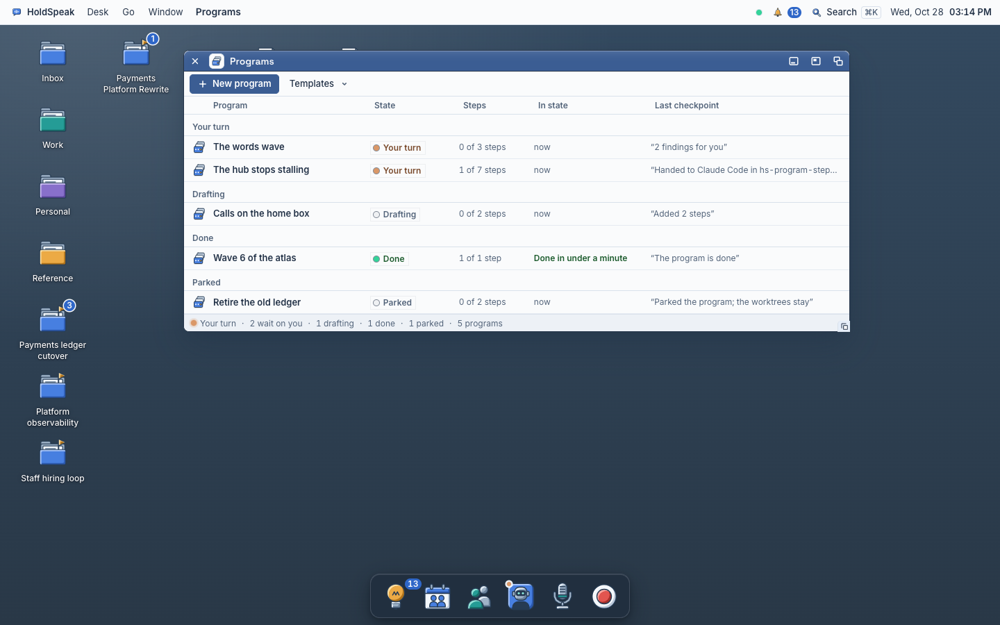
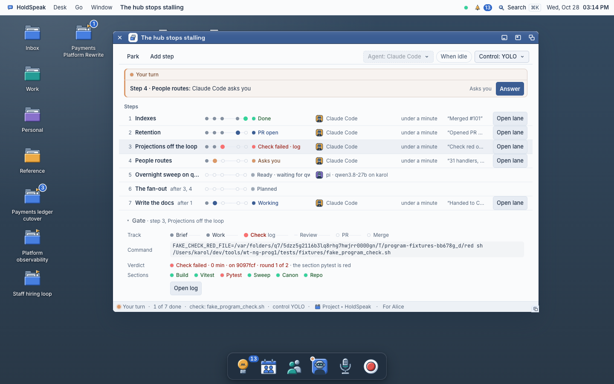

# Programs

A program is a goal cut into steps. An agent does each step in its own worktree.
HoldSpeak runs the configured check and review gates, opens a pull request when
the step has a PR gate, and merges only when the step's merge gate and Control
level allow it. What only you can do waits for you in **Needs you**. The program
keeps a note on your desk that tells its state in plain words.

Use a program when one goal is too big for one agent: "make the hub stop stalling", "the words wave", "wave 6 of the atlas".



*The Programs window. The programs that wait on you are on top.*

## What a program has

| Part | What it is |
|---|---|
| **Program** | A goal, a repository, a base branch, a control level, the steps and a handover note. |
| **Step** | One bounded part of the goal: a brief, the files it owns, the agent that does it, an effort and a gate. One step is one agent in one worktree. |
| **Gate** | The step's independent check, review (`none`, `agent`, or `person`), and merge (`level`, `owner`, or `none`) settings. A `none` merge gate finishes without a PR. |
| **Requirement** | One sentence that you want true, on a step, on every step or on the whole program, with the way HoldSpeak proves it: a command, the reviewer's answer, a shot of a window, your word, or a measured number. See "Requirements". |
| **Checkpoint** | One line that the agent, HoldSpeak or you write on a step at an important moment. |
| **Your turn** | A thing that only you can do: merge, decide a finding, resume a parked step, answer a core question. |
| **Handover note** | A desk note named "Program: <title>". HoldSpeak writes it again after each change. |

## Start a program

### From a goal

1. Open **Go ▸ Programs** (after Agents), or press ⌃7.
2. Press **New program**. The Program window opens in **Drafting**.
3. Press the goal at the top and type it. Choose the repository (or a project, which gives its repository).
4. Add the steps. Each step is one row; press it to open it in place: its title, agent, effort and "after", its brief, its **Gate** (the check, the review, who merges) and **What it must prove**. Paste a brief for each step. Give each step the files it owns. A step can start after other steps ("after 2, 3"). Or press **Plan it**, and the engine drafts the steps for you (see "Plan it from a goal"). Press **Ask me first** if you want the engine to ask you some questions before it plans (see "The interview rounds").
5. Press **Start**. Under it the window says what Start checks first: the repository, the remote (when a step opens a pull request) and the check command.

### From one action of a project

In a project's Room, an action's row has **Run as a program**. HoldSpeak makes a program in Drafting from that one action: the action's words are the goal, it runs on the project's repository, and its person is the action's owner when exactly one person has that name. The program window opens. When the program's pull request merges, the action closes. Tools and scripts use `POST /api/programs/from-action` with `action_id`.

### From the desk

Choose the **From the desk** template and a project. HoldSpeak makes one step for each open action of the project. When the pull request of a step merges, HoldSpeak closes its action and keeps the pull request as the evidence.

### From a note

On a note, open the toolbar fold and press **Run as a program**. The note becomes the goal.

### On a call

On a call, say "start the overnight program". HoldSpeak asks "I want to start the program Overnight on the home box. Say yes or no." and starts it only when you say yes. Say "how is the phone program doing" to hear its state. See [Calls](calls.md#what-a-call-can-do).

### Programs on a schedule

An automation can start a program. In the automation window, press **Edit**, and under **Do** press **Run a program**. Choose the template, the level (Secure, Normal or YOLO; no choice keeps the template's level) and the agent. Type the goal. Then choose **When**: a time ("Every weekday at 23:30"), an event, or only **Run now**.

Each run makes one program and starts it:

- **From the desk** takes the automation's project (a project under **About**) and makes one step for each open action of that project.
- The other templates take the goal from **Do**. They make one step for each item under **About** (a note, an action, a decision). With no items, the goal is the one step.

The run's result is the program: its row in **Results** shows the program and its state now, and a press opens the Program window. The Program window says "From the automation Nightly fixes". While the last program that the automation made still runs, a new run starts nothing and says so.

When the model library has an engine that pi can run on, **New automation** also offers **Overnight on the home box**: each weekday at 23:30, pi builds on that engine when it is idle, Claude Code reviews, and the program runs at YOLO. Its schedule stays off until you turn it on. Phone calls are off for it.

Tools and agents use `automation.create` with `do: "run_program"` and the fields `program_template`, `program_control`, `program_runs_on`, `program_may_call` and `program_may_handoff`. Only you can set the level, the agents and the two permissions.

### From pull requests that merged already

A program can hold work that merged before the program existed. Each merged pull request is one step in the state Merged, with its number and its merge time. No agent runs it. A program of only such steps is Done at once. In the Programs window it says "Done, merged 14 PRs, 28 Oct", and the fold of each step says "Imported from PR #1584". To make one, run `scripts/program_import_history.py --title "…" --goal "…" --repository <folder> --pr 1584-1598`. The script reads each pull request with `gh` and leaves out a pull request that did not merge. Add `--dry-run` to see the steps first. Tools and agents give `program.plan` a step with `history: {pr_number, merged_at}`.

## Templates

| Template | Steps | Gate | Review |
|---|---|---|---|
| **Fast cycle** | One step for each brief you paste. | The repository's check. | None. The step's merge gate uses your Control level. |
| **Build and review** | One step for each brief. | The check. | Codex reviews each change at the configured depth. |
| **Race** | One brief, two agents (Claude Code and Codex) in two worktrees. | The check. | None. The first contender that satisfies its configured gate wins; HoldSpeak parks the other. |
| **Overnight on the home box** | One step for each brief. pi builds on your home engine when it is idle. | The check. | Claude Code reviews. The program runs at YOLO and its merge gate is `level`. |
| **From the desk** | One step for each open action of a project. | The check. | None. |
| **Dreaming** | At night only (`night 23:30-07:00 · at most 8 steps`), from the backlog. pi builds on your home engine when it is idle, in steps that fit `budget 64k`. | The check. | Claude Code reviews at a glance. The program runs at YOLO. |

You can change all values after you pick a template. Each template also gives each new program its default requirements (see "The template defaults").

### Overnight on the home box

Use this template for work you want done while you sleep. pi does the steps on
your home engine (for example qwen3.8-27b over Tailscale). Claude Code reviews
each change. The program runs at YOLO and its default step has a check, an agent
review, and a level merge gate, so a green and reviewed step can merge without
you. In the morning you find the merged pull requests, a note that tells what
HoldSpeak decided for you, and only the core questions in Needs you. Phone
escalation is enabled by this template, but it still follows the configured
Reach rules and requires a configured phone path.

## The agent and the engine

Each role in a program (the agent that builds a step, the reviewer, each agent in a race) has an agent, and pi also has an engine. Choose them with **Agent: … ▾** in the Program window's toolbar, or on the step's row:

| Choice | What runs |
|---|---|
| **Claude Code** | The `claude` harness. |
| **Codex** | The `codex` harness. |
| **pi on an engine** | The `pi` harness on an engine from your library: your home engine, a LAN engine, or a hosted model. |
| **The desk's assignment** | pi on the engine that **Settings ▸ This Mac ▸ Engines** gives to code. |

The default pair: Codex reviews the work of Claude Code, and Claude Code reviews the work of Codex. You can change each role on each step.

**When idle.** A pi step with **When idle** starts only when its engine is idle. Until then the step says **Ready · waiting for qwen**. Your own use (dictation, Ask) always gets the engine first. The step starts on the next pass after the engine is idle again.

## When an agent runs out

Claude Code and Codex stop when their plan's usage window is used up. A program can continue the step in another agent.

**The order of agents.** Open **Agent: … ▾** in the toolbar. The first choice runs the step. Under **Then, at a limit**, press each agent that can take over, in order. The button then reads, for example, **Agent: Claude Code, then Codex**.

**What the step says.** When an agent shows its limit notice, the step says **Limited until 14:00**. HoldSpeak reads the notice on the agent's own screen.

**Is the notice known on this desk?** Open **Settings ▸ Engines** and press the Claude Code or Codex row. The **Limit notice** line tells you if HoldSpeak read a real stop of that agent on this desk. **Verified · last stop Mon 15:17 · reset Sat 02:00** gives the time of the last stop and the reset time that the notice gave. **Documented · never read here** tells you that HoldSpeak knows only the published wording of the notice. When HoldSpeak reads a stop on the agent's screen, the line changes to verified. Point to the line to see the notice. HoldSpeak keeps the words of the notice, but it removes the times, the dates and the time zone.

**What happens next** depends on the control level:

| Control | What HoldSpeak does |
|---|---|
| **Secure** | A Your turn row asks you to continue in the next configured agent or **Wait**. |
| **Normal** | The same row. If the program **may hand off on its own**, HoldSpeak continues after 10 minutes. |
| **YOLO** | HoldSpeak continues at once in the next agent and writes it under Decided for you. |

HoldSpeak skips an agent that the desk does not have, an agent that the program does not allow, and an agent that is at its own limit. If no agent is left, the step waits until the reset time. When the limit resets, HoldSpeak tells the agent to continue.

HoldSpeak moves a stopped turn one time only. It never moves the same turn two times.

**The handoff brief.** The next agent works in the same worktree, on the same branch. It does not get the conversation of the earlier agent. It gets a brief that HoldSpeak makes from the step's record, without a model: the goal, the step's brief, the plan and its progress, what you said, the files that changed, `git status`, `git diff --stat`, the end of the last red check, the open questions, and the repository's CLAUDE.md or AGENTS.md. HoldSpeak removes keys, tokens, passwords and private keys from the brief before it sends it.

In the Checkpoints fold, a handoff is one line: **Step 1 · Handed to Codex · usage limit**. Press **View brief** to read the brief that was sent, what was removed (for example "Redacted: 2 keys, 1 token") and how many earlier turns it does not include.

**Allowed agents.** In Drafting, the **Allowed agents** fold sets which agents
may receive this repository's context. An empty list means every agent that the
desk has. Turn an agent off for a repository whose code must stay with one
company.

**Checkpoint refs.** Each checkpoint on a step also keeps the step's worktree as it is at that moment: the commits, the changes that are not committed and the new files (git's ignored files stay out). HoldSpeak writes it to a hidden ref, `refs/holdspeak/checkpoints/<step>/<n>`, through a temporary index. Your working tree, its index and its branch do not change. If git cannot write the ref, the checkpoint keeps a note and the step continues. In the Checkpoints fold, a row with a ref shows its short commit; the full ref is in its title. A handoff brief names the ref that the next agent continues from, and **View brief** shows it. Press **Start from here** on a row to add a new step that has the same brief and agent; its worktree starts at that ref, on a new branch. The step's own agent can ask for the same thing (`program.start_from`): at YOLO, HoldSpeak adds the step and shows it under Decided for you; at Secure and Normal, you decide. HoldSpeak does not remove old refs yet.

**By hand.** A tool or the API can move a running step to another agent (`program.handoff`, or `POST /api/programs/{id}/steps/{sid}/handoff` with `preview: true` to read the brief first). Only you can do this; an agent cannot.

## The steps and their states

A step goes through six stations: BRIEF · WORK · CHECK · REVIEW · PR · MERGE. A step's **Gate** shows its stations. The lit station is the current one.

At the top of the Program window is **the line**: one station for each step, and **Done when** at the end when the program has its own requirements. A merged step is grey with its pull request. A running step has a blue lamp that breathes. The step that waits for you has an orange lamp that breathes. A step that waits for your answer says "Waits on 4". The goal is under the line. At 393 the line shows only the step numbers.

| The step says | What it means |
|---|---|
| **Planned** | The steps it waits for are not done. |
| **Ready** | It can start. It waits for a free agent. |
| **Working** | The agent works on it. |
| **Asks you** | The agent waits for you. The row is in Needs you. |
| **Limited until 14:00** | The agent stopped at its usage limit. See "When an agent runs out". |
| **Checking** | The agent made a commit. The check runs in the worktree. |
| **Check failed** | The check log is not green. The agent gets the end of the log and tries again. |
| **In review** | A reviewer reads the change. |
| **Findings** | The reviewer found problems. The agent gets them and tries again. |
| **PR open** | The pull request is open. HoldSpeak waits for CI. |
| **Merge?** | The step waits for your merge. |
| **Merged** | The pull request merged. |
| **Parked** | You parked the step, or HoldSpeak parked it after it failed. |

The program is **Drafting**, **Running**, **Your turn**, **Done**, **Parked** or **Failed**. The worst state of its steps shows in the Programs list and on the Dock.

A stopped step also says how its work ended, after its state: **Parked · interrupted** (the agent's lane was cut off, the PR was closed without a merge, or the night ended) or **Parked · failed** (the check or a requirement stayed red after the rounds, or the push or the PR failed). The Programs list says it after its line ("Step 2 of 3 waits on you since 21:43 · interrupted").

When a step waits on something that does not come by itself, its row and the Programs list say so in one sentence:

| The row says | What happened |
|---|---|
| Step 4 with Claude Code is waiting on something that has ended. | It waits on a step that HoldSpeak parked, that failed, or that is no longer in the plan. |
| Step 1 with Claude Code is waiting on something HoldSpeak can no longer find. | The hub has no record of the step's agent lane. |
| Step 2 with Claude Code is waiting: the hold on its commit ended with no answer. | The gate held the agent's commit, and the hold ended before you answered here. |
| Step 2 with Claude Code picks up again after the hub restart. | The hub restarted and the agent resumes. |
| Step 3 with Claude Code waits on you, and the message to you did not arrive. | A Telegram message about the step was not delivered. |

**Take it over, hand it back.** A running step's row has **Take it over**. It opens the agent's lane and tells HoldSpeak that you have it: the row says "You have the lane", and HoldSpeak types nothing into the lane (no nudge, no amendment, no message after a red check), never parks the step for a turn with no commit, and does not decide or end a held commit. A commit on the step's branch, yours or the agent's, still goes to the check. **Hand it back** gives the lane back; HoldSpeak goes on from the branch head and types what waited. Neither press asks first: each undoes the other.

**Since you were last here.** When you come back to the desk after 30 minutes or more away, Today starts with a few lines about the Programs, one for each Program, for example "README touch: 2 steps merged, 1 decided for you". A press opens that Program. A night program's line is its "Since last night" line. When part of the record could not be read, or only the newest 40 rows were read, a line under them says so. When nothing happened, Today shows nothing here.

A step moves on a receipt, not on a claim. "Done" from the agent is not enough: HoldSpeak waits for a new commit on the step's branch. "Green" is a green check log. "Merged" is the merge that GitHub reports.

### The step report

When a step is Merged, Done, Parked or skipped, open its row to read its report. The report has four parts, in this order:

| Part | What it shows |
|---|---|
| **Checked:** | What HoldSpeak saw itself: the commit, the check result, the pull request, the merge, and each requirement that HoldSpeak judged, with its value. |
| **The agent says:** | What the agent said: the first lines of its report and its own lines on the step. HoldSpeak did not check these. |
| **Not checked:** | What nobody checked: a Your word requirement that nobody judged, a review that did not run, a gate check that was off. |
| **Files:** | The files that the step's commits changed (at most 12, then "and 4 more"). |

HoldSpeak writes a "Checked" line only for a fact that it saw. Each line points to the ledger line that saw it. A part with nothing in it does not show. On the briefing page, **Report** opens the same report, read only.

A Done program says **finished** in the Programs list and under its line. A Done program that still has a decision for you (a delivery to merge or retry, a finding or a proposed step that nobody decided) says **finished · needs a decision**. These words are grey: the program is not stopped, so it does not light the Your turn lamp.



*A running program at YOLO. Step 3's check failed in the Pytest section; the Gate fold shows the command, the verdict and each section. Step 5 waits for its idle engine.*

On a phone, the board is the screen and each step shows its state as one word:


## Your turn, and what is a core question

HoldSpeak decides what it can decide by rule at the program's control level. A **core question** always comes to you, at every level:

- **The goal.** A step would change what the program is for, or a finding says that the goal is wrong.
- **The shape of the work.** A step touches files outside the repository, or files that no step owns.
- **Egress.** A step would send something beyond its own pull request: a message to a person, a post, a publish.
- **Money.** pi on a paid engine, and the program has no spend limit, or the cost is more than the limit.
- **Authority or settings.** The gate holds a tool call, a change to Settings, a credential.
- **Safety.** A finding about security or data loss, a deleted test, a migration that drops or changes rows.
- **No rule.** HoldSpeak has no rule for the choice.

Each item of your turn is a row in Needs you, in a group with the program's title. In the Program window, the first item is under the line, in the words of the briefing page: what the step was doing, what happened, the question, and which steps wait on your answer. Under it, each verb has one line that says what it does ("HoldSpeak merges the PR. The step that waits on it can start."). Under the verbs, one row of words opens more: **Brief** (the step's brief), **Program text** and **Copy page link**. These are not choices. The other items are one line each under the verbs. The verbs are **Merge** / **Not yet**, **Fix now** / **Later** / **Skip**, **Go on** / **Park** for a core question, **Resume** / **Skip**, **Allow the commit** / **Not now** for a held commit, **Answer**. You can also decide most of these items away from the desk (see "Decide from anywhere").


*Your turn at Secure: a merge, a REQUIRED and a SHOULD finding, and a core question (a step touched a file that no step owns).*

**Open lane** on a step opens that agent's lane window. **Open program** in a project's Room or a person's room opens the program. In Agents, the "Step 4 of …" line under an agent opens it too.

## The control ladder: Secure, Normal, YOLO

A program uses your desk's control mode when you make it. You can change it for each program with **Control ▾**.

| Decision | Secure | Normal | YOLO |
|---|---|---|---|
| Start, brief again, run the check, start a reviewer | HoldSpeak | HoldSpeak | HoldSpeak |
| Open the step's pull request on your repository | HoldSpeak | HoldSpeak | HoldSpeak |
| Merge when the check is green and the review passed | You when `gate_merge=level` or `owner` | HoldSpeak when `gate_merge=level`; you when `owner` | HoldSpeak when `gate_merge=level`; you when `owner` |
| A REQUIRED finding | Two rounds for the agent, then you | Two rounds, then you | Three rounds, then you |
| A SHOULD finding | You | HoldSpeak: **Later** (a task for you) | HoldSpeak: fixed in the open round, else Later |
| A NOTE finding | HoldSpeak: Skip | HoldSpeak: Skip | HoldSpeak: Skip |
| A routine question from the agent | You | HoldSpeak types the desk's draft | HoldSpeak types the desk's draft |
| A tool call that the gate can allow by its rules | You | HoldSpeak | HoldSpeak |
| A failed check | Two rounds, then you | Two rounds, then you | Three rounds, then you |
| A step that still fails | You | HoldSpeak parks it, the other steps go on | HoldSpeak tries one smaller brief, then parks it |
| The winner of a race | You | HoldSpeak | HoldSpeak |
| A step the plan did not have | You | You | HoldSpeak adds it and tells you |
| The program is done | You close it | HoldSpeak | HoldSpeak |
| A core question | You | You | You |

Use Secure for a repository where you do not trust the engine yet. Use YOLO when you want HoldSpeak to do as much as possible without you.

The agents of a program's steps follow the program's level, not your desk's control mode. This applies to their routine questions and to the tool calls that the gate holds. A program at Secure on a desk at YOLO sends each question and each held call to you. A program at YOLO on a desk at Normal gets the desk's draft typed and the calls that the YOLO rules allow. Agents that are not in a program continue to use your desk's mode. Each answer or call that HoldSpeak gives for a step is a line in **Decided for you**, for example "Answered for you: …" or "Allowed: Bash", with its rule. HoldSpeak writes one "Allowed" line for each tool and rule on a step. Note: file edits in the step's own worktree follow your desk's mode at the time the agent starts.

## Decided for you, and Overturn

Each decision that HoldSpeak makes for you is a line in the **Decided for you** fold of the Program window, and in the handover note. Each line gives the rule. While a decision can be undone, it has an **Overturn** verb: a Later task, a Skip, a parked step, or an added step. A merge cannot be undone.

## Phone escalation

A program or step may set **May call**. This only permits the engine to ask
the Phone service to call where the Reach rules allow it; it does not force a
call. Secure does not allow an unattended program call. The owner's
**Settings > Reach > Reach you** choices, quiet hours, reply state,
repeat window, active-call state, and the configured phone/Line path still
apply. Without a paired phone or configured Line, the call is held or falls
back to a message according to the service result. If **May call** is off, the
program uses the normal message or desk path.

## The gate and its log

Each program has a check command. The default is the `check` command in the repository's `.holdspeak/program.json`, then `scripts/quick_check.sh` if the repository has it.

HoldSpeak runs the check in the step's worktree with an isolated home folder. If the repository has `scripts/test_lock.py`, only one check runs at a time on the machine. The check writes a log to `<worktree>/.tmp/program-check/<step>/<time>.log`. Then HoldSpeak reads the log. The exit code is not enough. The check is green only when:

1. the log names the commit, and the worktree was clean at the start;
2. each section of the check has a result line;
3. no section is red, and no section shows two times;
4. the log ends with the check's own result line.

A check with no log is not green. The **Gate** fold of a step shows the command, the result of each section and **Open log**.

A new worktree has no installed packages. If your check needs them, put a command in `.holdspeak/program.json` that installs them first (for example `uv sync --extra dev` and `npm ci`). Otherwise the check is red, and the log tells why.

## Requirements

<!-- PG-REQ (2026-10-31): the hub behaviour below is from
holdspeak/services/program_requirements.py, program_service.py and
program_runner.py; the faces are web/src/desk/programs/Requirements.tsx
(#1665). The Measure kind and walk lines are from #1671; the Measure
verifier is not built yet. -->

A requirement is one sentence that you want true, with the way HoldSpeak proves it. Examples: "`uv run pytest -q tests/unit/test_program_rules.py` is green", "The People window at 393 has no clipped text", "No new route skips the residual set", "I tried it on my desk".

A step is done only when its check is green **and** each required requirement on the step is **Met** or **Waived**. A program is done only when each step is done **and** each required requirement of the whole program is Met or Waived.

### Where a requirement is

| Scope | When HoldSpeak judges it |
|---|---|
| **Step n** | On that step only, on the step's commit. |
| **Every step** | HoldSpeak copies the requirement to each step that is not merged, and to each step that you add later. Each copy has the same number (R2 on step 3 and R2 on step 5). The board says "5 of 6 steps". |
| **The program** | One time, after the last step is finished (the end check). HoldSpeak runs each Check and Shot in a new worktree at the head of the base branch, `hs-program-<id>-end`. A Review requirement of the whole program comes to you as a Your turn row with **Met** and **Unmet**, because no reviewer reads the base branch yet. |

Each requirement has a number, R1, R2 and so on. A number is not used again in the same program.

### The five kinds

| Kind | How HoldSpeak proves it | The evidence |
|---|---|---|
| **Check** | At CHECK, after the step's check is green, on the same commit. HoldSpeak runs the command in the step's worktree with an isolated home folder. The log goes to `<worktree>/.tmp/program-check/<step>/`. | The log, its commit and its last result line. Press **Open log**. |
| **Review** | At REVIEW. The step's reviewer gets each Review requirement by its number and answers `REQ R3: MET · <one line>` or `REQ R3: UNMET · <what is missing>`. | The reviewer's line, its round and the commit it read. |
| **Shot** | At CHECK. The repository's shot command renders one window at 393 or at 1440. Met when the case is green and the image is there. | The image, the window, the width and the commit. Press **Open shot**. |
| **Your word** | At MERGE (a step) or at the end (the program). A Your turn row asks you. | Your press and its time. |
| **Measure** | At CHECK, like a Check: HoldSpeak runs the command on the step's commit. The last output line that names the metric and then a number gives the value. HoldSpeak changes the value to the bound's unit (ms, s, min; kB, MB, GB). Met when the value is in the bound. A bound is `p95 < 100 ms`, `total under 2 s`, `files at most 3` or `errors equal to 0`. | The result in words, for example "Measured 1.4 s, under 2 s", and the log. A command that did not run, or printed no number, is Unmet with the reason, for example "Not measured: the command ended with exit 127". |

**A Check log is green only when:**

1. the log names the commit, and the worktree was clean at the start;
2. HoldSpeak's own last line says `program-check: exit 0` (HoldSpeak writes that line, not the agent);
3. no line is red (`FAILED`, `ERROR`, or "n failed" with n more than 0);
4. when the requirement has an expected line (a pattern such as `\b12 passed\b`), one line of the log matches it.

A log that is not there is not green.

**The kind is set by a rule, not by a model.** Text in backticks is a Check with that command. A window name followed by "window at 393" or "window at 1440" is a Shot of that window at that width. All other text is a Review. Only you choose **Your word**. You can change the kind on the row. The **Add requirement** row offers Check, Review, Shot and Your word. To add a Measure, write it in the Program text (see "The Program text") or give `kind: "measure"` to `program.require`.

**A Measure** has a `run` line (the command) and a `bound` line (`p95 < 100 ms`, `total < 6 min`) under it in the text. Its verifier is not built yet, so today a Measure records what you want measured and nothing more. A text change that makes a Check, Shot or Review into a Measure lowers the bar, because a Measure does not stop a step yet.

**Walk lines on Your word.** Under a Your word requirement, each `walk` line is one thing that you will do before you press **Met** ("walk Open People at 393"). HoldSpeak keeps them in order and prints them in the text. They are for you; HoldSpeak does not run them.

A requirement that HoldSpeak cannot prove is not added, and HoldSpeak tells you why: "A check needs a command", "A shot needs a window and a width", "No shot command in this repository", "A measure needs a command and a bound".

A Review requirement needs a reviewer. On a step with no review gate, a Review requirement starts the program's reviewer for that step.

### The states

| The row says | What it means |
|---|---|
| **Not yet** | HoldSpeak did not judge it on the step's current commit. |
| **Checking** | HoldSpeak judges it now. |
| **Met** | The evidence says that it is true on the commit that the evidence names. |
| **Unmet** | The evidence says that it is not true. The agent gets it in its next round. |
| **Waits for you** | It is Your word, and it waits for your press. |
| **Waived** | You waived it, with one line. It does not stop the step. It stays on the list, struck through. |
| **Not measured yet** | A Measure that HoldSpeak did not measure on the step's current commit. |

A state changes only on evidence. A requirement is never Met because an agent says so.

**When the commit changes, the judgement goes.** When the step's head commit changes, each Met or Unmet Check, Shot and Review goes back to Not yet. HoldSpeak judges it again on the new commit. Your word stays as you pressed it.

**When you change the sentence, the judgement goes.** A change to the text, the kind, the command or the window sets the requirement to Not yet.

### When a requirement is not met

| What happens | Secure | Normal | YOLO |
|---|---|---|---|
| A Check or Shot is red | The log end goes back to the agent, two rounds, then you | The same | Three rounds, then you |
| The reviewer answers UNMET | A REQUIRED finding for the agent, two rounds, then you | The same | Three rounds, then you |
| The reviewer does not answer for a requirement | You | HoldSpeak asks the same reviewer one more time, then you | As Normal |
| A Check or Shot is still red after the rounds | You: **Send back** or **Waive** | HoldSpeak parks the step, the other steps go on, one row to you | HoldSpeak tries one smaller brief that names the requirement, then parks the step |
| Your word | You | You | You |
| An agent proposes a requirement | You: **Add** or **Skip** | You: Add or Skip | HoldSpeak adds it and writes it under Decided for you |
| Waive a requirement | You | You | You |

An UNMET answer from the reviewer goes through the rounds as a REQUIRED finding. After the rounds, it comes to you as a finding with **Send back** and **Waive**. HoldSpeak does not park the step for it.

**Your word stops the merge at every level, YOLO too.** An overnight program with a Your word requirement on a step merges that step when you press **Met** in the morning. The other steps go on.

**A walk is a to-do.** A required Your word requirement with walk lines is a thing you do by hand. From the step's start to its merge, Your turn shows it as "Claude Code asks you to do this · step 3", with the walk lines, an optional note and two presses:

- **Done** writes the requirement Met, with your note as its evidence.
- **Can't do it** writes it Unmet, with your note. The step does not merge; **Send back** or **Waive** is your next choice.

The agent gets your answer and your note at its next prompt. The briefing page, Telegram and a call ask the same question: "Did you do it?"

**Send back** types the requirement to the step's agent ("HoldSpeak on step 5: R5 is unmet: <the sentence> (<the evidence>). The owner: <your line>") and starts one more round, also after the rounds are used. **Unmet** on Your word does the same.

**Waive** asks for one line: why. That line is the evidence. It goes in the Program window's ledger and in the handover note. Only you can waive. No agent and no rule waives a requirement.

A requirement that you add while a step's pull request is open is judged on the pull request's head. The step goes back through CHECK on the same commit.

### Your turn rows

| Row | Verbs |
|---|---|
| "Step 3 · Projections off the loop: R7 · I tried it on my desk" | **Met** · **Unmet** |
| "Step 5 · Projects routes: R4 is unmet after 2 rounds · <the evidence>" | **Send back** · **Waive** |
| "Codex proposes a requirement on step 4: <sentence>" | **Add** · **Skip** |

The first two rows are also in **Needs you**, in the group with the program's title. An agent's proposal shows only in the Program window's Your turn.

### What the agent reads

The brief of a step has a section "What must be true". It lists each requirement of the step that is not waived, with its number and the way HoldSpeak proves it, then the requirements of the whole program:

```
What must be true (the owner's requirements; HoldSpeak checks each one):
- R2 · The People routes take no lock on the event loop · the reviewer judges it
- R3 · `uv run pytest -q tests/unit/test_hub_loop_budget.py` is green · HoldSpeak runs it on your commit
- R5 · The People window at 393 has no clipped text · the desk sweep renders people-393
- R7 · The owner tried it on his desk · the owner says it
For the whole program (judged after the last step): R1 · …
```

The rules of the brief also say: "Do not claim a requirement is met. HoldSpeak judges each one on your commit."

### The template defaults

| Template | Every step |
|---|---|
| **Fast cycle** | Review: "The change does only what its brief says." |
| **Build and review** | Review: "The change does only what its brief says." · Review: "Each new behaviour has a test." |
| **Race** | Review: "The change does only what its brief says." |
| **Overnight on the home box** | The two of Build and review. |
| **From the desk** | On each step: Review: "The change does what its action asks: <the action's title>". |

A template adds a Review requirement only when its steps have a review gate. Build and review and Overnight on the home box have one, so their requirements are on each new program. Fast cycle, Race and From the desk have no review gate, so they add no requirement. HoldSpeak never starts a second reviewer for a template's default. A template's requirement says "by template". You can change or waive each one.

### `.holdspeak/program.json` for another repository

A repository gives HoldSpeak its own defaults in `.holdspeak/program.json`:

```json
{
  "check": "scripts/quick_check.sh",
  "shot": "DESK_SWEEP_SHOTS=1 uv run pytest -q tests/e2e/test_desk_sweep.py -k \"{case}-{width}\"",
  "shot_image": ".tmp/evidence-shots/desk-sweep/*{case}-{width}*.png",
  "requirements": [
    {"text": "`uv run ruff check .` is green", "kind": "check", "each_step": true, "required": true}
  ]
}
```

| Key | What it does |
|---|---|
| `check` | The step's check command (see "The gate and its log"). |
| `shot` | The command that renders one window. `{case}` is the window and `{width}` is 393 or 1440. Without it, a repository has no Shot kind. |
| `shot_image` | A pattern under the worktree for the image that the shot command writes. The newest file that matches is the evidence. |
| `requirements` | Requirements that each new program of the repository gets. Each item has `text`, and can have `kind`, `spec` (`command`, `expect`, `case`, `width`), `each_step` (default true) and `required` (default true). A Review item is added only when the template's steps have a review gate. An item that HoldSpeak cannot prove is not added. |

HoldSpeak's own file names the desk sweep's shot command. It has no default requirement.

## Find and filter

In the Programs window:

- Each program is one row: its title, a lamp and one line in plain words ("Step 2 of 3 waits on you since 21:43", "Runs step 4 of 8, Claude Code, 11 min", "Drafting, 4 steps", "Done, 14 PRs, 28 Oct", "Parked at step 1 of 2"; a done program you then parked keeps "Done, 3 merges, 1 Nov · parked"), a small track with one dot for each step, and the Met count. The programs that wait on you are first, then running, drafting, done and parked.

- **Find a program** (with its mic) keeps only the rows that have each word you type. It reads the title, the goal, the project, the persons, the step titles, the pull request numbers (type "#1591") and the template. The window finds locally; each key costs no request.
- **Project ▾** and **Person ▾** keep only the programs of one project or one person. They list only the projects and persons that have a program. **Any project** and **Anyone** remove the filter.
- **Group: State ▾** puts the rows in bands by state (Your turn, Running, Drafting, Done, Parked) or by project ("No project" is last). In a band, the worst state is first, then the newest change.
- The **Met** column says "4 of 5 met" for the required requirements of the program. Each copy of an Every step requirement counts one time, and each requirement of the whole program counts one time. A Waived one counts as met; point to the cell to see "1 waived". Before HoldSpeak judges any of them, it says "7 requirements". A program with no requirement has an empty cell.
- When a filter is on, the status bar says "3 of 12 programs · HoldSpeak · Alice".

At 393, Templates, Project, Person and Group are in **More ▾**.

In the Program window:

- Each step row on the board has a **Met** cell: "2 of 3", or "3 to meet" before any is met.
- Press a step to open it under its row. Press it again to close it. When something waits for you, no step opens by itself, so every step stays in view; otherwise the running step is open first. Each step row says the last thing that happened to it, in plain words. An open step shows **What it must prove**: each requirement on one line (a step with none shows only **Add a requirement**), with its lamp, its kind, its proof and its verbs. **Add a requirement** adds one to this step: type the sentence; the kind follows the rule as you type; you can change Where (The program, Every step, Step n); press **Add**.
- Under it, **What the agent did**: up to three plain lines from the step's ledger, with their times.
- Then **Brief**, **Gate**, **Findings**, **Handoffs** and **Ledger**. A part with nothing in it is not shown. Gate opens by itself when the check is red, Findings when the reviewer found problems. Press an open part again to close it.
- **Done when** is the last row of the board. It has the requirements of the whole program (judged after the last step) and the Every step requirements, and its own **Add a requirement**.
- The **Ledger** fold has one part for each step ("Step 3 · 14 lines · last 18:40"). The program's own lines (start, park, plan, the end check) are first.

Tools and agents use `program.list` with `q`, `project_id` and `person_id`, or `GET /api/programs?q=&project_id=&person_id=`.

## Change a running program

What you can change on a step depends on its state:

| Field | Planned, Ready | Started (Briefed to Findings) | PR open, Merge?, Parked | Merged, Done |
|---|---|---|---|---|
| Title | Change | Change (the branch keeps its name) | Change | Change |
| Brief | Change | **Amend brief**: add a line | Frozen: **Send back** with a line | Frozen |
| Owns, After | Change | Frozen | Frozen | Frozen |
| Effort, Race | Change | Frozen | Frozen | Frozen |
| Agent (first) | Change | Frozen: **Hand off** moves it | Frozen | Frozen |
| Agent (then, at a limit) | Change | Change | Frozen | Frozen |
| Check gate | Change | Frozen | Frozen | Frozen |
| Review gate | Change | From none to agent; not from agent to none | Frozen | Frozen |
| Review depth | Change | Change until the review starts | Frozen | Frozen |
| Merge gate | Change | Change | Change (frozen when Parked) | Frozen |
| Requirements | Add, change, waive | Add, change, waive | Add (judged on the PR head), waive | Frozen: add it to the program |
| Place | **Move up**, **Move down**, **Insert before** | Fixed | Fixed | Fixed |
| Person, May call | Change | Change | Change (frozen when Parked) | Frozen |

Point to a frozen field to see why:

- **"The agent has read it."** The agent has its brief, its files and the files of the other steps. A change to the record would not change what the agent was told. An amendment adds; it does not rewrite.
- **"The worktree and the agent are set."** To move the step to another agent, use **Hand off**.
- **"The bar does not come down while it runs."** A gate can only go up. To lower the bar, waive a requirement with a line.
- **"It is merged."** HoldSpeak does not change history.

**Amend brief.** On a started step, press **Amend brief** and type one line. HoldSpeak adds it under the brief and types it to the agent at its next turn end, never into an agent that waits: "The owner on step 4: <your line>". The first brief stays as it was.

**Insert before.** On a selected Planned or Ready step, press **Insert before**. The new step is Planned, in that place. It waits for the same steps as the step after it, and that step now also waits for the new one (**5 waits**, on by default). You cannot insert before a started step: "Step 4 started. Add the step after it."

**Move up, Move down** (`Alt+↑`, `Alt+↓`) on a selected Planned or Ready step. A step cannot go above a step that it waits for; HoldSpeak names that step. The order is the order of reading and the order in which HoldSpeak starts ready steps.

**The numbers follow the order.** Insert and move give each step a new number by its place and change each "after" to match, in one write. A started step whose number changes keeps its branch name and gets one line: "Step 4 is now step 5".

Your change applies at once. A change from an orchestrating agent follows the Control level: at Secure and Normal, a Your turn row asks you (**Apply** or **Skip**, **Send** or **Skip** for an amendment); at YOLO, HoldSpeak applies it and writes it under Decided for you.

**Remove a step.** A Planned or Ready step can go. Delete its block in the Program text (see "The Program text"), or use `program.step_remove`. The steps are numbered again. A step that came after the removed step now comes after what the removed step came after. The removed step's requirements stay in the record, so a number such as R4 is not used again. A started step stays: "Step 3 started. It stays."

## The Program text

Each program has a text: one statement on each line. The text is a view of the program. The record stays the truth, and HoldSpeak prints the text again from the record after each change.

In the Program window's toolbar, press **Board · Text** to change the view. The window keeps your choice. At 393, the choice is in **More ▾**.

This is the text of a running program, as the hub prints it:

```
# program text 1
program The hub stops stalling                    # Running · 0 of 3 done
  goal
  > Every route under 100 ms while a meeting records.
  in app · main · project HoldSpeak
  template build and review
  control normal
  check sh tests/fixtures/fake_program_check.sh
  reviewer Codex at standard
  budget 64k
  night 23:30–07:00 · at most 8 steps
  within holdspeak/, docs/

every step
  R1 review: The change does only what its brief says.  # Not yet
  R2 review: Each new behaviour has a test.       # Not yet

at the end
  R5 word: I used the desk for a morning with no stall  # Not yet
    walk Open People at 393
    walk Start a meeting
    walk Open People again

round Architecture · asking
  ? Does the cache live in the hub or the client?

step 1 Indexes                                    # In review · Claude Code · under a minute
  owns holdspeak/db/schema.py
  brief
  > Add the three indexes.

step 2 People routes                              # Working · Claude Code · under a minute
  owns holdspeak/web/routes/people.py
  brief
  > 31 handlers through run_in_threadpool.
  R3 check: `echo 12 passed` is green             # Not yet
  R4 measure: The People routes answer fast       # Not measured yet
    run sh scripts/bench_people.sh
    bound p95 < 100 ms

step 3 The fan-out                                # Planned
  after 1, 2
  budget 32k
  brief
  > One frame per change, not one per row.
```

### How to read it

- **Headers.** `program`, `every step`, `at the end`, `round` and `step N` start a block. Two spaces of indent put a line under the last header. Four spaces put a line under the last requirement.
- **Lamps.** Two or more spaces and `#` start a lamp: the state that HoldSpeak writes at the end of a line. HoldSpeak does not read a lamp back, so a change to a lamp changes nothing. The Text view shows each lamp at the end of its line, outside the text that you edit.
- **Your words.** A line that starts with `>` is your words (a goal, a brief). HoldSpeak keeps them exactly as you wrote them.
- **Joins.** `·` joins short statements on one line: `agent Codex · effort high`, `review agent · merge owner`.
- **Defaults.** A value that is the same as the default is not printed. For example, a step that uses the program's agent has no `agent` line.
- **New things.** Write `step +` for a new step and `R+` for a new requirement. HoldSpeak gives the numbers. Under a started step, a line that starts with `+` is one more line for its brief (an amendment).
- **Requirements.** `R<n> <kind>: <sentence>`, with `optional` after the kind for a requirement that does not stop the step. The kinds are `check`, `review`, `shot`, `word` and `measure`. Under a requirement: `run` and `expect` (a check or a measure), `shot <window> at <width>`, `bound` (a measure), `walk` (your word) and `waived: <why>`.

The program lines are `goal`, `in`, `template`, `control`, `check`, `agent`, `planner`, `reviewer`, `budget`, the flags (`when idle`, `may call`, `may hand off`, `rounds before start`), `night`, `within`, `allow`, `spend up to`, `usage warning`, `delivery dw`, `for` and `from`. The step lines are `owns`, `after`, `agent` and `effort`, `race`, `budget`, `when idle` and `may call`, `review`, `merge` and `check on` or `check off`, `for`, `from`, `brief` and the `+` lines.

### What the text can change, and what it cannot

The text changes what the record lets you change, by the same rules as the board (see "Change a running program"). HoldSpeak refuses these changes, and each refused row tells you why:

| Change | Why HoldSpeak refuses it |
|---|---|
| `in` (the repository or the branch) | A program works in one repository, from one branch. Make a new program for another. |
| `template` | A template shapes a program when HoldSpeak makes it. Change the fields that it set. |
| `from` (on the program or on a step), and a step's `merged` line | They name where the work came from. |
| A frozen field of a started step | The reason from the frozen table, for example "The agent has read it. Add a line with + instead." |
| Remove a started or merged step | "Step 3 started. It stays." |
| Change a `?` line, or set a round to `asking` | The engine asks the questions. |
| Change an answer in a done round | Open the round again first. |
| Remove the project | A program stays filed to its project. |
| Any change to a closed program | The program is closed. |

Some lines are in the record and in the text, but HoldSpeak does not act on them yet: `planner` (shaping, planning and the split use the desk's engine) and `rounds before start` (the rounds never stop **Start**). `delivery dw` acts at Done (see "Delivery at Done"). `within` bounds only the night's planning (see "Night programs"); a file outside it is not yet a core question. A step's `budget` sizes the planning draft and stops a step that is too big from starting (see "Too big at the start"). A `walk` under Your word lists the steps you do; HoldSpeak never runs a walk.

### Preview, Apply, Not this

1. In the Text view, change the text.
2. Press **Preview** in the toolbar. **Revert** puts your text back as it was. Preview writes nothing.
3. The change rows open in the change well above the text. Each row tells what changes, where, the old value and the new value, and the verdict.
4. Press **Apply** to apply the rows. Press **Not this** to remove them.

A refused row names its line and tells why. Its line in the text gets a `!` mark. When one or more rows are refused, the button says, for example, **Apply 5**: it applies only the rows that can apply and puts the refused ones back.

If the program changed after you read the text, a row that touches the same field is a conflict. The well says "Changed since you read it" and HoldSpeak reads the text again.

After Apply, the board shows the steps that the text added or changed, and the Ledger gets one line: "Changed by the text: 3 changes".

### Rows that lower the bar

Some changes make the program check less. HoldSpeak marks each one, and **Apply** stays off until you press **Apply this** on each such row. These rows lower the bar:

- a higher control level (Secure to Normal, Normal to YOLO), or a higher spend limit;
- a lower review depth, `reviewer none`, a step review set to `none`, or a merge gate from `owner` to `level` or `none`;
- a check removed (`check none` on the program, `check off` on a step);
- `rounds before start` turned off;
- a required requirement made `optional`, a Check, Shot or Measure made a Review, any requirement made a Measure;
- a `waived:` line (only you can waive).

A shaped sentence, a call and YOLO never apply a row that lowers the bar. It always waits for your own press.

## Shape it by a sentence

At the foot of the Program window, over the status bar, is the bar **Change the program** ("Tell the program what to change"), with its mic and **Shape**. Type one sentence, for example "add a step after step 2 that removes the old route", and press Return or **Shape**.

HoldSpeak sends your sentence and the program's text to one engine. The engine is the **Agent plan** assignment in **Settings ▸ This Mac ▸ Engines**. If that assignment has no engine, HoldSpeak uses the **Ask answer** engine. The engine also gets the folders that the steps own, the note the program came from, the project's open actions and the last checkpoints. It answers with the whole changed text. HoldSpeak compares that text with the current text, so the rows are the same rows that a typed edit gets, with the same refusals.

While the engine reads, the bar says "Reading the program · <engine>". The rows open in the change well. The head of the well is the engine's own line about the change, with the engine's name and the time it took. **Apply** and **Not this** work as in the Text view. If the engine asks a question back, the question shows under the bar.

If something goes wrong, HoldSpeak says what and changes nothing: "No engine is set for planning" (with **Open Engines**), the engine failed, or the engine did not answer in time (60 s). If HoldSpeak cannot read the engine's answer, it asks the engine one more time, then says so.

**What the guard holds back.** The engine never applies anything. These rows always wait for your own press, at every level:

- a row that lowers the bar (see "Rows that lower the bar");
- a row that is a core question, for example a file outside the repository or a new phone call;
- a waive: HoldSpeak refuses a `waived:` line from the engine ("Only you waive").

**At YOLO.** A shaped sentence on a YOLO program applies the allowed rows at once. The well then says "Shaped: <the change> · applied", with **Overturn** and **Keep**. The program's Decided for you gets one line, "Shaped by a sentence: …", with **Overturn**. Overturn takes the added steps out again and puts the changed fields and the order back. Overturn goes away when a step that the change touched has started. Rows that lower the bar stay in the well for your press.

### Change it by voice

Press the mic in **Change the program**, say the change, and press the mic again. HoldSpeak puts the words in the bar and sends them at once; you do not press **Shape**. While the engine reads, the bar shows "Heard:" and your words. The change rows open in the change well.

Say the next change while the rows wait: HoldSpeak sends it with them, and the well then holds the rows of each sentence. The head of the well keeps one line for each sentence. **Apply** applies all of them; **Not this** removes all of them.

When the engine asks a question back, the question shows under the bar and the mic changes to **Speak your answer**. Your answer goes with your first sentence.

### Change it on a call

On a call, say "change the overnight program: add a check that the People window fits at 393 to every step". HoldSpeak reads the program, then reads each change back in one sentence and asks "Apply? Say yes, no, or later."

- **Yes** applies the changes that can apply. A change that lowers the bar never applies from a call: HoldSpeak says "waits for you on the desk" and puts it in the program's change well.
- **Later** applies nothing. All the changes wait in the program's change well, with "On a call" in its head.
- **No** applies nothing and keeps nothing.

The changes that wait stay until you press **Apply** or **Not this**, or until the hub restarts.

## Plan it from a goal

In Drafting, write the goal (one or two paragraphs are enough) and press **Plan it** under it. **Plan it** is the first button while the program has no steps. The engine is the same as for shaping. It gets the goal (or the note that the program came from), the template's shape and requirements, a map of the repository (the top folders, the likely files and their size, the headings of CLAUDE.md or AGENTS.md, the last commit subjects) and the project's open actions. It writes the steps, with their briefs, the files they own and their order.

While it plans, the window says "Planning · <engine>". A plan can take some minutes on a home engine; HoldSpeak waits up to 240 s. The drafted steps open in the change well as rows. Press **Apply** to make them the program's steps, or **Not this**. HoldSpeak keeps the title, the goal, `in`, `template`, `from` and `budget` as they are, whatever the engine writes.

**The size lamp.** Each drafted step has a size, for example "7k of 32k". HoldSpeak counts it by a rule, not by a model: the brief and its frame, the requirement lines, and the files that the step owns (bytes divided by 4). The second number is the working share: half of the agent's budget. The other half stays free for the agent's own reads, edits and the check log. The budget is the `budget` line of the step or of the program (for example `budget 64k`). With no budget line, a pi step uses its engine's context window. Claude Code and Codex steps have no budget unless you give one, and then the lamp shows only the estimate.

**Too big.** A step over the working share goes back to the engine one time, to be split. A step that is still too big says, for example, "Too big for Claude Code · 61k of 32k", with **Split**: press it to ask the engine to split that step again.

Note: the size does not yet count the agent's own fixed cost (its system prompt and tools).

### Too big at the start

Before HoldSpeak hands a step to its agent, it counts the step's size again by the same rule. A step over the working share is not handed. Its row says, for example, "Ready · Too big for qwen · 41k of 32k", and the log says "Step 3 is too big for one agent run (about 41k tokens against 32k, half of the 64k budget)". Then the engine asks the planning engine one time to cut the step into 2 to 4 parts. Together the parts own the files that the step owned. The parts take the step's place, each part comes after the part before it, and the step after it waits for the last part. The last part keeps the step's own requirements and its origin; each part gets the every-step requirements.

| Secure | Normal | YOLO |
|---|---|---|
| Your turn: "Split step 3 … into 3 parts: … Skip runs it as it is." **Apply** splits it. **Skip** hands the step as it is. | the same | The engine splits it. Decided for you: "Split step 3 (too big for qwen · 41k of 32k) into 3 parts: steps 3 to 5" · **Overturn** while no part started. Overturn puts the step back, and the split waits for you. |

When there is no planning engine, when its answer cannot be used two times, or when a part of a split is still too big, the step is a core question: **Go on** hands it as it is, **Park** parks it.

## Night programs

A program with a `night` line runs only at night, for example `night 23:30-07:00 · at most 8 steps`. Outside the window, each Ready step says "Ready · sleeps until 23:30". In the window, the engine hands steps as usual (with `when idle`, only when the engine is idle). With `at most`, it hands that many steps in one night, then says "Ready · the night's 8 steps ran".

**Add to tonight.** Put one item in tonight's program: a Door task, a line of a note, or a step of another program. On the desk, press **Tonight** on a Door task's row in Needs you, or choose **Tonight** in the ⋯ menu of a task line that **Find the tasks** found in a note. The row then says "Tonight · in <the night program>". Agents and scripts use the tool `program.add_to_night` (`kind`: `action`, `note` with `line`, or `program_step`; `item_id`; `program_id` when more than one program has a night line), or `POST /api/programs/tonight`. The item becomes a Planned step of the night program. The same item two times is one step. A Door task's step closes the task when it merges. A night program that was Done opens again. An agent's add lands only at YOLO, with a Decided for you row and **Overturn**.

**Planned at the start of the night.** At the first tick in the window, the planning engine cuts each item into one small step: one concern, at most three files, each file in the `within` folders, and a size that fits. Until then, the step says "Ready · planning for tonight". With no planning engine, the step runs as you wrote it.

**The Dreaming template.** It gives a program the night line `23:30-07:00 · at most 8 steps`, control YOLO, pi on your home engine when it is idle, `budget 64k`, Claude Code's review at a glance, the home engine as the planner (when your library has it), and `within` with the folders `web/src/desk/`, `docs/` and `tests/unit/` that your repository has. A night program can start with no steps: its backlog fills it.

**The backlog.** At the start of the window, HoldSpeak reads the backlog one time: each open Door task with the word "dream" and each Later task from the program's own findings. Each one becomes a step for tonight's planner, up to the night's `at most`. At YOLO, HoldSpeak adds them and says so in Decided for you (**Overturn**). At Secure and Normal, one log line says how many wait; **Add to tonight** takes each one.

**When main is red.** At the start of each hand, HoldSpeak reads the newest finished run of the base branch on GitHub. When it failed, the night plans one step first, "Make main green", and the other steps say "Ready · waits: main is red". When a run is green again, the log says "Main is green again; the night goes on". The "Since last night" line says how long the night waited.

**Two red steps.** After two red steps in a row, the night stops: the other steps say "Ready · the night stopped after 2 red steps", and the "Since last night" line says so.

**When the night ends.** A step whose agent still works gets the message "the night ended: commit what you have". When its turn ends (or 10 minutes later), HoldSpeak commits what is left on the step's branch and parks the step: "Night ended; parked with a commit". It is not a Your turn row. The next night it goes on from that commit, in the same worktree.

**Since last night.** After the window (and after the steps that were still working park), HoldSpeak writes one line, one time a night, for example "Since last night: 4 steps done, 1 parked, 1 waits on you, 1 split", with the PR numbers that merged. It is at the top of the program's note. It is also the morning's one Telegram message: HoldSpeak sends it at your digest hour (Settings ▸ Reach), not in quiet hours, with how many items of the night wait on you and the briefing page of the first one. On that morning, the plain digest does not go as a second message. A night that did nothing writes no line.

Not yet: the canon scanner's findings and the failing tests of the last main run as backlog items, `within` as a core question for the diff, one briefing page for several items, and the Dreaming template in the New program picker (it is in the hub and in the program text: `template dreaming`).


## The interview rounds

In Drafting, press **Ask me first** (beside **Plan it**) to answer some questions before the plan. If a draft waits in the change well, **Ask me first** applies it first.

The round strip is above the board. It has five rounds: **Architecture**, **Product**, **Stack**, **Verification** and **Delivery**. Each round has a lamp: open, asking, done ("· 1 change") or skipped (struck through).

A round asks **one question at a time**. The question shows under the strip, with why it matters and, when the engine has some, the answers that it offers. Press an offered answer, or type or say your own. HoldSpeak keeps your answer as the `=` line under the question in the Program text, then turns it into change rows. The rows wait in the change well for **Apply**. The next question comes at once. A round asks four questions at most.

The verbs:

- **Skip question**: no answer to this question.
- **Skip round**: no more questions in this round. The strip goes to the next open round.
- **Done with <round>**: the round is done. This is off while a question waits.
- **Next question**: ask the round's next question when none waits.
- **Ask more**: on a done or skipped round, open it again. This also works while the program runs.

The rounds help you plan; they never stop **Start**. The `?` lines are the engine's, and you cannot change them in the text. In the text, an answered `=` line has a lamp that tells what the answer became, for example `# → step 3 brief`.

## Delivery at Done

A program with the line `delivery dw <project>/<phase>` or `delivery dw <project>/<phase>/<story>` writes one delivery when it closes. Only a repository with Delivery Workbench (`.githooks/dw`) takes the line.

1. HoldSpeak makes a scratch worktree at the head of the base branch, beside your repository, on the branch `program/<title>/delivery`. It does not change your working tree.
2. When the line names no story, `dw story create` makes one with the program's title.
3. `dw story evidence` writes the program's Done: the PR numbers, the requirements and their lines, the Decided for you counts and the handover note. `dw story status … done` marks the story done.
4. HoldSpeak commits, pushes and opens one PR, "Delivery: <title> done". At Normal and YOLO, HoldSpeak merges it. At Secure, a Your turn row asks you: **Merge** or **Skip**.

The log says "Delivered to dw app/1 (PR #12)". When a part fails, the log says it in words, for example "Could not deliver to dw app/1/07: Delivery Workbench did not take the evidence", and a Your turn row asks you: **Retry** or **Skip**. **Skip** leaves the program Done, with no delivery. At Secure the row asks you to **Merge** the delivery pull request or **Skip**. In the Program window this row is the headline, with what each choice does under it; you can also answer it from a briefing page. After the merge, the Done window says "Delivered to dw app/1 (PR #12)" under its step line. Delivery Workbench never gets the steps, the briefs, the checkpoints, the findings or the worktree paths.

Not there yet: the link when you make the program (the story's acceptance lines as proposed requirements), and `dw phase close` for a whole phase.

## A held commit

A step's agent commits its work on the step's branch. At Secure and Normal, the gate can hold that `git commit`. Then the step's Your turn row says "Step 2: the agent's commit waits for you", with **Allow the commit** and **Not now**.

- **Allow the commit**: the agent's change is committed on the step's branch, and the check runs.
- **Not now**: the step stops (Parked). The change stays in the worktree.

While the gate holds the call, Needs you has one row for it: the gate's own row. When the hold ends and the change is still not committed, the row in Needs you says **TO ALLOW**. A change that the agent left uncommitted at the end of its turn gets the same row. **Allow the commit** then makes the commit on the step's branch.

At YOLO, HoldSpeak allows the commit by rule and writes it under Decided for you. A change left uncommitted is committed by rule, and the step goes to the check. When you change a program to YOLO, a commit that waits is released at once.

A commit on the step's branch by anyone, also by you by hand, moves the step on to the check.

## Decide from anywhere

What waits on you does not need the desk. You can decide it from a page on your phone, from Telegram, or on a call. Each answer goes through the same verb as your press on the desk, and the Ledger says where you decided it, for example "Go on: … · decided from the briefing page".

### The briefing page

On a Your turn row (in the Program window or in Needs you), press **Copy page link**. In Needs you, it is in **Send ▾**. HoldSpeak makes a page for that one item and puts its link on the clipboard. The row's line then says "Page link copied · open until 06:30".

The page reads like a note: the kind of item, the program and its goal, the program's steps with this step lit and the steps that wait on it marked, what the step was doing, what happened, and then the question. Under the question, the choices, each with what it does, and **Later**, which shows four times in place. Under the choices, one line opens the evidence in place, read only: **The error**, **Check log**, **Brief**, **Program text**. Press a choice to decide. The page then shows one line, for example "Resume · 18:18. The step starts again. Nothing else waits on you.", and **Open on the desk**.

- **The token.** The link holds a token: 32 random bytes. The hub keeps only its hash. Nobody can read the page without the link.
- **Its life.** The page is open for 24 hours. You can read it many times. You can decide it once. An item that you decided on another channel shows its answer.
- **Revoke.** Press **Revoke** on the row to end the page. The item stays where it is. An expired page, a revoked page and a wrong link all show "This page has expired." with no data.
- **Where it opens.** The link uses the hub's tailnet address when the hub is on your tailnet (Tailscale Serve). Without it, the link uses the address that your desk is open on.
- **A waive stays on the desk.** A waive needs your typed reason, so the page does not offer it.

These items can have a page: a core question, a held commit (Telegram and the page; the desk row has no **Copy page link** yet), a merge, a finding, a parked step, an agent at its limit, a race winner, an added step, your word, a requirement left after its rounds, a proposed requirement, a proposed step change and a proposed amendment. An agent's question, a review request and Close stay on the desk.

### Telegram

Pair Telegram one time in **Settings ▸ Reach** (see [Reach](reach.md)). Then:

- HoldSpeak sends each item that waits on you to your Telegram chat, by your setting in **When to reach you**. A message has eight lines at most: where it is from, the question, what changed, each choice with what it does, and the page link.
- The buttons are the item's own choices and **Later**. Tap a choice to decide. **Merge**, and **Skip** on a proposed requirement, ask for a second tap. After your answer, the message changes: the buttons go and the last line tells the outcome.
- You can also reply in words: the word of a choice ("go on", "park"), "yes" or "no" when that is clear, or "later 2h". "waive" is refused: waive on the desk, with your reason.
- Any other sentence on a program's item is a shaping sentence. HoldSpeak replies with the changes and **Apply** · **Not this**.

### Later, and when it comes back

Every item has **Later**. Later decides nothing. In Needs you, **Later ▾** offers **In 1 hour**, **At 13:00**, **Tonight** (19:00) and **Tomorrow** (the end of your quiet hours). On Telegram you can also write the time: "later" (your default in **Settings ▸ Reach ▸ Later means**), "later 2h", "later 30m", "at 13:00", "at one", "tonight", "tomorrow".

A deferred item leaves the Needs you count. Its row says "Later · back at 13:00", and the channel when it was not the desk ("· from Telegram"). At that time, it comes back to the count, and Telegram sends it again when you deferred it on Telegram or on the page. The Ledger gets one line: "Later, back at 13:00 · from Telegram".

At YOLO, Later on a core question parks its step for now, and the other steps go on. **Go on** at the next time resumes it, and Decided for you has **Overturn**. Below YOLO, the step only waits. A merge only waits, at every level.

### On a call

When the desk calls you about a step, or when you say "what waits on me", HoldSpeak reads each item that waits on you: where it is from, the question, what changed, and the choices. Say a choice. HoldSpeak reads it back once and asks for your yes; only yes decides, and the Ledger says "decided on a call". Say "later" (with a time or without one) to decide later. A waive stays on the desk. If the call ends before your yes, nothing is decided. See [Decide on a call](calls.md#decide-on-a-call). A call can also change a program by your sentence (see "Change it on a call").

### What is not there yet

- The Telegram digest is a plain list: one line for each item, with no buttons ("3 wait on you", then "Finding · <program> · step 2", then "Open your desk to see each one.").
- No real Telegram bot was paired for these docs. The pairing and the messages are tested against the Bot API's documented shapes only.
- The page and Telegram are only for Program items today.

## The handover note

Each program has one desk note, "Program: <title>". HoldSpeak writes it again after each change. You do not edit it. It has:

- one line of state ("Running · 2 of 6 steps done · 1 waits on you");
- **Your turn**: what waits on you;
- **Steps**: each step, its state, its agent, its time and its last checkpoint;
- **Parked**: the parked steps and why;
- **Decided for you**: each decision of HoldSpeak and its rule;
- **Last checked**: the time of the last change.

Read this note first after a day away. A new chat or a new agent also reads it first. When the program is done, the note gets one last line ("Done · date · number of pull requests · time") and stays as the record of the program.

## The program on your desk

A program is a desk object, like a meeting or a note.

- **Its project.** A program made from a project uses the project's repository. A program without a project goes to the project of its repository. If there is none, the Program window shows **No project**: on a wide screen, press it to file the program. The project's Room shows a **Programs** fold, and its Needs you rows. The handover note goes to the project's memory. The project's update draft gets a Programs paragraph, and the Monday brief counts the running programs.
- **Its origin.** A program can come from a meeting (its actions are the steps), a decision (the pull requests become the decision's work), a note, or a project item. The status bar of the Program window tells where the program lives and where it came from: "Project ▸ HoldSpeak · From the meeting of Tue 28 Oct · For Alice".
- **The person it is for.** A program or a step can name a person. The person's room shows the program under their commitments. Your 1:1 brief with that person lists a merged step under "To show them", and a finding they own under "To ask".
- **A human review.** A step can name a person as its reviewer. Then Needs you shows "Ask Alice to review PR #1591" with **Send…** (a prepared send; you press Send). The merge waits until that person approves the pull request on GitHub. No agent reviewer reads such a step: its Review requirements are your word at the merge (**Met** or **Unmet** in Your turn). When the person asks for changes on GitHub, their comments go to the step's agent as one more round on the same branch and pull request; the log says "Alice asked for changes on GitHub; round 1 goes back to the agent".
- **What it leaves.** Today shows one line, such as "Programs: 1 running, 1 waits on you", on a day a Program moved. Each merged step is a result on Today and in the timelines of the project and the person. A **Later** decision makes a task for you, filed to the project and to the person. A **Skip** writes one line with your reason in the note.
- **Proposed decisions.** When you skip a finding, HoldSpeak makes a proposed decision. When the rules skip a finding that is more than a NOTE, HoldSpeak also makes one, and it names the rule. When the rules skip a NOTE finding, HoldSpeak makes no proposed decision: the note line and the Decided for you row are sufficient. When HoldSpeak merges a pull request by the rule of Normal or YOLO, it also makes a proposed decision. The decision tells the reason, the rule, the level and the step. It is linked to the program and to the pull request of the step. The project's drawer shows it in the **Proposed decisions** fold, with its program and its pull request. Press **Open** to read it in the Decisions window, and accept it there. HoldSpeak does not accept it for you. In the Program window, the row of the decision says "Proposed as a decision". If you overturn a Skip, its proposed decision goes away.

## For tools and agents

The service and web API use `gate_merge: "level"` for merge behavior governed by the Program's Control level.
The current MCP step schema spells that value `"auto"` instead.
MCP callers must send `"auto"`, `"owner"`, or `"none"`; the service normalizes `"auto"` to `"level"`.
This spelling difference does not change the gate's behavior.
`program.step_update` takes both `"level"` and `"auto"`.


The MCP tools are in the `program` family:

| Tool | What it does | Who can use it |
|---|---|---|
| `program.create` | Make a program (title, goal, repository or project, base branch, control, check command, agent and engine, template). | You, or the orchestrating agent |
| `program.plan` | Replace or add steps. `size: "auto"` sets each step's effort by rule. `before: <step id>` inserts the steps before a Planned or Ready step (`waits`, default true: that step also comes after them). | You, or the orchestrating agent |
| `program.update` | Change the title, goal, control, project, spend limit, agent or engine. An agent cannot make the control wider than its own (its step's program, else the desk's Control mode): "Refused: a program runs no wider than what made it". A program an agent makes is made at most at that level. You can widen it. | You, or the orchestrating agent |
| `program.start`, `program.park`, `program.resume` | Start, park or resume a program. `program.park` takes an optional `reason`: `proof` (a run that proved the engine) or `done-with-it`. The list folds such a program (`parked_as`). | You, or the orchestrating agent |
| `program.get`, `program.list` | Read programs, their steps, checkpoints, requirements and your turn. `program.list` takes `q`, `project_id` and `person_id`. `program.start` and `program.get` also take `name` (words of the title or the template); by name, the answer has `spoken`, and a name with no program is an answer that starts nothing. | Everyone |
| `program.checkpoint` | Write one line on a step. | The step's own agent, you |
| `program.step_done` | The step's agent says that it is done, with its report. HoldSpeak still waits for the commit. | The step's own agent |
| `program.require` | Add a requirement (`text`, `kind`, `step_id` or `each_step`, `required`, `spec`). With `requirement_id`, change one: you only. | You at once; an orchestrating agent or a step's own agent by the Control level (YOLO adds it, Secure and Normal ask you) |
| `program.step_update` | Change a step: the fields that its state leaves open. `before` moves a Planned or Ready step. A frozen field is refused with `step_frozen` and its reason. | You at once; an orchestrating agent by the Control level |
| `program.amend` | Add one line to a started step's brief. HoldSpeak types it at the next turn end. | You at once; an orchestrating agent by the Control level |
| `program.decide` | Merge, decide a finding, resume a parked step, answer a core question. Kind `requirement` with `requirement_id`: `met`, `unmet`, `waive` (with `reason`), `send_back`. With `proposal_id`: `requirement_proposed` (`add`, `skip`), `step_change` (`apply`, `skip`), `step_amend` (`send`, `skip`). | You only |
| `program.overturn` | Undo a decision of HoldSpeak. | You only |
| `program.start_from` | Add a step whose worktree starts at a checkpoint's ref. When an agent asks, the control level decides. | You, the step's own agent |
| `program.handoff` | Move a running step to another agent, with the handoff brief. `preview: true` shows the brief and sends nothing. The next agent uses the same worktree and branch. | You only |
| `program.step_remove` | Remove a Planned or Ready step. A started step stays (`step_stays`). | You at once; an orchestrating agent by the Control level |
| `program.text` | Read a program as its text, with `revision`. By `program_id` or by `name`. | Everyone |
| `program.text_apply` | Change a program by its whole text. `dry_run` (the default, true) returns the change rows and writes nothing. `dry_run: false` applies only when no row is refused or in conflict, and a row that lowers the bar only when its id is in `allow_lower`. `base` is the text that you read. `allowed_text` is your text with each refused change put back. | You; an agent's rows go through the same verbs and rules (it cannot change or waive your requirements, or answer a round, in the text) |
| `program.shape` | Change a program by one sentence: one engine call, the same rows as `program.text_apply`, with `say`, `engine` and `latency_ms`. Nothing is written; `apply: true` applies the allowed rows at once only at YOLO. `pending` adds the sentence to rows that wait. On a call, it waits for your spoken yes. | You, or the orchestrating agent |
| `program.plan_draft` | Draft the steps of a program in Drafting from its goal: one engine call; the rows with their size. With `text` and `split`, split one drafted step. Nothing is written. | You, or the orchestrating agent |
| `program.round` | The interview rounds: `open`, `next` (one question), `answer` (the rows it implies), `skip_question`, `not_this`, `done`, `skip`, `reopen`. | You, or the agent that made the program. Answer for yourself: a `=` line in the text from an agent is refused. |
| `phone.brief` | Make the briefing page for one held item, and with `send: "telegram"` send it to your Telegram chat. | You only |
| `phone.later` | Later on one held item, with your words for the time. It decides nothing. | You only |

No tool marks a requirement Met: HoldSpeak judges it, or you press. An agent can propose a requirement but cannot waive one, and cannot change one of yours.

An agent can make and start a program, but it cannot decide for you, and it does not prompt a step's agent: HoldSpeak does that. The skill `agent/skills/holdspeak-programs/SKILL.md` tells an agent how to drive a program.

The routes are under `/api/programs` (see [API surface](API_SURFACE.md)): `GET` and `POST /api/programs/{id}/text`, `GET` and `POST /api/programs/{id}/shape`, `DELETE /api/programs/{id}/shape/held`, `POST /api/programs/{id}/plan/draft`, `POST /api/programs/{id}/rounds`, `/rounds/{name}/next`, `/rounds/{name}/answer` and `/rounds/{name}/decide`, and `POST /api/programs/{id}/steps/{sid}/remove`. The briefing page is `/b/<token>` and `GET /api/b/{token}`, with `POST /api/b/{token}/answer`. The owner's reach routes are under `/api/reach` (see [Reach](reach.md)). Each change of a program is a `program_changed` frame.

`HOLDSPEAK_PROGRAMS=off` stops the engine: it hands, checks and merges nothing. Test hubs set it.

## From your shell: `holdspeak program`

The `holdspeak program` commands use the same service as the desk and the MCP tools. They have no rules of their own.

```sh
holdspeak program create --title "Overnight" --repo ~/dev/app --template fast-cycle --control normal
holdspeak program start program-1d3cbc4a0b72
holdspeak program get program-1d3cbc4a0b72 --json
holdspeak program decide program-1d3cbc4a0b72 step-4a1b9c0d2e3f --kind core --choice go_on
```

- Each command writes one line: the program's id, its title and its state in your words. With `--json`, it writes the hub's answer as it is.
- A refusal writes the hub's own words ("Refused: …") and the exit code is 1.
- `decide` takes `--kind` and `--choice`, the same values as `program.decide`. A lesson also takes `--lesson-id`, and a finding takes `--finding-id`.
- The hub is `--url`, else `HOLDSPEAK_URL`, else the hub that runs on this machine.
- The credential is `--token`, else `HOLDSPEAK_AGENT_CREDENTIAL` (an agent such as pi: the agent rules apply), else `HOLDSPEAK_TOKEN`, else the owner token of the hub on this machine. HoldSpeak sends that token only to a loopback address, and never across a redirect.
- If no hub answers, the command says so and the exit code is 1.
